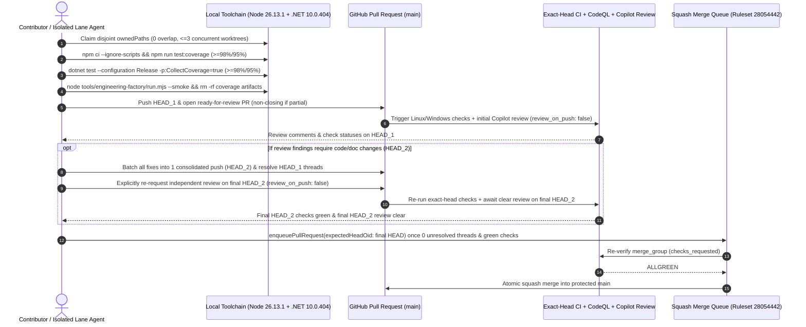
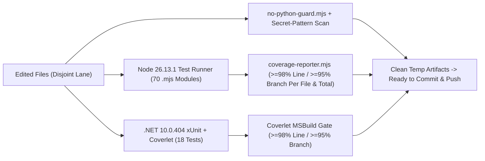

# Contributing to SoftwareFactory

Thank you for helping build a reusable, deterministic, fail-closed engineering factory. Read [AGENTS.md](AGENTS.md), [architecture](docs/ARCHITECTURE.md), [engineering standards](docs/ENGINEERING-STANDARDS.md), [security policy](SECURITY.md), and [roadmap v2](docs/ROADMAP.md) before starting.

## Delivery workflow

1. **Reuse tracked issues and logical `M01`–`M05` IDs**: Work from an approved GitHub issue with explicit entry/exit criteria, dependencies, risk, non-overlapping owned paths, and measurable evidence (`M01` autonomous SoftwareFactory → `M02` `.NET 10` + Microsoft Agent Framework `1.28.0` GA speed → `M03` `Jamula/Spellbook` `#11` → `M04` `Jamula/FamilyTree` `#36` → `M05` `FamilyHub` `#12`). Never create duplicate issues or competing backlogs.
2. **Isolate file ownership per lane**: Work in an isolated branch/worktree owning a disjoint path set. Never overlap files owned by an active sibling PR or touch SHA-256 hash-locked workflows (`.github/workflows/factory-orchestrator.md` ↔ `.lock.yml`) outside a dedicated workflow lane.
3. **Keep fixtures synthetic and least-privileged**: Use synthetic repository identities, check producers, and disabled policies (`mode: "disabled"`, `killSwitch: true`). Never include private consumer data, real tokens, or live provider calls.
4. **Validate locally before pushing**: Run the exact pinned Node.js `26.13.1` and `.NET SDK 10.0.404` suites below, verify `>=98%` line and `>=95%` branch coverage per executable component and overall, and delete temporary local coverage files (`rm -rf .local coverage-evidence.json cobertura-coverage.xml`) before committing.
5. **Open ready-for-review PRs cleanly and re-review final heads**: `Default-Branch-Ruleset` (`28054442`) sets `review_on_push: false` and `review_draft_pull_requests: false` so Copilot does not auto-re-review every push. Batch local fixes before pushing, link the tracking issue (use non-closing `Relates to #N` linkage for partial increments so parent acceptance issues stay open until all exit criteria are proven), resolve every inline and summary-only review finding, and **whenever a repair commit changes `HEAD`, explicitly re-request and wait for a clear independent review on the final pushed `HEAD` SHA** (`core.mjs` rejects stale reviews from earlier commits).
6. **Integrate exclusively through Squash Merge Queue**: Merge to `main` only via GitHub's Native Squash Merge Queue (`enqueuePullRequest` with `ALLGREEN` grouping) after all required status checks (`build-test`, `upload-coverage-javascript`, `windows-aspire-runtime`), `CodeQL`, `minimum_coverage >= 98`, review-thread resolution, and a clear exact-head independent review pass with `$0` unapproved spend.

### Contributor PR-to-Merge-Queue sequence diagram



### Local validation data flow diagram



## Required local validation commands

SoftwareFactory pins **Node.js `26.13.1`** and **`.NET SDK 10.0.404`** (`global.json` `rollForward: "disable"`), with zero tracked Python files or workflow Python invocations (`tools/engineering-factory/no-python-guard.mjs`).

```sh
# 1. Node.js 26.13.1 full test suite + exact-head >=98% line / >=95% branch gate
#    Covers 70+ .mjs components across tools/engineering-factory/ and tools/engineering-coordinator/
#    plus locked @opentelemetry/* and cobertura packages
npm ci --ignore-scripts && npm run test:coverage

# 2. .NET SDK 10.0.404 + Microsoft Agent Framework 1.28.0 GA specialist test suite
#    Runs 18 xUnit tests; pass -p:CollectCoverage=true to enforce Coverlet 98%/95% gate
dotnet test tests/SoftwareFactory.Agents.Tests/SoftwareFactory.Agents.Tests.csproj --configuration Release
dotnet test tests/SoftwareFactory.Agents.Tests/SoftwareFactory.Agents.Tests.csproj --configuration Release -p:CollectCoverage=true

# 3. Unified deterministic factory CLI smoke & stage commands
node tools/engineering-factory/run.mjs --smoke

# 4. .NET 10 MAF Pregel superstep workflow smoke & 12/50/100 logical-lane benchmark
dotnet run --project src/SoftwareFactory.Agents/SoftwareFactory.Agents.csproj --configuration Release -- --smoke
dotnet run --project src/SoftwareFactory.Agents/SoftwareFactory.Agents.csproj --configuration Release -- --benchmark

# 5. Clean gitignored coverage artifacts before staging commits
rm -rf .local coverage-evidence.json cobertura-coverage.xml
```

### Unified `run.mjs` CLI reference

```sh
node tools/engineering-factory/run.mjs \
  [--smoke | --inventory | --reconcile-pull | --reconcile-issue | --reconcile-event | \
   --plan-lanes | --evaluate-squash | --verify-admission | --verify-m01-readiness] \
  [--receipt]
```

Every CLI mode bounds input payloads (`<= 262,144` UTF-8 bytes), rejects proxies/getters/non-plain prototypes, verifies repository identity (`1471342715` for `Jamula/SoftwareFactory`), and emits a sanitized execution receipt when `--receipt` is supplied without mutating GitHub.

## Chronicle retrospective rules (non-negotiable)

Four hard-won lessons from Waves 1–4 are mandatory across every PR and review cycle:

1. **Fail closed in 10 lines over 300-line partial-recovery heuristics**: When an input, descriptor, timestamp, SHA, lease generation, or receipt is missing, malformed, stale, or ambiguous, reject it immediately with a deterministic reason code. Complex fallback or partial-recovery heuristics introduce subtle bypasses and trigger multi-round review spirals.
2. **Never include literal secret-like strings in unit tests, fixtures, or docs**: Never commit literal token-shaped strings (`ghp_`..., `github_pat_`..., `sk-`..., `AKIA`...) in tests or fixtures. Construct secret-scanner negative-test inputs dynamically at runtime via string concatenation (for example, `'gh' + 'p_' + 'x'.repeat(36)`) so GitHub Secret Scanning and repository secret-pattern guards never block Merge Queue integration.
3. **Enforce strict non-overlapping file-ownership lanes and bounded worktree creation**: Maintain `0` concurrent owners on shared barrel, schema, lock, or evidence files, and batch `<= 3` concurrent `git worktree add` operations at a time to prevent `.git/config.lock` contention across parallel sessions.
4. **Preserve Apache-2.0 provenance, exact-head independent review, and `$0` unapproved spend**: Keep upstream `LICENSE`/`NOTICE` provenance notices intact, satisfy `Default-Branch-Ruleset` (`28054442`, `review_on_push: false`, Squash Merge Queue `ALLGREEN`) plus exact-head independent review (including summary-only findings), and preserve provider-level `$0` overage hard-stops ([#105](https://github.com/Jamula/SoftwareFactory/issues/105)) across AI Credits (`1 AI credit = $0.01`), Copilot Premium Requests, and Cloud Sandboxes/Actions.

## Required negative-path regression matrix

| Area | Required fail-closed regression examples |
| --- | --- |
| Policy, descriptors, and boundaries | Unknown/missing fields, `Proxy` traps, getters, custom prototypes, sparse arrays, wrong `repositoryId` or `head` SHA |
| Review, checks, and Merge Queue | Stale/dismissed review, `COMMENTED` bot review on consumers, unresolved summary-only findings, fork PR untrusted checks, stale base |
| `gh-aw` orchestration & CAS queue | `.md` ↔ `.lock.yml` SHA-256 frontmatter/body drift, unpinned actions, `refs/heads/work-queue` CAS conflict, expired lease TTL, duplicate delivery |
| `.NET 10` MAF inner workflows | Out-of-lane or protected control-plane path proposals, live `IChatClient` in shadow mode, tampered/colliding checkpoint JSON digests, repair-cap exhaustion |
| Budget, anti-rogue, and onboarding | Unknown or estimated AI-credit accounting, paid overage enabled, broken 9-link W3C `traceparent` provenance, `> 5` mandatory onboarding settings, synthetic Stage 2 claims |

Workflow, ruleset, policy, and privilege changes require explicit human owner sign-off and independent security review—autonomous runs are blocked by deterministic circuit breakers (`anti-rogue-audit.mjs` and `PathOwnershipGuard`) from self-modifying or self-merging protected control-plane paths. See [security reporting](SECURITY.md) for suspected vulnerabilities.

## Documentation and local runtime standards

Update architecture, CLI flags, workflow tables, and consumer contracts alongside code changes, and verify doc-contract assertions via `npm run test:coverage` before pushing. Keep target capabilities clearly distinguished from evidenced live outcomes.

Follow [local development and observability](docs/LOCAL-DEVELOPMENT.md): **Aspire `17.0.0` AppHost** (`apphost.cs`) and loopback-authenticated **OpenTelemetry/OTLP** are verified on GitHub-hosted Linux and Windows runners ([#17](https://github.com/Jamula/SoftwareFactory/issues/17), [#118](https://github.com/Jamula/SoftwareFactory/issues/118)), while headless Node and `.NET` test suites remain independently runnable without Docker or external collectors. GitHub is the orchestrator; a personal laptop or open chat is never a runtime dependency.
