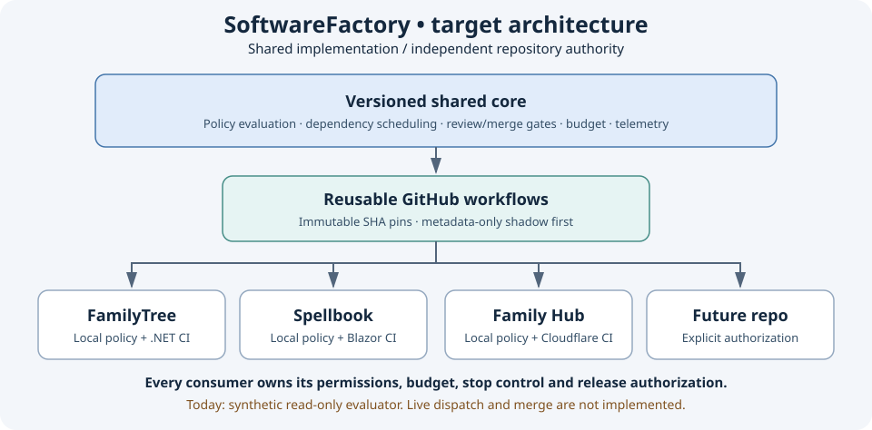
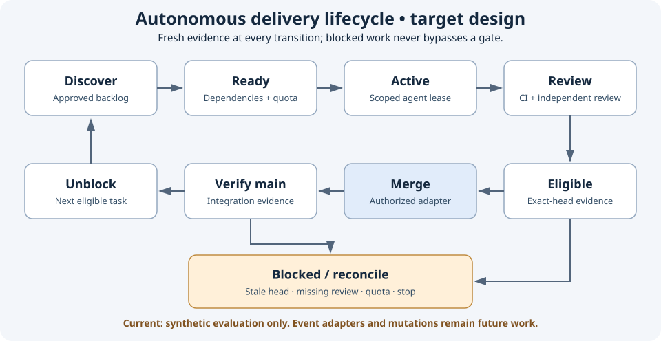

# SoftwareFactory

**One shared engineering engine. Independent project execution.**

SoftwareFactory is an Apache-2.0, policy-driven foundation for an event-driven autonomous software delivery system. The goal is to reduce idle time between approved issues, implementation, validation, review and integration without weakening project-specific security, quality or release gates.

> **Current maturity: read-only synthetic shadow evaluator (0.1.0 development).** The current code does not dispatch agents, approve PRs, merge changes, read live repository metadata or deploy products. An eligible shadow result is not authorization. The 10× throughput objective is a hypothesis, not a benchmark result.



## Start here

| I want to… | Read |
| --- | --- |
| Run the current evaluator locally | [Quickstart](docs/QUICKSTART.md) |
| Understand how the system works | [Architecture](docs/ARCHITECTURE.md), [delivery lifecycle](docs/DELIVERY-LIFECYCLE.md) |
| Integrate a repository without enabling writes | [Consumer onboarding](docs/CONSUMER-ONBOARDING.md) |
| Use or build GitHub workflows | [Workflow guide](docs/WORKFLOWS.md) |
| Understand policy and evidence | [Policy guide](docs/POLICY.md) |
| Operate, pause and troubleshoot | [Operations](docs/OPERATIONS.md) |
| Report a security issue | [Security policy](SECURITY.md), [threat model](docs/THREAT-MODEL.md) |
| Contribute | [Contributing](CONTRIBUTING.md), [agent rules](AGENTS.md) |
| Track what is implemented | [Roadmap](docs/ROADMAP.md), [documentation index](docs/README.md) |

## Local development

Use Node.js 20 or later (prefer a currently supported LTS release). No npm dependencies are required by the current evaluator.

```sh
node --test tests/engineering-factory/*.test.mjs
```

The tests replay synthetic policy and evidence snapshots. All sample repository identities, check producers and quotas are fictional. A passing replay does not prove live repository safety, credentials, branch protection or budget.

## Target delivery loop



Consumers adopt independently, pin immutable reviewed workflow revisions and retain their own CI, permissions, budgets and kill switches. FamilyTree is the intended first pilot; Spellbook and Family Hub follow after their own readiness checks. No project is enabled by this documentation.

## License and provenance

Apache License 2.0. See [LICENSE](LICENSE) and [NOTICE](NOTICE). The initial evaluator and replay tests were ported from [FamilyTree commit 1b871b76895f0d4943eda441a3295e843a127f58](https://github.com/Jamula/FamilyTree/tree/1b871b76895f0d4943eda441a3295e843a127f58). Preserve applicable attribution.
