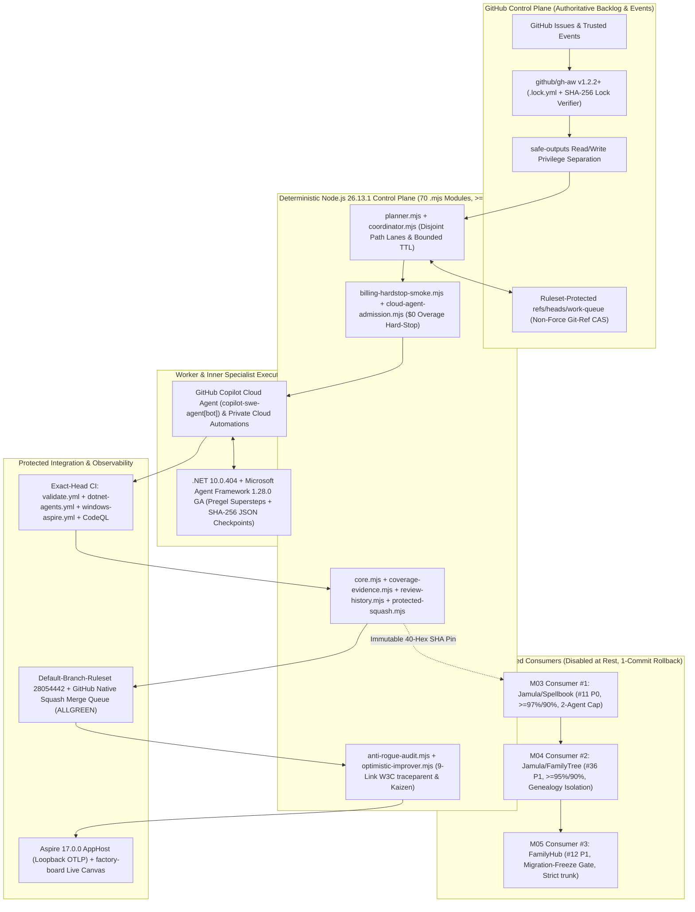
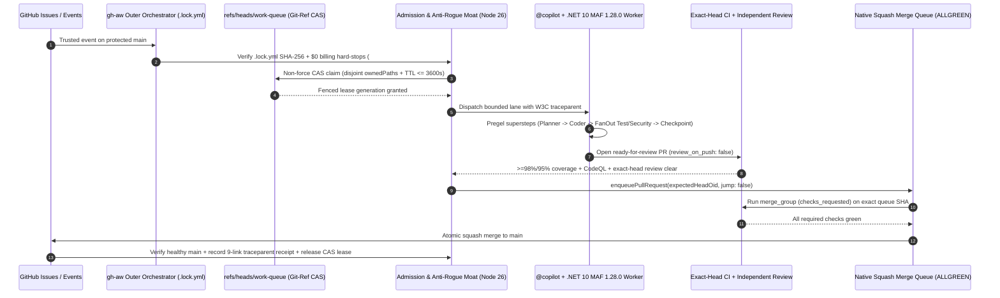
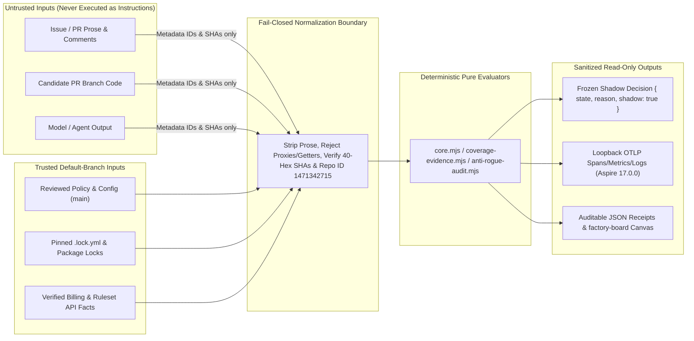

# SoftwareFactory

**One shared engineering engine. Independent project execution.**

SoftwareFactory is an Apache-2.0, policy-driven autonomous software delivery engine orchestrated natively on GitHub. It eliminates idle handoff time between approved issues, specialist execution, exact-head validation, independent review, and protected Squash Merge Queue integration without weakening repository-specific security, coverage, budget, or release gates.

> **Current maturity (`0.1.0`): `M01` foundation `9 / 10` closed (`#10` live `@copilot` proof active), `M02` `.NET 10` + Microsoft Agent Framework `1.28.0` GA inner engine shipped.** GitHub is the orchestrator; outer orchestration runs on pinned `github/gh-aw` (`v1.2.2+`) `.lock.yml` workflows with `safe-outputs` privilege separation, non-force git-ref Compare-and-Swap (`CAS`) claims on `refs/heads/work-queue`, native GitHub Copilot Cloud Agent (`copilot-swe-agent[bot]`), and GitHub Native Squash Merge Queue (`ALLGREEN`). All evaluators remain deterministic and fail-closed (`$0` unapproved incremental spend). An eligible shadow result is never live authorization.


## System architecture, sequence, and data flow

### 1. Architecture diagram (`v2` GitHub-orchestrated engine)



### 2. Sequence diagram (unattended issue-to-Squash-Merge-Queue loop)



### 3. Data flow diagram (trust boundaries, sanitization, and receipts)



## Product direction

SoftwareFactory is a lightweight, cloud-native, AI-first engineering framework—never a mandatory SoftwareFactory-hosted service, separate issue tracker, external database, or laptop daemon. Bring your own AI and authorized GitHub compute; GitHub Issues, pull requests, rulesets, and trusted events remain the sole authoritative backlog and control plane.

**Customer One is `Jamula/SoftwareFactory` itself (`M01` / `M02`), followed in strict order by:**

1. **`M03` — Consumer #1 `Jamula/Spellbook` ([#11](https://github.com/Jamula/SoftwareFactory/issues/11), `M03.02 P0`)**: shared onboarding contract ([#13](https://github.com/Jamula/SoftwareFactory/issues/13), closed) + first external consumer pilot preserving `>=97%` app line / `>=90%` branch coverage, WebKit/iOS/release gates, formal `APPROVED` review, and a `2`-agent concurrency cap.
2. **`M04` — Consumer #2 `Jamula/FamilyTree` ([#36](https://github.com/Jamula/SoftwareFactory/issues/36), `M04.01 P1`)**: follows `M01` (`#10`), `#13`, and `#11` Spellbook acceptance under `>=95%` line / `>=90%` branch coverage and strict genealogy private-data isolation.
3. **`M05` — Consumer #3 `FamilyHub` ([#12](https://github.com/Jamula/SoftwareFactory/issues/12), `M05.01 P1`)**: gated on `M01` (`#10`), `#13`, `#11` Spellbook, explicit migration-freeze clearance, formal exact-head `APPROVED` review, strict base freshness, and production isolation.

New and existing repositories onboard from a single natural-language request (`<=5` mandatory settings, `<=5 min` read-only discovery plan, `<=15 min` disabled-at-rest 2-file Stage 1 shadow PR with `6` single-mutation shadow denials and `1`-commit independent rollback) before separately authorized Stage 2 unattended `@copilot` acceptance. See [consumer onboarding](docs/CONSUMER-ONBOARDING.md).

## Start here

| I want to… | Read |
| --- | --- |
| Full documentation index across all guides | [Documentation index](docs/README.md) |
| Run the Node `26.13.1` and `.NET 10.0.404` suites locally | [Quickstart](docs/QUICKSTART.md), [Contributing](CONTRIBUTING.md) |
| Aspire `17.0.0` local development and OpenTelemetry | [Local development and observability](docs/LOCAL-DEVELOPMENT.md) |
| Understand module boundaries and inner/outer orchestration | [Architecture](docs/ARCHITECTURE.md), [MAF inner orchestration](docs/MAF-INNER-ORCHESTRATION.md), [gh-aw orchestration](docs/GH-AW-ORCHESTRATION.md) |
| Follow the issue-to-merge state machine | [Delivery lifecycle](docs/DELIVERY-LIFECYCLE.md), [Operations](docs/OPERATIONS.md) |
| Onboard a consumer repository safely | [Consumer onboarding](docs/CONSUMER-ONBOARDING.md), [Consumer adoption contract](docs/CONSUMER-ADOPTION-CONTRACT.md) |
| Inspect GitHub workflows, rulesets, and Merge Queue | [Workflow guide](docs/WORKFLOWS.md) |
| Understand policy, provenance, and anti-rogue guardrails | [Policy guide](docs/POLICY.md), [Anti-rogue & Kaizen loop](docs/ANTI-ROGUE-AND-OPTIMISTIC-IMPROVEMENT.md) |
| Report a security issue or review trust boundaries | [Security policy](SECURITY.md), [Threat model](docs/THREAT-MODEL.md) |
| Engineering standards, retrospective rules, and SLOs | [Engineering standards](docs/ENGINEERING-STANDARDS.md), [Agent rules](AGENTS.md) |
| Track milestone status (`M01`–`M05`) | [Roadmap v2](docs/ROADMAP.md) |

## Engineering expectations

| Metric | Objective |
| --- | --- |
| Source line / branch coverage | `>=98%` / `>=95%` per executable component and overall in `Jamula/SoftwareFactory` (Node `26.13.1` + `.NET 10.0.404`); consumer baseline `>=95%` / `>=90%` or stricter local gates |
| Eligible work dispatch / merge | `p95 <= 2 minutes` each |
| Full required automated CI | `p50 < 75 seconds` from candidate event to last required automated check |
| Small PR turnaround | `p50 <= 10 minutes` creation to merge; `<= 2 minutes` merge to verified `main` |
| Security bypass / duplicate dispatch / unapproved spend | `0` (`$0` overage hard-stops verified across AI Credits, Copilot Premium Requests, and Cloud Sandboxes/Actions per [#105](https://github.com/Jamula/SoftwareFactory/issues/105)) |

See [Engineering standards](docs/ENGINEERING-STANDARDS.md) for mandatory merge gates versus velocity SLOs.

## Delivery milestones (`M01`–`M05`)

| Milestone | Scope & current status on `main` |
| --- | --- |
| **`M01`** | **Autonomous SoftwareFactory**: `github/gh-aw` (`v1.2.2+`) `.lock.yml` + `safe-outputs` + `tools.work-queue` non-force git-ref CAS on `refs/heads/work-queue` + native `copilot-swe-agent[bot]` + GitHub Native Squash Merge Queue (`ALLGREEN`) — **`9 / 10` foundation issues closed** (`#4–#9, #17, #105, #118` closed; [#10](https://github.com/Jamula/SoftwareFactory/issues/10) live 3-issue `@copilot` proof active). |
| **`M02`** | **Fast SoftwareFactory**: **`.NET 10.0.404` + Microsoft Agent Framework `1.28.0` GA** (`Microsoft.Agents.AI`, `Microsoft.Agents.AI.Workflows`, `Microsoft.Agents.AI.GitHub.Copilot` in `src/SoftwareFactory.Agents/`, superseding the earlier optional Rust execution-engine experiment and retired July 2026 GitHub Models), poison-safe exact-lockfile `~/.npm` + `NuGet` + `Aspire.Cli 17.0.0` CI caching ([#15](https://github.com/Jamula/SoftwareFactory/issues/15) / [#174](https://github.com/Jamula/SoftwareFactory/pull/174)), `factory-board` live Canvas ([#135](https://github.com/Jamula/SoftwareFactory/issues/135)), 9-link W3C `traceparent` anti-rogue audit & Kaizen loop ([#137](https://github.com/Jamula/SoftwareFactory/issues/137)), and MCP multi-agent connector ([#136](https://github.com/Jamula/SoftwareFactory/issues/136)). |
| **`M03`** | **Consumer #1 — `Jamula/Spellbook`** ([#13](https://github.com/Jamula/SoftwareFactory/issues/13) shared onboarding contract closed; [#11](https://github.com/Jamula/SoftwareFactory/issues/11) `M03.02 P0` pilot): `>=97%` line / `>=90%` branch app coverage, WebKit/iOS/release gates, `2`-agent cap, independent `1`-commit rollback. |
| **`M04`** | **Consumer #2 — `Jamula/FamilyTree`** ([#36](https://github.com/Jamula/SoftwareFactory/issues/36), `M04.01 P1`): `>=95%` line / `>=90%` branch coverage, genealogy private-data isolation; gated on `M01` (`#10`), `#13`, and `#11` Spellbook. |
| **`M05`** | **Consumer #3 — `FamilyHub`** ([#12](https://github.com/Jamula/SoftwareFactory/issues/12), `M05.01 P1`): hard migration-freeze gate, formal exact-head `APPROVED` review, strict base freshness, and production isolation. |

See [roadmap v2](docs/ROADMAP.md) for complete entry/exit gates and historical milestone mapping. `M02` speed work does not block `M01` autonomy or consumer pilots.

## Local validation

Use the CI-pinned **Node.js `26.13.1`** and **`.NET SDK 10.0.404`** toolchains:

```sh
# 1. Install locked Node dependencies (OpenTelemetry + Cobertura) and enforce >=98% line / >=95% branch coverage across all 70 .mjs components
npm ci --ignore-scripts && npm run test:coverage

# 2. Run the .NET 10.0.404 Microsoft Agent Framework 1.28.0 GA specialist test suite (18 xUnit tests; add -p:CollectCoverage=true for Coverlet 98%/95% gate)
dotnet test tests/SoftwareFactory.Agents.Tests/SoftwareFactory.Agents.Tests.csproj --configuration Release

# 3. Run the deterministic synthetic factory CLI smoke check
node tools/engineering-factory/run.mjs --smoke
```

Clean temporary coverage artifacts (`rm -rf .local coverage-evidence.json cobertura-coverage.xml`) before committing. All replay fixtures use synthetic repository identities, check producers, and disabled policies (`mode: "disabled"`, `killSwitch: true`).

## Target delivery loop


Consumers adopt independently (`M03` Spellbook → `M04` FamilyTree → `M05` FamilyHub), pin immutable reviewed 40-hex commit SHAs, and retain their own CI, permissions, `$0` overage hard-stops, and kill switches. No consumer is activated by this documentation.

## License and provenance

Apache License 2.0. See [LICENSE](LICENSE) and [NOTICE](NOTICE). The initial evaluator and replay tests were ported from [FamilyTree commit 1b871b76895f0d4943eda441a3295e843a127f58](https://github.com/Jamula/FamilyTree/tree/1b871b76895f0d4943eda441a3295e843a127f58). Preserve applicable attribution.

## Platform standards

**Aspire `17.0.0` AppHost** (`apphost.cs` on `.NET 10.0.404`) orchestrates both the Node `synthetic-shadow` resource and the `.NET 10` `maf-specialist-shadow` resource for optional local development and GitHub-hosted Linux/Windows CI runtime verification ([#17](https://github.com/Jamula/SoftwareFactory/issues/17) and [#118](https://github.com/Jamula/SoftwareFactory/issues/118), closed). **OpenTelemetry/OTLP** exports sanitized traces, metrics, and correlated structured logs over authenticated loopback only ([#9](https://github.com/Jamula/SoftwareFactory/issues/9), closed). No personal laptop or open chat is ever an operational dependency. See [local development](docs/LOCAL-DEVELOPMENT.md).
