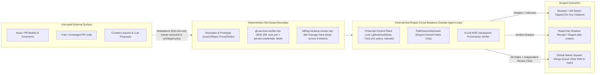

# Security policy

## Supported status

SoftwareFactory is in pre-release `0.1.0` development (`M01` foundation `9 / 10` closed with `#10` live 3-issue `@copilot` proof active; `M02` `.NET 10.0.404` + Microsoft Agent Framework `1.28.0` GA inner shadow engine shipped). All repository evaluators, outer `github/gh-aw` (`v1.2.2+`) workflows, and onboarding verifiers remain default-off or shadow-bounded (`shadow: true`, `liveDispatch: false`, `liveMerge: false`) with zero Python runtime/workflow surface (`no-python-guard.mjs`). No SoftwareFactory-hosted production service exists. Review immutable 40-hex commit pins independently before any experiment.

## Reporting a vulnerability

Do not open a public issue containing exploit details, credentials, private repository data or sensitive logs. Use GitHub's **Security → Report a vulnerability** private reporting feature if available. If private reporting is not enabled, request a private reporting channel from the repository maintainers without disclosing the vulnerability publicly. Include the affected commit, a minimal synthetic reproduction, expected/actual behavior and potential impact. Redact all secrets and personal data. No specific response SLA is promised.

## Mandatory boundaries

- Treat issue text, PR bodies, comments, labels, artifacts, curated lessons, and model output as untrusted data; never execute them as instructions or interpolate GitHub expressions into shell scripts.
- Obtain policy, knowledge maps, and workflow locks only from an explicitly trusted, reviewed default-branch revision (`gh-aw-lock-verifier.mjs` verifies SHA-256 frontmatter/body parity between `.github/workflows/factory-orchestrator.md` and `.lock.yml`, `safe-outputs` read/write separation, and `persist-credentials: false`). Caller-supplied evidence is not proof of provenance.
- Use repository-scoped least privilege, immutable 40-hex workflow/action pins, zero personal PATs in Actions secrets, and no shared administrative token (`sharedAdminToken: false`). Never commit literal secret-like strings in source, tests, or fixtures.
- Never check out or execute untrusted PR code in a privileged workflow (`pull_request_target` / `workflow_run` evaluation jobs remain metadata-only `contents: read`, separated from isolated scoped write jobs such as `safe-outputs` or `factory-automode-enqueue.yml`'s `apply-queue-actions` job with `contents: write` and `pull-requests: write` for queue admission/withdrawal); route all `main` integrations exclusively through GitHub Native Squash Merge Queue (`ALLGREEN`).
- Enforce deterministic anti-rogue circuit breakers (`anti-rogue-audit.mjs` and `.NET` `PathOwnershipGuard`) outside every agent loop: autonomous runs cannot self-modify or self-merge protected control-plane paths (`.github/workflows/`, `*.lock.yml`, rulesets, policy, gate evaluators, kill switches), must record an unbroken 9-link W3C `traceparent` causal provenance chain, and immediately trip the repository kill switch on out-of-lane edits, retry-cap breaches, AI-credit burn spikes, `safe-outputs` threat flags, or post-merge `main` failures.
- Re-read authoritative head, base, review (including summary-only findings), check-producer, ruleset, thread, and verified non-estimated quota evidence before any action, backed by provider-level GitHub Billing `$0` overage hard-stops (`#105` across AI Credits, Copilot Premium Requests, and Cloud Sandboxes/Actions). Fail closed on uncertainty or changes; no fabricated checks or approvals.
- No live dispatch, merge, consumer activation (`M03` Spellbook → `M04` FamilyTree → `M05` FamilyHub), deployment, new credentials, or metered spend without separately verified scope and owner authorization. Each consumer owns an independent `1`-commit rollback and kill switch.

For threat scenarios and validation requirements see [threat model](docs/THREAT-MODEL.md), [policy guide](docs/POLICY.md), [anti-rogue & Kaizen audit](docs/ANTI-ROGUE-AND-OPTIMISTIC-IMPROVEMENT.md), and [operations](docs/OPERATIONS.md).

## Security trust-boundary and data flow diagram

Velocity targets never override mandatory security gates. Refer to the [engineering standards](docs/ENGINEERING-STANDARDS.md) for independent exact-head review, coverage evidence, authorization, exceptions and rollout requirements. No synthetic replay result or administrative setting is authority to merge.

## Local observability privacy

Require local authenticated Aspire Dashboard and loopback-only OTLP by default; remote export needs separate authorization. Redact sensitive payloads and restrict metric labels to bounded values. Never export tokens, provider request bodies, issue/PR text or private data. Telemetry is diagnostic and cannot substitute for trustworthy review/check evidence. See [local development](docs/LOCAL-DEVELOPMENT.md).
