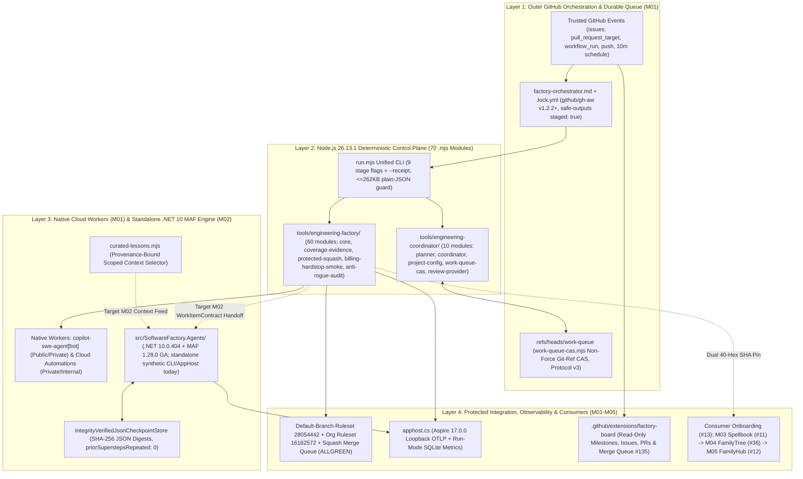
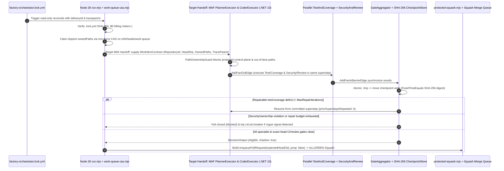
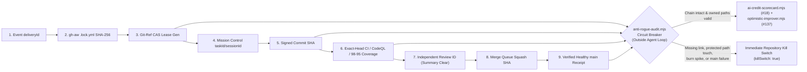
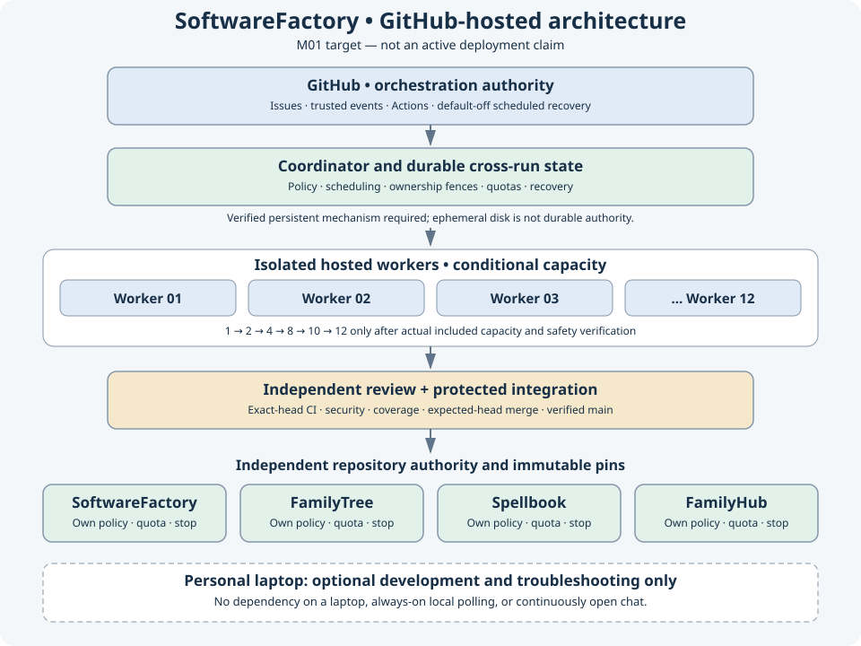

# Architecture (0.1.0)

## Current module boundaries

SoftwareFactory ships two deterministic, fail-closed, 98%/95%-gated runtime surfaces plus a read-only Canvas board extension, orchestrated natively on GitHub with zero tracked Python files (`tools/engineering-factory/no-python-guard.mjs`):

1. **Node.js `26.13.1` ESM control plane (`70` `.mjs` modules across `tools/engineering-factory/` and `tools/engineering-coordinator/`)**: Enforces `>=98%` source line and `>=95%` branch coverage per `.mjs` component and overall via `tests/engineering-factory/coverage-reporter.mjs`.
2. **`.NET 10.0.404` + Microsoft Agent Framework `1.28.0` GA inner specialist engine (`src/SoftwareFactory.Agents/`)**: Supersedes the earlier optional Rust execution-engine experiment and retired July 2026 GitHub Models (`Microsoft.Agents.AI`, `Microsoft.Agents.AI.Workflows`, `Microsoft.Agents.AI.GitHub.Copilot`), enforcing `>=98%` line and `>=95%` branch coverage via Coverlet across `18` xUnit tests (`tests/SoftwareFactory.Agents.Tests/`).
3. **Read-only live Canvas extension (`.github/extensions/factory-board/`, `#135`)**: Renders live milestones, open/closed issue activity, open/merged PR checks and review decisions, and merge-queue position/status without write credentials (it does not display lane ownership, CAS leases, or OTLP telemetry).

Every evaluator, inner workflow, and shadow adapter is deterministic, fail-closed, and non-mutating (`shadow: true`, `liveMerge: false` / `liveDispatch: false`, `$0` unapproved spend).

## Layered `v2` architecture, sequence, and data flow

### 1. Layered system architecture diagram

### 2. Target cross-runtime orchestration and checkpoint resume sequence diagram

> **Implementation boundary note:** Today `run.mjs` does **not** spawn `SoftwareFactory.Agents` or transmit a live `WorkItemContract`; `src/SoftwareFactory.Agents/` runs independently via its synthetic CLI (`--smoke` / `--benchmark`) and explicit-start AppHost resource while live `M01` worker tasks use native `copilot-swe-agent[bot]` / Cloud Automations. The sequence below illustrates the **target `M02` cross-runtime integration** combining outer `gh-aw`/Node admission with inner `.NET 10` MAF specialist supersteps.

### 3. 9-link W3C `traceparent` provenance and anti-rogue data flow diagram

### `tools/engineering-factory/` (`60` modules) — policy evaluators, admission/audit gates, metadata adapters, and telemetry

- **Pure policy, coverage, review, and Squash Merge Queue evaluators** (zero I/O, rejecting sparse arrays and stale heads; receipt/boundary verifiers such as `coverage-evidence.mjs`, `platform-merge-gates.mjs`, `protected-squash.mjs`, `queue-reread.mjs`, `anti-rogue-audit.mjs`, `curated-lessons.mjs`, `consumer-onboarding.mjs`, and `run.mjs` inspect own enumerable data descriptors to reject `Proxy` traps, getters, and custom prototypes, whereas `core.mjs`, `review-history.mjs`, `review-batch.mjs`, and remaining snapshot evaluators check own-key presence and read properties directly—requiring callers/adapters or `protected-squash.mjs` to strip getters/proxies and supply trusted, normalized plain JSON data upstream):
  - `core.mjs`: validates closed version-1 repository policies (`validPolicy`) and normalized plain-JSON snapshots (`evaluate`), returning frozen `{ state, reason, shadow: true }` decisions. `policySource: "trusted-default-branch"` and snapshot fields are caller assertions rather than proof of live authority—adapters must enforce independent upstream default-branch provenance validation before invoking `evaluate`.
  - `coverage-evidence.mjs`: validates exact-head component and aggregate line/branch counts (`coverageEvidence`, `coverageFromNodeSummary`) against SoftwareFactory's `98%/95%` floor or consumer `>=95%/90%` (preserving stricter floors such as Spellbook `97%/90%`), requires reviewed justifications for branchless (`0/0`) components, and reconciles effective `main` ruleset, fork-PR, `merge_group`, `CodeQL`, summary-finding, and `minimum_coverage >= 98` gates (`verifyCandidateGateReceipt`).
  - `review-history.mjs` and `review-batch.mjs`: normalize chronological review sequences (permitting exact-head allowlisted `copilot-pull-request-reviewer[bot]` `COMMENTED` reviews with `summaryDisposition: "clear"` only on `Jamula/SoftwareFactory`, while requiring formal `APPROVED` for all consumers) and batch inline plus summary-only findings.
  - `platform-merge-gates.mjs`, `protected-squash.mjs`, `merge-queue-slo.mjs`, `integration-train.mjs`, `portfolio-train-benchmark.mjs`, `queue-inspection.mjs`, `queue-reread.mjs`, and `main-health-audit.mjs`: compose candidate platform checks, serialized shadow squash state machines with post-merge `main` health verification, inert GraphQL `enqueuePullRequest` (`expectedHeadOid`, `jump: false`) request builders, queue SLOs, and multi-wave integration-train simulations (`#16`).
- **Outer `gh-aw` verification, `$0` billing admission, 9-link anti-rogue audit, Kaizen, and multi-agent boundaries**:
  - `gh-aw-lock-verifier.mjs` (`#5`): verifies pinned `github/gh-aw` (`v1.2.2`) `.github/workflows/factory-orchestrator.md` ↔ `.lock.yml` SHA-256 frontmatter/body integrity, trigger parity, `safe-outputs` read/write separation, and `persist-credentials: false`.
  - `billing-hardstop-smoke.mjs` (`#105`), `cloud-agent-admission.mjs` (`#7`), `budget.mjs`, `capacity-scale.mjs`, and `worker-ladder-handoff.mjs`: enforce provider-level `$0` overage hard-stops (`1 AI credit = $0.01`) across AI Credits, Copilot Premium Requests, and Cloud Sandboxes/Actions, reject missing or estimated AI-credit accounting before dispatch (treating `gh-aw` `max-ai-credits` / `max-daily-ai-credits` as soft caps only), and gate `1→2→4→8→10→12` worker scaling.
  - `anti-rogue-audit.mjs` (`#9` / `#137`), `ai-credit-scorecard.mjs` (`#18`), and `optimistic-improver.mjs` (`#137`): verify the unbroken **9-link W3C `traceparent` causal provenance chain** (`Issue/Event deliveryId -> gh-aw .lock.yml SHA-256 -> git-ref CAS lease generation -> Mission Control taskId/sessionId -> signed commit SHA -> exact-head CI/CodeQL/coverage receipts -> independent review ID -> Merge Queue squash SHA -> verified main receipt`), trip deterministic kill-switch circuit breakers outside the agent loop on protected control-plane touches or out-of-lane edits, compute read-only AI-credit scorecards, and evaluate bounded `>=5`-outcome Kaizen improvement/auto-revert cohorts.
  - `curated-lessons.mjs` (`#14`), `contract-routing.mjs`, `locked-build-cache.mjs` (`#15`), `ci-stage-benchmark.mjs` (`#15`), `validation-diagnosis.mjs`, `factory-board.mjs` (`#135` live milestone, issue, PR check/review, and merge-queue snapshot projection), `mcp-agent-connector.mjs` (`#136`), and `workstation-preflight.mjs` (`#66`): selective provenance-bound repository guidance/lessons memory, subsystem fast-feedback routing, poison-safe build-cache verification, read-only Canvas board snapshots, deferred Codex/Claude MCP isolation, and optional workstation preflight.
  - `consumer-onboarding.mjs` (`#13`), `customer-one-usability-scorecard.mjs`, `spellbook-pilot-readiness.mjs` (`#11`), `familytree-pilot-readiness.mjs` (`#36`), `familyhub-pilot-readiness.mjs` (`#12`), and `pilot-readiness.mjs` (`#10`): enforce the 3-stage consumer onboarding rubric, independent `1`-commit rollback, and pilot exit dossiers across **`M03` Spellbook → `M04` FamilyTree → `M05` FamilyHub**.
- **Read-only GitHub metadata adapters and unified shadow CLI** (bounded unauthenticated reads, `<= 262,144`-byte payload cap, no write credentials):
  - `run.mjs`, `shadow-runtime.mjs`, `event-envelope.mjs`, `issue-event.mjs`, `pull-signals.mjs`, `shadow-dispatch-ledger.mjs`, and `local-shadow-host.mjs`: provide the unified CLI (`--smoke`, `--inventory`, `--reconcile-pull`, `--reconcile-issue`, `--reconcile-event`, `--plan-lanes`, `--evaluate-squash`, `--verify-admission`, `--verify-m01-readiness`, plus `--receipt`), bounded same-repository REST reads that discard raw user prose, and cross-run `work-queue-cas`-bound reservation checks.
- **Local and hosted synthetic Aspire `17.0.0` / OpenTelemetry boundary**:
  - `apphost.cs`, `telemetry.mjs`, `local-otel-sdk.mjs`, `aspire-smoke.mjs`, `aspire-telemetry-smoke.mjs`, `aspire-hosted-receipt.mjs`, `verify-dashboard-export.mjs`, `verify-dashboard-api.mjs`, `verify-dashboard-metric-receipt.mjs`, `inspect-dashboard-metric-schema.mjs`, and `no-python-guard.mjs`: register both `synthetic-shadow` (Node `26.13.1`) and `maf-specialist-shadow` (`.NET 10.0.404`) with `WithExplicitStart()` under Aspire AppHost (`17.0.0`). Hosted Linux and Windows CI workflows currently start and verify authenticated loopback OTLP traces, correlated structured logs, and SQLite-persisted metrics for the Node `synthetic-shadow` resource (`#17`, `#118`), while `maf-specialist-shadow` runs headlessly in `dotnet-agents.yml` and hosted dashboard telemetry verification for the `.NET` resource remains outstanding.

### `tools/engineering-coordinator/` (`10` modules) — lane planner, git-ref CAS queue, and SQLite fencing

- **Cross-run Git-Ref CAS & lane planning**:
  - `work-queue-cas.mjs` (`#6`): implements non-force git-ref Compare-and-Swap (`CAS`) lease acquisition, fencing, heartbeat renewal, crash recovery, and terminal state transitions on ruleset-protected `refs/heads/work-queue` (`gh-aw` Protocol `v3`), paired with non-overlapping path ownership and bounded TTLs (`<= 3,600,000 ms`).
  - `project-config.mjs` and `planner.mjs`: validate closed project schemas (`config/engineering-coordinator.schema.json`), disjoint lane/subsystem `knowledgeMap` ownership, acyclic task dependencies, risk ceilings, aging priority, and critical-path tie-breaking.
  - `retry.mjs`, `provider-adapters.mjs`, `coordinator.mjs`, and `review-provider.mjs`: enforce bounded exponential retry with `retry-after`, `readAfterUncertainWrite` reconciliation, `AbortController` cancellation on lease loss, and capacity-gated shadow Copilot review intent claims.
- **Local `node:sqlite` harness stores**:
  - `sqlite-state-store.mjs`, `event-journal.mjs`, and `review-intent-store.mjs`: provide transactional local generation leases, a bounded 10,000-entry deduplicated event journal, and write-once `repo:pr:head` review intents for local testing (ephemeral Actions runner disks are never used as cross-run authoritative lease storage).

### `src/SoftwareFactory.Agents/` — `.NET 10.0.404` + Microsoft Agent Framework `1.28.0` GA (`#14`, `#16`)

- **Pregel superstep specialist workflow (`SpecialistWorkflowEngine`)**: Executes `PlannerExecutor` → `CoderExecutor` → parallel `AddFanOutEdge` (`TestAndCoverageExecutor` + `SecurityAndReviewExecutor`) → `AddFanInBarrierEdge` (`GateAggregatorExecutor`) → bounded repair loop (`MaxRepairIterations <= 5`) or terminal `DecisionOutputExecutor`.
- **Ownership & offline shadow guards (`WorkItemContract`, `PathOwnershipGuard`, `GitHubCopilotAgentAdapter`)**: Reject protected control-plane paths without human sign-off, out-of-lane paths, cross-repository mismatches, and non-offline `IChatClient` instances in shadow mode (`<CopilotSkipCliDownload>true</CopilotSkipCliDownload>`).
- **Cryptographic JSON checkpointing & OTel (`IntegrityVerifiedJsonCheckpointStore`, `LocalOtlpBootstrap`)**: Implements atomic, SHA-256 integrity-verified `ICheckpointStore<JsonElement>` (`priorSuperstepsRepeated: 0` on resume) and emits W3C `traceparent`-correlated spans on `ActivitySource("Microsoft.Agents.AI.Workflows")` and `ActivitySource("SoftwareFactory.Agents")` to authenticated loopback OTLP. See [MAF inner orchestration](MAF-INNER-ORCHESTRATION.md).

## Workflows and effective `main` protection boundary

SoftwareFactory maintains eight workflows (`9` files under `.github/workflows/`, documented in [Workflow guide](WORKFLOWS.md)):

1. `factory-orchestrator.md` + `factory-orchestrator.lock.yml` (**Factory gh-aw outer orchestrator**): default-off (`vars.FACTORY_GHAW_ENABLED == 'true'`), SHA-256 hash-locked `github/gh-aw` (`v1.2.2`) outer orchestrator with `tools.work-queue`, `safe-outputs` (`staged: true`), and `contents: read` privilege separation across `workflow_dispatch`, 10-minute `schedule`, `issues`, `pull_request_target`, `workflow_run`, and `push` (`main`).
2. `validate.yml` (**Factory validation**): exact-head Linux Node `26.13.1` test/`98%-95%` coverage gate, poison-safe exact-lockfile `~/.npm` + NuGet + `Aspire.Cli 17.0.0` caching (`#15`/`#174`), isolated Linux Aspire OTLP/SQLite runtime validation, `build-test`, and `upload-coverage-javascript`.
3. `dotnet-agents.yml` (**.NET MAF specialist agents**): exact-head Linux and Windows `.NET 10.0.404` MAF `1.28.0` GA build, poison-safe NuGet cache, `18` xUnit tests with Coverlet `98%/95%` gate, and `--smoke` / `--benchmark` CLI verification.
4. `windows-aspire.yml` (**Windows Aspire runtime**): exact-head `windows-aspire-runtime` check on `windows-latest` with poison-safe `~/.npm` + NuGet + `Aspire.Cli 17.0.0` caching, scoped ephemeral PEM TLS trust, loopback HTTPS OTLP API readback, and SQLite metric receipt verification.
5. `shadow-reconcile.yml` (**Factory shadow reconciliation**): default-off (`FACTORY_SHADOW_ENABLED=true`) manual `workflow_dispatch` fallback listener running `run.mjs` (`--inventory`, `--reconcile-issue`, etc.) on protected `refs/heads/main`.
6. `reusable-replay-smoke.yml` (**Reusable replay smoke**): exercises the pinned consumer reusable workflow (`afc3d223f287b029db32672908097efc67a259c9`) on contract changes, `merge_group`, and `main`.
7. `shadow-tests.yml` (**Engineering factory shadow replay**): `workflow_call` synthetic replay of pinned SoftwareFactory tests (`1208481843e73d1d2506085c654e84255303541d`); [docs/consumer-shadow-tests.yml](consumer-shadow-tests.yml) remains an inert example pinned to `fbecbf99b4c8e1696194bd6fa5220b2328cd1379`.
8. `otel-sdk-lock-evidence.yml` (**OpenTelemetry SDK dependency evidence**): isolated `@opentelemetry/*` lockfile integrity and registry provenance check on same-repo PRs.

### Ruleset vs. independent review reconciliation

Observed `main` branch rulesets combine repository `Default-Branch-Ruleset` (`28054442`) and organization ruleset (`16162572`) with zero bypass actors:

- **Enforced by `Default-Branch-Ruleset` (`28054442`)**: `build-test`, `upload-coverage-javascript`, and `windows-aspire-runtime` (`integration_id: 15368`, `strict_required_status_checks_policy: true`), `code_coverage` (`minimum_coverage: 98`, `max_coverage_drop: 0`), `required_review_thread_resolution: true`, `copilot_code_review` (`review_on_push: false`, `review_draft_pull_requests: false`), squash-only merges, and GitHub's Native `SQUASH` Merge Queue (`grouping_strategy: "ALLGREEN"`).
- **Enforced by organization ruleset (`16162572`)**: `CodeQL` (`medium_or_higher` security alerts, `errors_and_warnings` alerts), secret-scanning alert resolution, linear history, and non-fast-forward/deletion protections.
- **Exact-head independent review & summary-finding enforcement (`required_approving_review_count: 0` ruleset gap)**: because GitHub's `pull_request` rulesets set `required_approving_review_count: 0` and inline thread resolution does not clear summary-only review text, SoftwareFactory's evaluators (`core.mjs`, `review-history.mjs`, `verifyCandidateGateReceipt`) require verified exact-head independent review from `trustedReviewers` (`APPROVED`, or allowlisted `copilot-pull-request-reviewer[bot]` `COMMENTED` on `Jamula/SoftwareFactory`) with `summaryDisposition: "clear"`, zero unresolved inline or summary-only findings, and zero blocking reviews. Fork PRs skip platform runtime/coverage-upload jobs and fail closed (`FORK_PR_PLATFORM_GATES_UNTRUSTED`).

## Current milestone status (`M01`–`M05`)

- **`M01` Autonomous SoftwareFactory**: `9 / 10` foundation issues closed (`#4–#9, #17, #105, #118` closed); [#10](https://github.com/Jamula/SoftwareFactory/issues/10) live 3-issue unattended `copilot-swe-agent[bot]` acceptance proof is active under verified `$0` overage hard-stops (`#105`) and default-off `FACTORY_GHAW_ENABLED` gating.
- **`M02` Fast SoftwareFactory**: `.NET 10.0.404` + MAF `1.28.0` GA inner engine (`#14`, `#16`), poison-safe CI caching (`#15`/`#174`), `factory-board` Canvas (`#135`), 9-link anti-rogue audit & Kaizen evaluator (`#137`), and MCP connector (`#136`) are merged on `main`, awaiting the shared `5`-outcome real `@copilot` cohort readout to close final speed acceptance.
- **Consumer rollout order (`M03` → `M04` → `M05`)**:
  1. **`M03`**: Shared onboarding contract ([#13](https://github.com/Jamula/SoftwareFactory/issues/13), closed) + **Consumer #1 `Jamula/Spellbook`** ([#11](https://github.com/Jamula/SoftwareFactory/issues/11), `M03.02 P0`: `>=97%/90%` app coverage, WebKit/iOS/release gates, `2`-agent cap).
  2. **`M04`**: **Consumer #2 `Jamula/FamilyTree`** ([#36](https://github.com/Jamula/SoftwareFactory/issues/36), `M04.01 P1`: `>=95%/90%` coverage, genealogy private-data isolation; follows `M01` `#10` + `#13` + `#11` Spellbook).
  3. **`M05`**: **Consumer #3 `FamilyHub`** ([#12](https://github.com/Jamula/SoftwareFactory/issues/12), `M05.01 P1`: hard migration-freeze gate, formal exact-head `APPROVED` review, strict base freshness, production isolation).

Every consumer pins an immutable 40-hex commit SHA, retains its own CI, permissions, `$0` overage hard-stops, and kill switch, and can revert onboarding in `1` commit without affecting `Jamula/SoftwareFactory` or peer consumers.

### GitHub-hosted execution topology

GitHub issues, PRs, rulesets, and supported GitHub-hosted runners/sandboxes orchestrate all work; no personal laptop or open chat is ever part of the operational path. See [local development](LOCAL-DEVELOPMENT.md) and [roadmap v2](ROADMAP.md).
