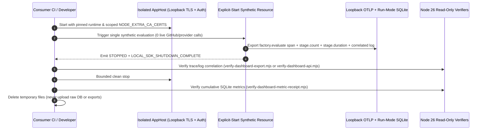

# Aspire consumer reference and hosted metric verification

This is a reference pattern only—never automatic consumer enrollment or activation ([#17](https://github.com/Jamula/SoftwareFactory/issues/17) and [#118](https://github.com/Jamula/SoftwareFactory/issues/118), closed and verified on GitHub-hosted Linux and Windows runners in [`docs/evidence/m01-02-hosted-aspire-receipts.json`](evidence/m01-02-hosted-aspire-receipts.json)). Consumers adopt independently in **`M03` `Jamula/Spellbook` (`#11` P0) → `M04` `Jamula/FamilyTree` (`#36` P1) → `M05` `FamilyHub` (`#12` P1)** order behind closed contract [#13](https://github.com/Jamula/SoftwareFactory/issues/13), using an immutable 40-hex reviewed factory pin and repository-local disabled policy (`mode: "disabled"`, `killSwitch: true`). Preserve all stricter coverage, review, platform, authorization, isolation, and `$0`-spend gates. No new credentials, paid services, deployment, Python helper scripts (`no-python-guard.mjs`), or remote collectors are authorized.

## Reproduce the synthetic reference

1. Use the CI-pinned **Node.js `26.13.1`**, **`.NET SDK 10.0.404`**, **`Aspire.Cli` `17.0.0`**, and locked manifests from the reviewed candidate. Restore and validate locally with:
   - `npm ci --ignore-scripts && npm run test:coverage`
   - `dotnet test tests/SoftwareFactory.Agents.Tests/SoftwareFactory.Agents.Tests.csproj --configuration Release -p:CollectCoverage=true`
2. Start an isolated `apphost.cs` instance with scoped developer TLS (`NODE_EXTRA_CA_CERTS`, never `NODE_TLS_REJECT_UNAUTHORIZED=0`), loopback-only authenticated Aspire Dashboard (`ASPIRE_ALLOW_UNSECURED_TRANSPORT=false`, `ASPIRE_DASHBOARD_UNSECURED_ALLOW_ANONYMOUS=false`), and numeric-loopback (`127.0.0.1` / `[::1]`) OTLP HTTP/protobuf ingestion. `apphost.cs` registers both `synthetic-shadow` (Node `26.13.1`) and `maf-specialist-shadow` (`.NET 10.0.404` + Microsoft Agent Framework `1.28.0` GA) with `WithExplicitStart()`; hosted Linux and Windows dashboard receipts currently verify `synthetic-shadow`, while hosted dashboard telemetry verification for `maf-specialist-shadow` remains outstanding.
3. Explicitly start the default-off synthetic resource. Require both `STOPPED` and `LOCAL_SDK_SHUTDOWN_COMPLETE` markers, followed by bounded clean AppHost shutdown. Zero live provider calls, GitHub writes, or dispatches occur.
4. Verify traces, correlated structured logs, and persisted metrics using SoftwareFactory's Node-only verifiers (`#118`):
   - **Linux ZIP archive export**: `node tools/engineering-factory/verify-dashboard-export.mjs <archive.zip>` confirms service `softwarefactory-shadow`, span `factory.evaluate`, and correlated `factory.stage.completed` log with matching non-zero hex W3C `traceId`/`spanId`.
   - **Windows loopback HTTPS API readback**: `node tools/engineering-factory/verify-dashboard-api.mjs` verifies the same authenticated trace/log correlation with scoped PEM certificate trust without modifying the Windows root store.
   - **Unattended `Run`-mode SQLite metric persistence** (Linux & Windows after bounded AppHost stop): `node tools/engineering-factory/verify-dashboard-metric-receipt.mjs` (paired with schema probe `node tools/engineering-factory/inspect-dashboard-metric-schema.mjs`) verifies persisted cumulative counter (`factory.stage.count`) and histogram (`factory.stage.duration`) points on fixed `evaluate/blocked/POLICY` dimensions.
   - **Manual dashboard UI OTLP JSON metric export** (optional interactive check): export only the isolated run's metric JSON to temporary storage and run `node tests/engineering-factory/verify-dashboard-metrics.mjs <metric-json-file> [additional-metric-json-files]` (ignoring OTLP `no-recorded-value` points), then delete temporary files.
5. Verify cross-OS receipt completeness offline via `tools/engineering-factory/aspire-hosted-receipt.mjs` (`tests/engineering-factory/aspire-hosted-receipt.test.mjs`) and record exact commit SHA, runner OS, trusted checks, source coverage counts, independent review, and healthy `main` separately.

References: https://aspire.dev/dashboard/explore/ ; https://aspire.dev/dashboard/apis/ ; https://aspire.dev/dashboard/data-persistence/ .

### Consumer AppHost telemetry & verification sequence diagram

## Consumer boundary (`M03` → `M04` → `M05`)

Keep pure policy/gate evaluation deterministic and completely free of telemetry side effects; attach loopback OTLP exporters strictly in the outer runner or `.NET` `LocalOtlpBootstrap` boundary. Inject synthetic inputs and allowlisted low-cardinality metric labels only—never raw issue prose, prompts, genealogy/private records, or tokens. Each consumer (`Jamula/Spellbook` `>=97%/90%` & 2-agent cap → `Jamula/FamilyTree` `>=95%/90%` & genealogy isolation → `FamilyHub` migration-freeze gate & strict `trunk`) retains its native language/runtime, isolated `credentialId` (`sharedAdminToken: false`), `$0` overage hard-stops, and `1`-commit independent rollback (`verifyIndependentRollback`) without requiring a framework rewrite.
