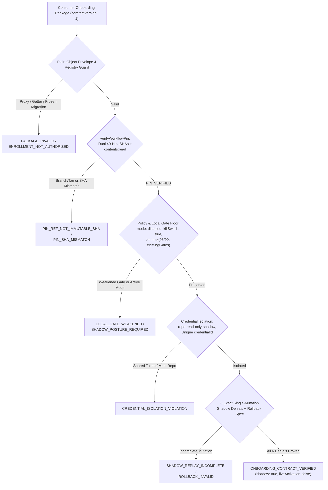
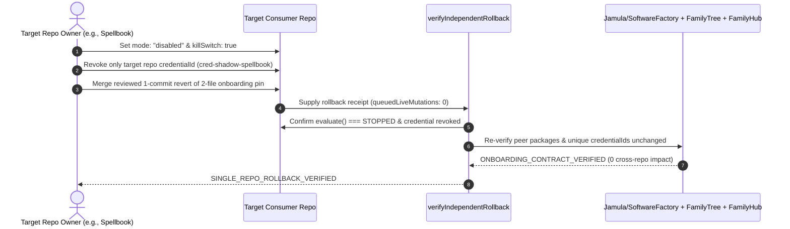

# Independent consumer adoption contract
Shared contract [#13](https://github.com/Jamula/SoftwareFactory/issues/13) (`M03.01`, closed); governs [#10](https://github.com/Jamula/SoftwareFactory/issues/10) (`M01`), [#11](https://github.com/Jamula/SoftwareFactory/issues/11) (`M03.02 P0` `Jamula/Spellbook`), [#36](https://github.com/Jamula/SoftwareFactory/issues/36) (`M04.01 P1` `Jamula/FamilyTree`), and [#12](https://github.com/Jamula/SoftwareFactory/issues/12) (`M05.01 P1` `FamilyHub`). Offline contract and synthetic verification only; no external consumer is activated.

## Versioned onboarding contract (v1)
`tools/engineering-factory/consumer-onboarding.mjs` implements deterministic, pure, metadata-only contract verification (`verifyConsumerOnboardingPackage`, `verifyWorkflowPin`, `verifyIndependentRollback`, `planConsumerBootstrap`, `buildReadOnlyOnboardingPlan`, `evaluateConsumerOnboardingSuccess`) backed by `validPolicy` and `evaluate` in `tools/engineering-factory/core.mjs`.

## What Success Looks Like: 3-Stage New-Repo Onboarding Rubric (Discovery → Shadow PR → First Unattended Merge)
`evaluateConsumerOnboardingSuccess(input)` (`ONBOARDING_SUCCESS_STAGES`, `ONBOARDING_SUCCESS_THRESHOLDS`, `CONSUMER_ROLLOUT_ORDER`) enforces the non-bypassable contract separating initial shadow wiring from autonomous acceptance:
- **Customer journey**: `1` natural-language request → `<= 5` mandatory settings (excluding explicit auth/billing confirmation) → `2` generated files (`.github/workflows/softwarefactory-shadow-replay.yml`, `.github/softwarefactory-policy.json`) → `6`-scenario shadow verification & disabled-at-rest onboarding PR (`<= 15 min`) → `1` real bounded unattended `@copilot` issue merged to healthy protected default branch (`0` human interventions, `$0` spend) → independent `1`-commit rollback leaving `Jamula/SoftwareFactory` and peer consumers untouched.
- **Stage 0 (`READ_ONLY_ONBOARDING_PLAN_READY`)**: `mandatorySettingsCount <= 5`, `discoveryAndPlanDurationMs <= 300_000` (`<= 5 min`), `overwrittenExistingFiles === 0`, `competingBacklogsCreated === 0` (`authoritativeBacklog: "github-issues"`), `mandatoryExternalServices === 0`, and `incrementalBilledUsdCents === 0`.
- **Stage 1 (`STAGE_1_SHADOW_ONBOARDED`)**: `basicIntegrationDurationMs <= 900_000` (`<= 15 min`), `onboardingPrMerged === true`, `mode: "disabled"` & `killSwitch: true`, dual 40-hex SHA pin (`verifyWorkflowPin`), stronger local gate preservation (`effectiveCoverage.line >= Math.max(95, existingLine)` & `effectiveCoverage.branch >= Math.max(90, existingBranch)`, required checks/`appId`s, `maxActive <= maxConcurrency`), formal `APPROVED` independent review (`allowCommentedBotApproval === false`), repository-isolated credentials (`sharedAdminToken === false`), `$0` per-repo AI-credit overage hard-stops (`paidOverageAllowed === false`), all `6` single-mutation shadow denials, and `1`-commit independent rollback (`verifyIndependentRollback`).
- **Stage 2 (`STAGE_2_AUTONOMOUS_ACCEPTED`, "Onboarded & Accepted")**: Requires Stage 1 **plus** non-synthetic (`synthetic === false`) Day-1 autonomous proof bound to the exact consumer `repository` and `repositoryId` (`AUTONOMOUS_PROOF_REPO_MISMATCH` on cross-repo reuse) showing `>= 1` real bounded unattended `@copilot` (`copilot-swe-agent[bot]`) issue landed onto healthy protected `defaultBranch` with exact-head `APPROVED` review, `humanInterventions === 0`, `unauthorizedWrites === 0`, `productionDeployments === 0`, and `incrementalBilledUsdCents === 0` (`liveActivation: false` preserved throughout offline evaluation). Synthetic fixtures always fail Stage 2 with `SYNTHETIC_RUN_CANNOT_ACCEPT_STAGE_2`.
- **Public vs. private execution matrix**: `gh-aw` `.lock.yml` + `@copilot` (`copilot-swe-agent[bot]`) + GitHub Actions Automode / pinned `@microsoft/copilot-sdk` `2.0.3` is supported across `public`, `private`, and `internal` repositories; Repository Cloud Automations are supported on `private` and `internal` repositories only (`copilotCloudAutomationsSupported: false` on `public`); per-repo `$0` AI-credit/Actions overage hard-stops and scoped `repo-read-only-shadow` credentials apply to all visibilities.

| Evidence | Required proof | Verifier enforcement |
|---|---|---|
| Repository identity | Authoritative stable numeric `repositoryId`, `owner/repo` slug, default branch, explicit owner enrollment (`ownerAuthorized: true`), migration-freeze clearance (`migrationFreezeClear: true`), `autoActivate: false`, `productionDeployEnabled: false` | Rejects `Jamula/SoftwareFactory` (`1471342715`), duplicate repositories/IDs, unauthorized names and frozen migrations (`ENROLLMENT_NOT_AUTHORIZED`, `INVALID_CONSUMER_POLICY`, `DUPLICATE_CONSUMER`) |
| Implementation & pin | Separate immutable 40-lowercase-hex SHAs on `Jamula/SoftwareFactory/.github/workflows/shadow-tests.yml@<sha>` (`reviewedWorkflowSha`) and internal `checkoutRef` (`reviewedCheckoutSha`), with `permissions: contents:read` and `persistCredentials: false` | Rejects branch/tag refs, short/uppercase SHAs, unreviewed or mismatched workflow/checkout SHAs and write/persisted credentials (`PIN_REF_NOT_IMMUTABLE_SHA`, `PIN_SHA_MISMATCH`, `PIN_PRIVILEGE_INVALID`) |
| Review | Independent exact-candidate `APPROVED` review, no unresolved threads, trusted check `appId` producers | Outside `Jamula/SoftwareFactory`, `COMMENTED` bot reviews (even allowlisted `copilot-pull-request-reviewer[bot]` with `summaryDisposition: "clear"`) fail closed with `REVIEW_MISSING` |
| Coverage & local gates | Consumer baseline minimum `>=95%` source-line and `>=90%` branch coverage per executable component and overall; SoftwareFactory itself requires `98%/95%`; stricter local gates (`minLineCoverage`, `minBranchCoverage`, `maxConcurrency`, `requiredChecks`, `requireExplicitApproval`, `requireStrictUpToDate`) always prevail | Stored onboarding policy must remain `mode: "disabled"` and `killSwitch: true`; lowering local coverage, raising `maxActive` above `maxConcurrency` or dropping a required check/producer fails closed (`BASELINE_COVERAGE_BELOW_MINIMUM`, `LOCAL_GATE_WEAKENED`, `SHADOW_POSTURE_REQUIRED`) |
| Capacity | Verified included quota and overage controls, repository-specific concurrency cap and kill switch | Missing/zero quota (`remainingCredits <= 0`) and tripped kill switch must fail closed in replay (`BUDGET_OR_CONCURRENCY`, `STOPPED`) |
| Access & isolation | Separate least-privilege `repo-read-only-shadow` credential scoped strictly to `[policy.repository]`; `sharedAdminToken: false`; `persistedInCheckout: false`; unique `credentialId` per repository | Rejects shared admin tokens, multi-repo scopes and cross-repository credential reuse (`CREDENTIAL_ISOLATION_VIOLATION`) |
| Reversibility | Disable enrollment (`mode: "disabled"`, `killSwitch: true`), revoke only the target repository's `credentialId`, revert workflow pin via reviewed PR and confirm `queuedLiveMutations === 0` | `verifyIndependentRollback` proves stopping one consumer leaves peer synthetic consumers unaffected (`SINGLE_REPO_ROLLBACK_VERIFIED`) |

## Contract verifier data flow and rollback sequence diagrams

### 1. Onboarding contract verification pipeline (`flowchart TD`)

### 2. Single-consumer rollback isolation sequence diagram

## Component compatibility and provenance catalog
`CONSUMER_COMPONENT_CATALOG` enumerates the frozen, read-only factory surfaces reusable by consumers without copying consumer secrets or mutating GitHub:
- `evaluator-core` (`tools/engineering-factory/core.mjs`, v1): pure snapshot evaluator; zero network/GitHub I/O.
- `shadow-replay-workflow` (`.github/workflows/shadow-tests.yml`, v1): SHA-pinned `workflow_call` synthetic replay workflow with `contents: read` and `persist-credentials: false`.
- `consumer-onboarding-verifier` (`tools/engineering-factory/consumer-onboarding.mjs`, v1): offline onboarding package, isolation, rollback and dry-run bootstrap verifier.

## Independent pilot lanes (`CONSUMER_ROLLOUT_ORDER`)
- **Customer One — `Jamula/SoftwareFactory` (`M01`, [#10](https://github.com/Jamula/SoftwareFactory/issues/10))**: `9 / 10` foundation issues closed (`#4–#9, #17, #105, #118`); live 3-issue unattended `copilot-swe-agent[bot]` acceptance proof active under `>=98%` line / `>=95%` branch coverage, `Default-Branch-Ruleset` `28054442`, Squash Merge Queue `ALLGREEN`, and `$0` overage hard-stops.
- **1st Consumer — `Jamula/Spellbook` (`M03.02 P0`, [#11](https://github.com/Jamula/SoftwareFactory/issues/11); `Jamula/Spellbook#103`)**: promoted ahead of FamilyTree as first external consumer pilot (`spellbook-pilot-readiness.mjs`); after `M01` (`#10`) acceptance and closed contract `#13`, preserve stricter `>=97%` app line / `>=90%` branch coverage (`example/spellbook` / `ios-webkit-97-90` offline profile), WebKit, iOS, and release required check producers, formal `APPROVED`-only review, `maxActive: 2` two-agent concurrency cap, and zero production release.
- **2nd Consumer — `Jamula/FamilyTree` (`M04.01 P1`, [#36](https://github.com/Jamula/SoftwareFactory/issues/36); `Jamula/FamilyTree#128`, `Jamula/FamilyTree#120`)**: follows `M01` (`#10`), `#13`, and `#11` Spellbook acceptance (`familytree-pilot-readiness.mjs`); use synthetic data only during contract verification (`example/family-tree` / `web-genealogy-95-90` offline profile), retain `>=95%/90%` baseline coverage, single-lane concurrency cap (`maxActive: 1`), genealogy private-data isolation, formal `APPROVED`-only review, independent auth/persistence review, and zero product release.
- **3rd Consumer — `FamilyHub` (`M05.01 P1`, [#12](https://github.com/Jamula/SoftwareFactory/issues/12); consumer readiness issue `#81` in the authoritative FamilyHub repository once verified)**: follows `M01` (`#10`), `#13`, and `#11` Spellbook acceptance (`familyhub-pilot-readiness.mjs`); verify authoritative repository identity and explicit owner migration-freeze lift (`migrationFreezeClear: true` hard gate), preserve `trunk` strict up-to-date base freshness, formal exact-head `APPROVED` review, and production isolation (`example/family-hub` / `strict-up-to-date-migration-gated` offline profile). Development resumption is not factory activation authorization.

## Verification, dry-run bootstrap and negative fixtures
`tests/engineering-factory/profiles.test.mjs`, `tests/engineering-factory/consumer-onboarding.test.mjs`, and [`docs/evidence/m03-01-onboarding-success-contract.json`](evidence/m03-01-onboarding-success-contract.json) verify greenfield and all three synthetic stack profiles (`example/spellbook`, `example/family-tree`, `example/family-hub` in `tools/engineering-factory/example-policies.json`, all stored at `mode: "disabled"` and `killSwitch: true`). Mandatory replay, bootstrap, and success-scorecard tests prove:
- Wrong repository identity (`UNTRUSTED_POLICY`), branch/tag or mismatched workflow/checkout SHA pins (`PIN_REF_NOT_IMMUTABLE_SHA`, `PIN_SHA_MISMATCH`), and missing check producer (`CHECKS_INCOMPLETE` / `LOCAL_GATE_WEAKENED`).
- Stale review, dismissed review and `COMMENTED` bot review denial outside `Jamula/SoftwareFactory` (`REVIEW_MISSING`).
- Exhausted or unknown quota (`BUDGET_OR_CONCURRENCY`), concurrency cap overflow, active migration freeze (`ENROLLMENT_NOT_AUTHORIZED`), cross-repo credential reuse (`CREDENTIAL_ISOLATION_VIOLATION`), kill-switch stop (`STOPPED`) and single-repository rollback without peer impact (`SINGLE_REPO_ROLLBACK_VERIFIED`).
- Conflict-safe dry-run bootstrap planning (`planConsumerBootstrap`) for blank and existing repositories: enforces `>=95/90` while preserving stricter existing gates, reruns idempotently (`IDEMPOTENT_NOOP`) and refuses to overwrite diverged files (`EXISTING_FILE_CONFLICT`).

Every unknown fails closed. Do not copy credentials, live policy from PR heads or private data. No live dispatch, merge, deployment or extra spending without separate verified authority.
