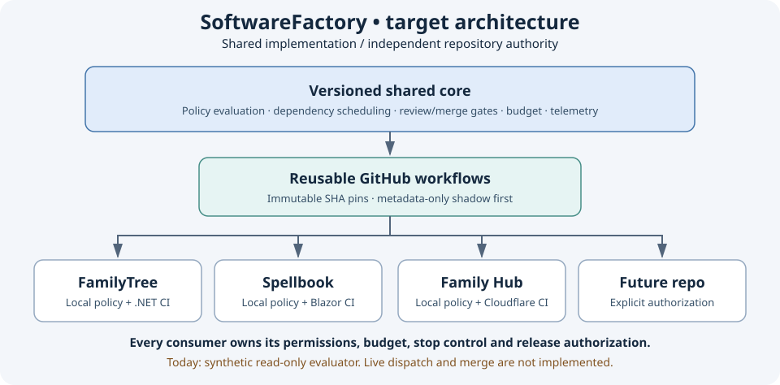

# Onboard a consumer repository

The integration model is shared code with independently pinned, repository-local configuration. Today only synthetic replay is available; do not activate live controller behavior.

## Readiness checklist

- Confirm the repository is explicitly authorized and no migration freeze or production restriction conflicts.
- Inventory default branch, effective rulesets, exact required check names and trusted producers, review policy, current CI and coverage evidence.
- Document independent path ownership, dependency rules, concurrency and included quota; unknown budget means no dispatch.
- Review the SoftwareFactory commit and pin the reusable workflow to its full commit SHA. Verify repository access and read-only permissions.
- Run synthetic replay on a dedicated test branch; demonstrate stale-head, wrong-producer, disabled and budget-denial cases.
- Record outcomes and limitations. Do not enable write permissions, agent dispatch, merges or deployment based on replay.

| Intended consumer | Policy to retain |
| --- | --- |
| FamilyTree | Private-data isolation, 95/90 targets and independent auth/persistence review |
| Spellbook | Existing stricter line gate, branch target, native UI/release verification and current concurrency cap |
| Family Hub | Migration freeze, verified exact-head approval and enforced review gate, existing validation and production boundary |
| Future repository | Explicit owner approval, its own required checks, credentials, budget and stop control |

Actual check names, IDs and permissions must be obtained by the owner from live repository settings, not copied from fictional examples. No adoption is currently activated. See [workflow guide](WORKFLOWS.md).
