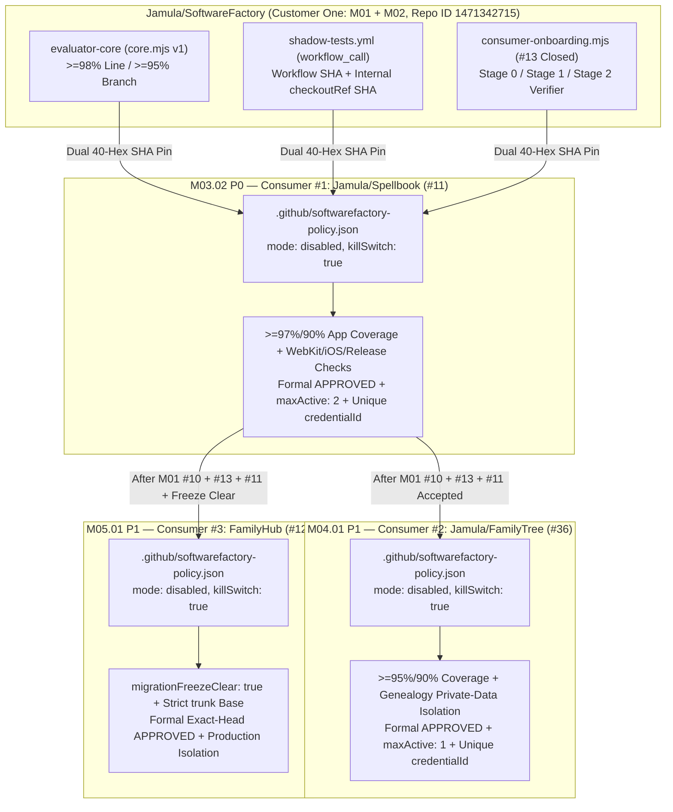
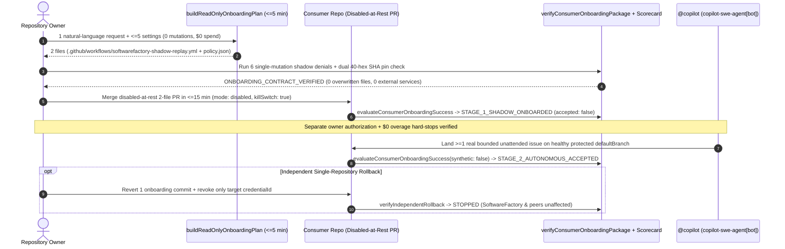
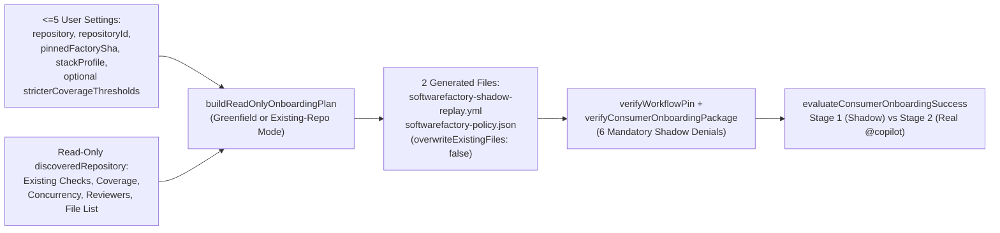

# Onboard a consumer repository

The integration model is shared code with independently pinned, repository-local configuration (`M03.01` [#13](https://github.com/Jamula/SoftwareFactory/issues/13), closed). In `Jamula/SoftwareFactory`, `M01` foundation issues `#4–#9, #17, #105, #118` (`9 / 10`) are closed and the [#10](https://github.com/Jamula/SoftwareFactory/issues/10) live 3-issue `@copilot` proof is active; external consumers adopt in strict **`M03` `Jamula/Spellbook` (`#11`, `P0`) → `M04` `Jamula/FamilyTree` (`#36`, `P1`) → `M05` `FamilyHub` (`#12`, `P1`)** order only after `M01` (`#10`) acceptance and separate repository-scoped owner authorization.


## Onboarding architecture, sequence, and data flow diagrams

### 1. Consumer isolation & `M03` → `M04` → `M05` rollout architecture diagram



### 2. 3-stage onboarding & independent `1`-commit rollback sequence diagram



### 3. Discovery-to-scorecard data flow diagram



## What Success Looks Like: 3-Stage New-Repo Onboarding Rubric (Discovery → Shadow PR → First Unattended Merge)

New-repository onboarding (`#13`, `M03.01`, closed) is measured by the deterministic, fail-closed `evaluateConsumerOnboardingSuccess(input)` scorecard in `tools/engineering-factory/consumer-onboarding.mjs` (backed by [`docs/evidence/m03-01-onboarding-success-contract.json`](evidence/m03-01-onboarding-success-contract.json)). Merging a disabled workflow is **Stage 1 (`STAGE_1_SHADOW_ONBOARDED`)**, never full acceptance: a repository is **onboarded and accepted (`STAGE_2_AUTONOMOUS_ACCEPTED`)** only after `>= 1` real (non-synthetic) bounded unattended `@copilot` issue lands cleanly onto its healthy protected default branch with `0` human interventions and `$0` incremental spend.

### End-to-end customer journey

1. **`1` natural-language request** initiates read-only discovery with zero live GitHub mutations.
2. **`<= 5` mandatory settings** (`repository`, `repositoryId`, `pinnedFactorySha`, `stackProfile`, plus optional `stricterCoverageThresholds`; explicit owner auth/billing confirmation excluded).
3. **`2` generated repository-local files** (`.github/workflows/softwarefactory-shadow-replay.yml` and `.github/softwarefactory-policy.json`) with `overwrittenExistingFiles === 0`, `competingBacklogsCreated === 0` (GitHub Issues remain sole backlog), `mandatoryExternalServices === 0`, and `incrementalBilledUsdCents === 0`.
4. **Shadow verification & reviewable disabled-at-rest PR (`STAGE_1_SHADOW_ONBOARDED`, `<= 15 min`)**: dual 40-hex SHA pin (`verifyWorkflowPin`), `mode: "disabled"` + `killSwitch: true`, stronger local gates preserved, formal `APPROVED` independent review, per-repo credential isolation, `$0` AI-credit overage hard-stop, all `6` single-mutation shadow denials proven, and `1`-commit independent rollback verified.
5. **`1` real bounded unattended `@copilot` issue merged (`STAGE_2_AUTONOMOUS_ACCEPTED`)**: lands on healthy protected `defaultBranch` with exact-head `APPROVED` review, `humanInterventions === 0`, `unauthorizedWrites === 0`, `productionDeployments === 0`, and `incrementalBilledUsdCents === 0` (synthetic runs always reject Stage 2 with `SYNTHETIC_RUN_CANNOT_ACCEPT_STAGE_2`).
6. **Independent `1`-commit rollback**: reverting the 2-file onboarding commit + revoking only the consumer's `credentialId` (`verifyIndependentRollback`) stops that consumer (`STOPPED`) while leaving `Jamula/SoftwareFactory` and peer consumers untouched.

### 3-stage pass/fail scorecard

| Stage | Status / `evaluateConsumerOnboardingSuccess` output | Mandatory pass metrics | Fail-closed denial reasons |
| --- | --- | --- | --- |
| **Stage 0: Discovery & Dry-Run Plan** | `buildReadOnlyOnboardingPlan` → `READ_ONLY_ONBOARDING_PLAN_READY` | `mandatorySettingsCount <= 5`, `discoveryAndPlanDurationMs <= 300_000` (`<= 5 min`), `2` generated files, `overwrittenExistingFiles === 0`, `competingBacklogsCreated === 0` (`authoritativeBacklog: "github-issues"`), `mandatoryExternalServices === 0`, `incrementalBilledUsdCents === 0` (`$0`) | `MANDATORY_SETTINGS_LIMIT_EXCEEDED`, `DISCOVERY_DURATION_EXCEEDED`, `EXISTING_FILE_CONFLICT`, `EXISTING_FILES_OVERWRITTEN`, `COMPETING_BACKLOG_PROHIBITED`, `EXTERNAL_SERVICE_REQUIRED`, `NON_ZERO_INCREMENTAL_SPEND` |
| **Stage 1: Shadow-Onboarded** | `valid: true`, `accepted: false`, `stage: "STAGE_1_SHADOW_ONBOARDED"` | `basicIntegrationDurationMs <= 900_000` (`<= 15 min`), `onboardingPrMerged === true`, `mode: "disabled"`, `killSwitch: true`, dual 40-hex SHA pin (`verifyWorkflowPin`), `effectiveCoverage.line >= Math.max(95, existingLine)` & `effectiveCoverage.branch >= Math.max(90, existingBranch)`, required checks/`appId`s + `maxActive <= maxConcurrency`, `allowCommentedBotApproval === false`, `sharedAdminToken === false`, `$0` AI-credit hard-stop, `6` shadow denials, `commitsToRevert === 1` independent rollback | `INTEGRATION_DURATION_EXCEEDED`, `ONBOARDING_PR_NOT_MERGED`, `PIN_REF_NOT_IMMUTABLE_SHA`, `PIN_SHA_MISMATCH`, `SHADOW_POSTURE_REQUIRED`, `LOCAL_GATE_WEAKENED`, `FORMAL_APPROVAL_REQUIRED`, `CREDENTIAL_ISOLATION_VIOLATION`, `AI_CREDIT_HARD_STOP_REQUIRED`, `SHADOW_REPLAY_INCOMPLETE`, `SINGLE_COMMIT_ROLLBACK_REQUIRED`, `FACTORY_ISOLATION_REQUIRED` |
| **Stage 2: Autonomous Accepted ("Onboarded & Accepted")** | `valid: true`, `accepted: true`, `autonomousAccepted: true`, `liveActivation: false`, `stage: "STAGE_2_AUTONOMOUS_ACCEPTED"` | All Stage 0 + Stage 1 gates **plus** non-synthetic (`synthetic === false`) repository-bound receipt (`repository` + `repositoryId` matching the scored consumer): `unattendedCopilotIssuesLanded >= 1` by `@copilot` (`copilot-swe-agent[bot]`) onto healthy protected `defaultBranch`, bounded scope + exact-head `APPROVED` review, `humanInterventions === 0`, `unauthorizedWrites === 0`, `productionDeployments === 0`, `incrementalBilledUsdCents === 0` | `SYNTHETIC_RUN_CANNOT_ACCEPT_STAGE_2`, `AUTONOMOUS_PROOF_REQUIRED`, `AUTONOMOUS_PROOF_REPO_MISMATCH`, `AUTONOMOUS_AGENT_INVALID`, `UNATTENDED_ISSUE_NOT_LANDED`, `DEFAULT_BRANCH_UNHEALTHY`, `AUTONOMOUS_GOVERNANCE_INCOMPLETE`, `HUMAN_INTERVENTION_REQUIRED`, `UNAUTHORIZED_WRITE_DETECTED`, `PRODUCTION_DEPLOYMENT_PROHIBITED`, `NON_ZERO_INCREMENTAL_SPEND` |

### Public vs. private repository execution matrix

| Repository visibility | `gh-aw` `.lock.yml` + `@copilot` (`copilot-swe-agent[bot]`) + GitHub Actions Automode / `@microsoft/copilot-sdk` `2.0.3` | Repository Cloud Automations | Mandatory billing & credential controls |
| --- | --- | --- | --- |
| `public` | Supported (`copilotCloudAgentSupported: true`) | Not available (`copilotCloudAutomationsSupported: false`) | Per-repo `$0` AI-credit/Actions overage hard-stop (`paidOverageAllowed: false`), isolated `repo-read-only-shadow` credential (`sharedAdminToken: false`), zero personal PATs |
| `private` | Supported (`copilotCloudAgentSupported: true`) | Supported (`copilotCloudAutomationsSupported: true`) | Per-repo `$0` AI-credit/Actions overage hard-stop (`paidOverageAllowed: false`), isolated `repo-read-only-shadow` credential (`sharedAdminToken: false`), zero personal PATs |
| `internal` | Supported (`copilotCloudAgentSupported: true`) | Supported (`copilotCloudAutomationsSupported: true`) | Per-repo `$0` AI-credit/Actions overage hard-stop (`paidOverageAllowed: false`), isolated `repo-read-only-shadow` credential (`sharedAdminToken: false`), zero personal PATs |

## Lightweight read-only onboarding planner (`<= 5` mandatory settings)

`buildReadOnlyOnboardingPlan(discoveryInput)` in `tools/engineering-factory/consumer-onboarding.mjs` implements Customer One's deterministic, metadata-only onboarding planner for both `"greenfield"` and `"existing-repository"` modes without live GitHub mutations, repository creation, credentials, external services, or incremental spend (`$0`).

### Mandatory user-supplied settings ceiling (`MAX_MANDATORY_USER_SETTINGS = 5`)

Onboarding requires at most **4 mandatory user-supplied settings** plus **1 optional threshold override** (`<= 5` total; any request demanding `> 5` mandatory user inputs fails closed with `MANDATORY_SETTINGS_LIMIT_EXCEEDED`):

1. `repository`: Target `owner/repo` slug (never `Jamula/SoftwareFactory`).
2. `repositoryId`: Stable numeric GitHub repository ID (never `1471342715`).
3. `pinnedFactorySha`: Immutable 40-lowercase-hex commit SHA for `Jamula/SoftwareFactory/.github/workflows/shadow-tests.yml@<sha>`. Cataloged workflow revisions in `TRUSTED_WORKFLOW_CHECKOUT_PINS` (`afc3d223f287b029db32672908097efc67a259c9` → `1208481843e73d1d2506085c654e84255303541d`) automatically bind their verified internal `checkoutRef`; uncataloged workflow SHAs require explicit `observedCheckoutRef` + `pinnedCheckoutSha` evidence or fail closed (`CHECKOUT_PIN_UNVERIFIED` / `PIN_SHA_MISMATCH`).
4. `stackProfile`: Cataloged profile key (`baseline-95-90`, `web-genealogy-95-90`, `ios-webkit-97-90`, or `strict-up-to-date-migration-gated`).
5. `stricterCoverageThresholds` *(optional 5th setting)*: `{ line, branch }` raising local coverage above the consumer/profile/discovered floor (attempting to lower any existing or baseline gate fails closed with `BASELINE_COVERAGE_BELOW_MINIMUM` or `LOCAL_GATE_WEAKENED`).

### Greenfield vs. existing-repository workflow

- **Greenfield (`mode: "greenfield"`, default when `discoveredRepository` is omitted)**: Synthesizes a disabled-at-rest `.github/softwarefactory-policy.json` (`mode: "disabled"`, `killSwitch: true`), a SHA-pinned `.github/workflows/softwarefactory-shadow-replay.yml` (`permissions: contents: read`, `persistCredentials: false`), GitHub-Issues-authoritative tracking defaults (`separateBacklogCreated: false`, `mandatoryExternalServices: 0`), an independent per-repository kill switch, and a single-commit rollback plan (`single-commit-revert`).
- **Existing repository (`mode: "existing-repository"`)**: Combines the `<= 5` user settings with complete read-only `discoveredRepository` gate and file inventory (`defaultBranch`, `mergeMethod`, `checks`, `reviewers`, `owners`, `coverage`, `maxConcurrency`, `existingFiles`, plus optional `visibility`, `migrationFreezeClear`, `requireExplicitApproval`, `requireStrictUpToDate`, `allowCommentedBotApproval`; missing discovery fields block readiness with `DISCOVERY_INVENTORY_INCOMPLETE` and explicit `blockers`). Preserves all stricter existing consumer and profile gates—such as `97%/90%` line/branch coverage and `>= 2` platform checks on `ios-webkit-97-90`, `100%/100%` + locked `trunk`/`merge` + migration-freeze enforcement on `strict-up-to-date-migration-gated` (`LOCAL_GATE_WEAKENED` on conflict), stricter concurrency caps (`Math.min(profile.maxActive, maxConcurrency)`), and formal `APPROVED`-only independent reviews (`allowCommentedBotApproval: false`).
- **Read-only safety defaults & zero overwrites**: Enforces `defaultEnabled: false`, `implicitActivation: false`, `overwriteExistingFiles: false`, `liveMutations: 0`, and `deployments: 0`. Any override attempt fails closed (`UNSAFE_DISCOVERY_DEFAULTS`), unsupported external resources fail closed (`UNSUPPORTED_RESOURCE_BLOCKED`), and any collision with existing consumer files (exact, case-variant, ancestor, or descendant path) fails closed with `EXISTING_FILE_CONFLICT`.
- **Hosted execution options & AI Credit hard-stops**: Reports repository-visibility-aware execution capabilities (`gh-aw` + Copilot Cloud Agent + pinned `@microsoft/copilot-sdk` `2.0.3` on `public`, `private`, and `internal` repositories; Copilot Cloud Automations on `private` and `internal` repositories only) alongside mandatory per-repository `$0` paid-overage AI Credit hard-stops (`perRepoAiCreditHardStopRequired: true`, `paidOverageAllowed: false`).

```js
import { buildReadOnlyOnboardingPlan } from './tools/engineering-factory/consumer-onboarding.mjs';

// 1. Greenfield onboarding (4 mandatory settings; cataloged workflow SHA binds checkoutRef 12084818...)
const greenfieldPlan = buildReadOnlyOnboardingPlan({
  repository: 'example/new-project',
  repositoryId: 900501,
  pinnedFactorySha: 'afc3d223f287b029db32672908097efc67a259c9',
  stackProfile: 'baseline-95-90'
});

// 2. Existing repository onboarding with complete read-only gate & file inventory
const existingPlan = buildReadOnlyOnboardingPlan({
  mode: 'existing-repository',
  repository: 'example/spellbook',
  repositoryId: 900202,
  pinnedFactorySha: 'afc3d223f287b029db32672908097efc67a259c9',
  stackProfile: 'ios-webkit-97-90',
  stricterCoverageThresholds: { line: 98, branch: 92 },
  discoveredRepository: {
    defaultBranch: 'main',
    mergeMethod: 'squash',
    checks: [
      { name: 'fictional-webkit-gate', appId: 34567 },
      { name: 'fictional-ios-gate', appId: 34568 }
    ],
    reviewers: ['synthetic-spellbook-reviewer'],
    owners: [
      { prefix: 'ios/', owner: 'synthetic-ios-owner' },
      { prefix: 'src/', owner: 'synthetic-spellbook-owner' }
    ],
    coverage: { line: 97, branch: 90 },
    maxConcurrency: 2,
    existingFiles: ['.github/workflows/ios-ci.yml', 'src/bridge.ts']
  }
});
```

Measured synthetic verification (`tests/engineering-factory/consumer-onboarding.test.mjs`) executes both blank (`greenfield`) and existing (`existing-repository`) plans in `< 5 ms` (`<= 5 min` provisional target), emits `2` reviewable repository-local files, requires `4`–`5` user settings, records `0` live mutations/deployments and `$0` incremental spend, and proves single-commit/single-repository rollback without affecting peer consumers. Targets for live adoption remain provisional until M01 (#10) acceptance and separate owner authorization.

## Readiness checklist

1. **Verify authorization and freeze boundaries**: Confirm explicit owner authorization (`ownerAuthorized: true`), authoritative numeric `repositoryId` (never SoftwareFactory's `1471342715`), `autoActivate: false`, `productionDeployEnabled: false`, and no active migration freeze (`migrationFreezeClear: true`). Repository names never grant authorization.
2. **Inventory existing local gates**: Record `defaultBranch`, `mergeMethod`, exact required check `name` and trusted `appId` producers, independent reviewer identities, coverage gates (`>=95%` line / `>=90%` branch consumer floor, preserving any stricter existing gate) and `maxConcurrency`.
3. **Generate or author disabled local policy**: Use `buildReadOnlyOnboardingPlan` (lightweight `<= 5`-setting planner) or `planConsumerBootstrap` in `tools/engineering-factory/consumer-onboarding.mjs` for a dry-run, conflict-checked plan (`.github/workflows/softwarefactory-shadow-replay.yml` and `.github/softwarefactory-policy.json`). Stored onboarding policy must stay disabled at rest (`"mode": "disabled"`, `"killSwitch": true`); existing consumer files are never overwritten (`overwriteExistingFiles: false`).
4. **Pin immutable 40-hex commit SHAs**: Review both the called reusable workflow commit (`reviewedWorkflowSha`) and the internal evaluator checkout commit it references (`reviewedCheckoutSha`), pinning `Jamula/SoftwareFactory/.github/workflows/shadow-tests.yml@<40-hex-sha>` and verifying `checkoutRef` with `permissions: contents:read` and `persist-credentials: false`. Branch or tag refs (`@main`, `@v1.0.0`) and unreviewed or mismatched workflow/checkout SHAs are rejected by `verifyWorkflowPin` and `planConsumerBootstrap`.
5. **Isolate credentials per repository**: Scope shadow metadata access strictly to `[policy.repository]` (`scope: "repo-read-only-shadow"`, `sharedAdminToken: false`, `persistedInCheckout: false`) with a unique `credentialId` that is never shared across consumer repositories.
6. **Prove mandatory single-mutation shadow denials before review**: Verify the onboarding package with `verifyConsumerOnboardingPackage`, confirming `SHADOW_ELIGIBLE` for a valid candidate alongside single-field negative mutations and exact-reason denials for stale review (`REVIEW_MISSING`), dismissed review (`REVIEW_MISSING`), `COMMENTED` bot review (`REVIEW_MISSING`), wrong repository (`UNTRUSTED_POLICY`), missing quota (`BUDGET_OR_CONCURRENCY`) and active-shadow kill-switch stop (`STOPPED`).
7. **Verify independent single-repository rollback**: Prove via `verifyIndependentRollback` that setting `mode: "disabled"` and `killSwitch: true`, revoking only the target repository's `credentialId`, reverting the workflow SHA pin via a reviewed PR and confirming `queuedLiveMutations === 0` immediately stops the target repository (`STOPPED`) while peer consumers remain unaffected.
8. **Score Stage 1 shadow onboarding vs. Stage 2 autonomous acceptance**: Run `evaluateConsumerOnboardingSuccess(input)` to confirm `STAGE_1_SHADOW_ONBOARDED` once the disabled-at-rest 2-file onboarding PR is merged, and gate `STAGE_2_AUTONOMOUS_ACCEPTED` ("Onboarded & Accepted") on a non-synthetic (`synthetic: false`) receipt proving `>= 1` bounded unattended `@copilot` issue landed onto the healthy protected default branch with `humanInterventions === 0`, `unauthorizedWrites === 0`, `productionDeployments === 0`, and `incrementalBilledUsdCents === 0`.

| Rollout sequence | Intended consumer & prerequisite gate | Offline synthetic profile (`example-policies.json`) | Policy and local gates to retain |
| --- | --- | --- | --- |
| **1st (`M03.02 P0`)** | `Jamula/Spellbook` ([#11](https://github.com/Jamula/SoftwareFactory/issues/11); gated on `M01` `#10` + closed `#13` + `Jamula/Spellbook#103`) | `example/spellbook` (`ios-webkit-97-90`) | Stricter `>=97%` app line / `>=90%` branch gate, WebKit, iOS, and release required check producers, formal `APPROVED`-only review, `maxActive: 2` concurrency cap, and zero production release |
| **2nd (`M04.01 P1`)** | `Jamula/FamilyTree` ([#36](https://github.com/Jamula/SoftwareFactory/issues/36); gated on `M01` `#10` + `#13` + `#11` Spellbook + `Jamula/FamilyTree#128`/`#120`) | `example/family-tree` (`web-genealogy-95-90`) | Genealogy private-data isolation, `>=95%/90%` baseline coverage, `maxActive: 1`, formal `APPROVED`-only review, independent auth/persistence review, and zero production deploy |
| **3rd (`M05.01 P1`)** | `FamilyHub` ([#12](https://github.com/Jamula/SoftwareFactory/issues/12); gated on `M01` `#10` + `#13` + `#11` Spellbook + `#81` + explicit migration-freeze lift) | `example/family-hub` (`strict-up-to-date-migration-gated`) | Verified repository identity + hard migration-freeze gate (`migrationFreezeClear: true`), `trunk` strict up-to-date base freshness, formal exact-head `APPROVED` review, and production isolation |
| **Future** | Greenfield or existing repository | `baseline-95-90` or custom synthetic fixture | Explicit owner approval, unique `repositoryId` and `credentialId`, immutable 40-hex SHA pin, `>=95%/90%` or stricter local gates, `$0` overage hard-stop, and independent `1`-commit rollback |

## Local contract verification

Run the synthetic profile, shared onboarding contract, and per-consumer shadow-readiness suites locally without network or GitHub credentials:

```bash
node --test \
  tests/engineering-factory/profiles.test.mjs \
  tests/engineering-factory/consumer-onboarding.test.mjs \
  tests/engineering-factory/spellbook-pilot-readiness.test.mjs \
  tests/engineering-factory/familytree-pilot-readiness.test.mjs \
  tests/engineering-factory/familyhub-pilot-readiness.test.mjs
```

Actual check names, app IDs, repository IDs and permissions must be obtained by the owner from live repository settings after M01 (#10) acceptance and separate scoped authorization, never copied from fictional examples in `tools/engineering-factory/example-policies.json`. No adoption is currently activated. See [adoption contract](CONSUMER-ADOPTION-CONTRACT.md) and [workflow guide](WORKFLOWS.md).
