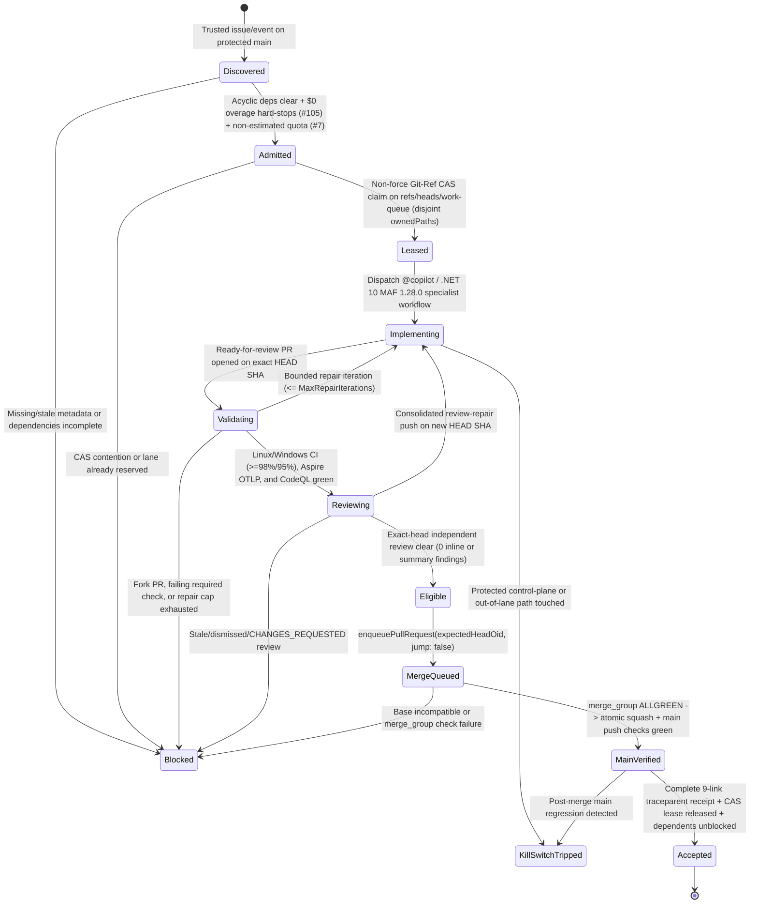
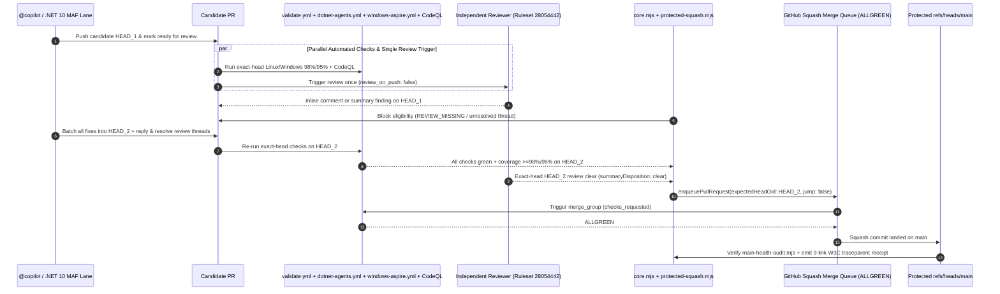
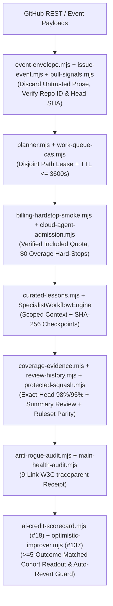

# Delivery lifecycle (`v2` event-to-acceptance state machine)

SoftwareFactory's delivery loop is event-driven, dependency-aware, and **orchestrated natively on GitHub** (`M01` foundation `9 / 10` closed across `#4–#9, #17, #105, #118`; `#10` live 3-issue `@copilot` proof active; consumer rollout sequence **`M03` `Jamula/Spellbook` `#11` → `M04` `Jamula/FamilyTree` `#36` → `M05` `FamilyHub` `#12`** behind closed contract `#13`). No personal laptop, local polling loop, or open chat session is part of the operational loop.

| Stage | Shipped `v2` gate / evaluator | Required exit evidence |
| --- | --- | --- |
| **1. Discover** | Outer `github/gh-aw` (`v1.2.2+`) `.lock.yml` (`gh-aw-lock-verifier.mjs`) + `run.mjs --inventory` / `--reconcile-event` (`contents: read`, `safe-outputs` `staged: true`) | Verified trusted default-branch provenance, SHA-256 `.lock.yml` parity, stable `repositoryId`, and sanitized issue/PR metadata |
| **2. Ready & Admit** | `planner.mjs` non-overlapping file-set/lane scheduler + `work-queue-cas.mjs` non-force git-ref CAS on `refs/heads/work-queue` + `cloud-agent-admission.mjs` / `billing-hardstop-smoke.mjs` (`#6`, `#7`, `#105`) | Acyclic dependencies clear, disjoint path lease fenced with bounded TTL (`<= 3,600,000 ms`), verified non-estimated quota, and `$0` overage hard-stops across AI Credits, Copilot Premium Requests, and Cloud Sandboxes/Actions |
| **3. Specialist Execution** | Native GitHub Copilot Cloud Agent (`copilot-swe-agent[bot]`) / Cloud Automations (private/internal repos) + `.NET 10.0.404` Microsoft Agent Framework `1.28.0` GA Pregel superstep workflow (`src/SoftwareFactory.Agents/`, `curated-lessons.mjs`, `#14`, `#16`) | Scoped context loaded without private cross-repo data, SHA-256 JSON checkpoint integrity (`priorSuperstepsRepeated: 0`), zero protected control-plane or out-of-lane edits (`PathOwnershipGuard`), and Mission Control `taskId`/`sessionId` recorded |
| **4. Validate & Review** | Exact-head CI (`validate.yml` Node `26.13.1`, `dotnet-agents.yml` `.NET 10.0.404`, `windows-aspire.yml` Aspire `17.0.0`, `CodeQL`) + `Default-Branch-Ruleset` `28054442` (`review_on_push: false`) + `review-history.mjs` (`#4`, `#15`, `#17`, `#118`) | `>=98%` line / `>=95%` branch coverage per executable component and overall (or stricter consumer gates), zero `CodeQL`/secret alerts, exact-head independent review (`summaryDisposition: "clear"`), and zero unresolved inline or summary findings |
| **5. Eligible** | `core.mjs`, `coverage-evidence.mjs` (`verifyCandidateGateReceipt`), `protected-squash.mjs`, and `anti-rogue-audit.mjs` (`run.mjs --evaluate-squash`) | Fresh authoritative head/base match, unbroken pre-merge W3C `traceparent` links, and zero tripped circuit breakers (shadow decision only—never self-merge authority) |
| **6. Squash Merge Queue** | **GitHub Native Squash Merge Queue** (`Default-Branch-Ruleset` `28054442`, `grouping_strategy: "ALLGREEN"`, GraphQL `enqueuePullRequest` with `expectedHeadOid` and `jump: false`; `gh-aw` never merges directly) | Independent `merge_group` (`checks_requested`) green across required Linux/Windows checks and atomic squash commit on `main` |
| **7. Verify `main` & Audit** | `main-health-audit.mjs` + `anti-rogue-audit.mjs` (`#8`, `#9`, `#137`) | Protected `main` push checks green, complete **9-link W3C `traceparent` causal provenance receipt**, and `$0` incremental billed spend verified |
| **8. Unblock & Kaizen** | `work-queue-cas.mjs` terminal release + `ai-credit-scorecard.mjs` (`#18`) + `optimistic-improver.mjs` (`#137`) | Dependent issues unblocked, lane lease released cleanly, and matched `>=5`-outcome Kaizen cohort evaluated (auto-proposing revert spec on regression) |

Any moved `HEAD` SHA, stale/dismissed review, unresolved summary-only finding, unknown or estimated AI-credit balance, out-of-lane or protected-path touch, failed `main` check, or stop variable routes deterministically to `blocked` and trips the repository kill switch when required (`anti-rogue-audit.mjs`). Partial PRs use non-closing issue linkage so parent acceptance issues remain open until every exit criterion is evidenced. See [roadmap v2](ROADMAP.md), [operations](OPERATIONS.md), and [engineering standards](ENGINEERING-STANDARDS.md).

## Lifecycle state machine, sequence, and data flow diagrams

### 1. Issue-to-acceptance state machine (`stateDiagram-v2`)

### 2. Review-repair and Squash Merge Queue sequence diagram

### 3. Stage-gate evidence data flow diagram

