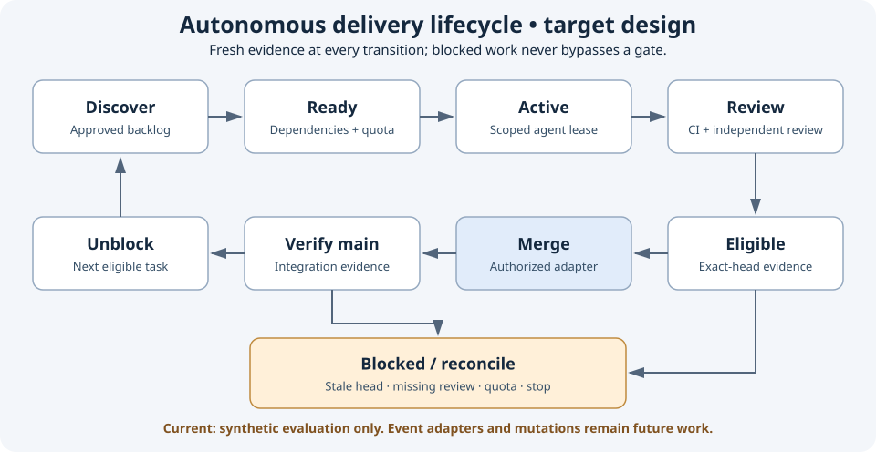

# Delivery lifecycle (target)

The target control loop is event-driven and dependency-aware. Current implementation is limited to evaluating supplied snapshots; event ingestion, persistent state, scheduling and mutations are not implemented.

| Stage | Input and decision | Exit evidence |
| --- | --- | --- |
| Discover | Trusted repository metadata, approved backlog | Stable issue identity and scope |
| Ready | Dependency, ownership and quota checks | No conflict; owner authorization |
| Active | Supported approved agent dispatch | Idempotent lease and run identity |
| Review | Exact-head tests, independent review, security | Verified check producers and no material findings |
| Eligible | Fresh authoritative head/base and all gates | Decision only, not permission |
| Merge | Separately authorized guarded adapter | Expected-head merge receipt |
| Verify main | Post-merge integration and acceptance | Main green; evidence attached |
| Unblock | Recompute dependencies and queue | Dispatch next eligible work only |

Any changed head, ambiguous evidence, unknown cost, failed main check, stop control or permission error routes to blocked/reconcile. Partial PRs do not close parent acceptance issues. Never bypass repository protections. The scheduler, mutation and main verification adapters require separate implementation and validation.
