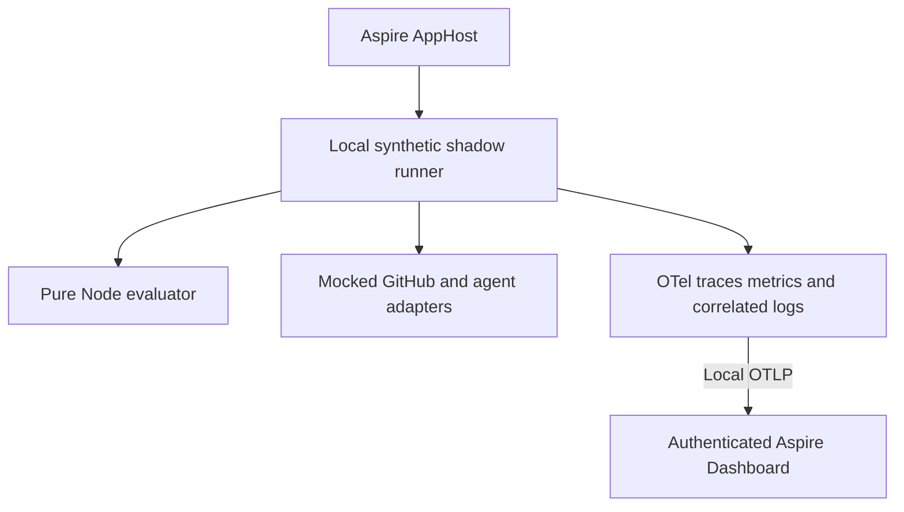

# Local development and observability

Owner standard: Aspire for local orchestration, OpenTelemetry for telemetry. Implementation is tracked in [#17](https://github.com/Jamula/SoftwareFactory/issues/17) and [#9](https://github.com/Jamula/SoftwareFactory/issues/9). **AppHost scaffold merged; local runtime and OTLP reception not yet verified.** Run headless tests with `npm ci --ignore-scripts` then `npm run test:coverage`.

## Target local topology

The AppHost manages local processes and resource health; the evaluator stays deterministic and free of telemetry side effects. The CLI runner accepts an optional `observe(stage, work)` adapter around synthetic evaluation and the current read-only inventory, issue and pull reconciliation commands. Its default adapter is a no-op; `createSignals` from `telemetry.mjs` can be injected by a trusted local bootstrap. The CLI does not create an SDK provider, exporter, endpoint or credentials. Queue, review, merge and main-verification stages remain uninstrumented until their trusted adapters exist. No actual GitHub mutation or production deployment is enabled.

## Local setup and acceptance

Use a supported stable Aspire SDK/CLI, pinned supported Node LTS, and locked dependencies. Use the launch and evidence checklist in [Aspire synthetic smoke](ASPIRE-SYNTHETIC-SMOKE.md). No mandatory Docker or remote service; explicitly document any container prerequisites. Bind dashboard and collector to loopback; keep authentication enabled where supported. No remote exporter by default. Stop/cleanup must not leave external agent runs, credentials or mutable consumer state. Use synthetic metadata, bounded scenarios and mocked adapters.

| Signal | Examples |
| --- | --- |
| Traces | reconcile, normalize evidence, evaluate policy, queue decision, review/merge simulation, main verification |
| Counters | decision outcomes, blocked reasons, duplicate suppression, dispatch/merge attempts and outcomes, failures, accepted work |
| Histograms | queue delay, reconciliation, CI, review, eligible-to-merge, main verification, acceptance |
| Structured logs | sanitized lifecycle state, reason codes, trace/span correlation |
| Resource health | runner readiness and bounded smoke scenario completion |

Use low-cardinality allowlists for metric labels. Do not use raw repository/issue identifiers or arbitrary exception strings as labels. Logs/traces must not contain raw issue content, prompts, tokens, personal records, provider response bodies or credential-bearing URLs. Use synthetic identifiers for local experiments. Validate endpoint/protocol, bound export buffering and test failures/shutdown. Export failure may degrade diagnostics, never authorization or gate correctness. JavaScript logs SDK support must be verified; a supported structured logging bridge with trace correlation is acceptable.

## Verification checklist

- Headless unit/replay and coverage tests independently pass, 98% lines/95% branches per executable component and overall, preserving stricter existing gates.
- Actual AppHost launch and shutdown on standard GitHub-hosted Windows and Linux runners; document SDK versions, command, resource health and smoke evidence. Dedicated workstation compatibility is deferred to #66. CI build alone is not runtime verification.
- Synthetic trace visible in local dashboard, corresponding metric sample and correlated structured log; prove no external export, no GitHub writes and no sensitive payloads.
- Negative tests: malformed endpoints/config, unavailable exporter, stop, oversized or unsafe telemetry attributes, unsupported runtime, missing credentials/metadata. Independent exact-head security review.
- Consumer-specific adoption only via reviewed immutable pins and local policies, no forced framework rewrite or automatic activation. Family Hub requires independent migration readiness verification and activation approval.

Official references: [Aspire existing app integration](https://aspire.dev/get-started/add-aspire-existing-app/), [JavaScript AppHost integration](https://aspire.dev/integrations/frameworks/javascript/), [Aspire telemetry](https://aspire.dev/fundamentals/telemetry/), [OpenTelemetry JavaScript](https://opentelemetry.io/docs/languages/js/).
