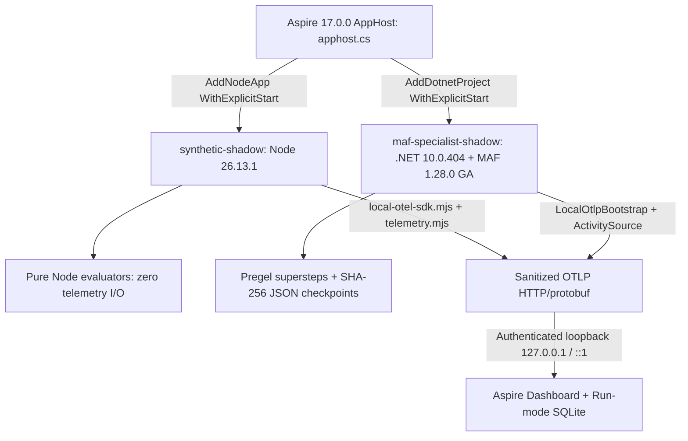
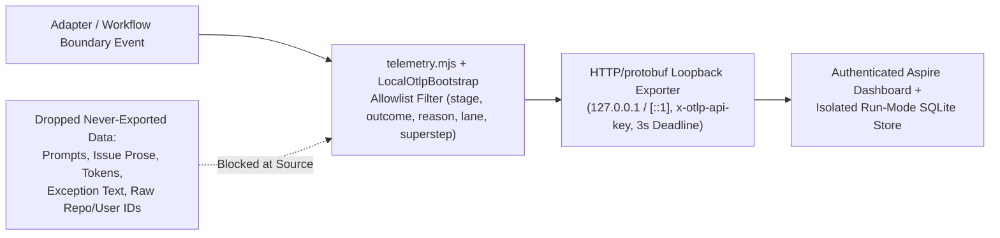

# Local development and observability

Owner standard: **Aspire `17.0.0` AppHost** (`apphost.cs` on `.NET SDK 10.0.404`) for local and hosted synthetic orchestration, and **OpenTelemetry (OTLP)** for traces, metrics, and correlated structured logs ([#17](https://github.com/Jamula/SoftwareFactory/issues/17), [#118](https://github.com/Jamula/SoftwareFactory/issues/118), [#9](https://github.com/Jamula/SoftwareFactory/issues/9) — all closed and verified on GitHub-hosted Linux and Windows runners in [`docs/evidence/m01-02-hosted-aspire-receipts.json`](evidence/m01-02-hosted-aspire-receipts.json)).

## Shipped local and hosted synthetic topology



`apphost.cs` orchestrates two explicit-start synthetic shadow resources without Docker, external collectors, retired July 2026 GitHub Models packages, or live GitHub mutations:

1. **`synthetic-shadow` (`tools/engineering-factory/aspire-telemetry-smoke.mjs` on Node.js `26.13.1`)**: Keeps `core.mjs` and pure evaluators free of telemetry side effects while `local-otel-sdk.mjs` + `telemetry.mjs` export sanitized spans (`factory.evaluate`), counters (`factory.stage.count`), histograms (`factory.stage.duration`), and correlated structured logs (`factory.stage.completed`) over loopback HTTP/protobuf with `x-otlp-api-key` authentication and a 3-second request deadline.
2. **`maf-specialist-shadow` (`src/SoftwareFactory.Agents/SoftwareFactory.Agents.csproj --smoke` on `.NET SDK 10.0.404` + Microsoft Agent Framework `1.28.0` GA)**: Emits W3C `traceparent`-correlated spans on `ActivitySource("Microsoft.Agents.AI.Workflows")` and `ActivitySource("SoftwareFactory.Agents")` via `LocalOtlpBootstrap` (`sf.stage`, `sf.lane`, `sf.superstep`, `sf.outcome`, `sf.reason`) when `OTEL_EXPORTER_OTLP_ENDPOINT` is set, while remaining collector-free for headless unit/CLI runs.

## Local commands

```sh
# 1. Headless Node 26.13.1 suite + >=98% line / >=95% branch gate across all 70+ .mjs modules
npm ci --ignore-scripts && npm run test:coverage

# 2. Headless .NET 10.0.404 + MAF 1.28.0 GA specialist tests (18 xUnit tests + Coverlet 98%/95% gate)
dotnet test tests/SoftwareFactory.Agents.Tests/SoftwareFactory.Agents.Tests.csproj --configuration Release -p:CollectCoverage=true

# 3. Verify Aspire 17.0.0 AppHost restore & Release build (and launch locally when developer TLS is configured)
dotnet restore apphost.cs --source https://api.nuget.org/v3/index.json
dotnet build apphost.cs --configuration Release --no-restore
# Optional interactive launch with Aspire CLI 17.0.0:
# aspire run --apphost apphost.cs

# 4. Clean temporary local coverage artifacts before committing
rm -rf .local coverage-evidence.json cobertura-coverage.xml
```

## Zero-Python and dashboard verification boundary

Dashboard API, ZIP archive export, and read-only `Run`-mode SQLite persistence verifiers run exclusively on pinned Node.js `26.13.1` (`tools/engineering-factory/verify-dashboard-export.mjs <archive.zip>`, `verify-dashboard-api.mjs`, `verify-dashboard-metric-receipt.mjs <aspire-data-root>`, `inspect-dashboard-metric-schema.mjs <aspire-data-root>`, and `aspire-hosted-receipt.mjs`, where `<aspire-data-root>` is the directory containing `runs/<run>/dashboard.db`) using built-in Node modules only; tracked Python files, manifests, and workflow Python invocations are rejected fail-closed by `tools/engineering-factory/no-python-guard.mjs` (`#118`). Use the step-by-step checklist in [Aspire synthetic smoke](ASPIRE-SYNTHETIC-SMOKE.md) and [telemetry acceptance](ASPIRE-TELEMETRY-ACCEPTANCE.md). Bind dashboard and collector strictly to numeric loopback (`127.0.0.1` / `[::1]`) with authentication enabled (`ASPIRE_ALLOW_UNSECURED_TRANSPORT=false` and `ASPIRE_DASHBOARD_UNSECURED_ALLOW_ANONYMOUS=false` on hosted CI), and never set `NODE_TLS_REJECT_UNAUTHORIZED=0` (use scoped `NODE_EXTRA_CA_CERTS` for ephemeral PEM trust).

| Signal | Exported surface |
| --- | --- |
| Traces | `factory.evaluate` (`softwarefactory-shadow`), `Microsoft.Agents.AI.Workflows`, `SoftwareFactory.Agents` (`sf.stage`, `sf.superstep`) |
| Counters | `factory.stage.count` (allowlisted low-cardinality outcome/reason dimensions) |
| Histograms | `factory.stage.duration` (cumulative stage latency buckets) |
| Structured logs | `factory.stage.completed` and sanitized lifecycle events correlated by non-zero W3C `traceId` / `spanId` |
| Resource health | Explicit `STOPPED` + `LOCAL_SDK_SHUTDOWN_COMPLETE` markers and bounded clean AppHost shutdown |

Use low-cardinality allowlists for metric labels; never attach raw repository/issue prose, prompts, tokens, personal/genealogy records, exception messages, or credential-bearing URLs. Telemetry export failure may degrade diagnostics, never authorization or merge-gate correctness.

### Hosted Linux & Windows OTLP verification sequence diagram (`#17`, `#118`)

> **Resource scope note:** Both hosted Aspire workflows (`validate.yml` and `windows-aspire.yml`) explicitly start and verify dashboard/SQLite telemetry reception for the Node **`synthetic-shadow`** resource; `maf-specialist-shadow` (`.NET 10.0.404` + MAF `1.28.0` GA) is registered with `WithExplicitStart()` and remains stopped during those hosted dashboard jobs (its headless smoke/benchmark runs in `dotnet-agents.yml`, and hosted dashboard telemetry verification for `maf-specialist-shadow` remains outstanding).

```mermaid
sequenceDiagram
  autonumber
  participant CI as GitHub-Hosted Runner (Linux / Windows)
  participant TLS as Ephemeral PEM CA (NODE_EXTRA_CA_CERTS)
  participant Host as Aspire 17.0.0 AppHost (apphost.cs)
  participant App as synthetic-shadow (Node 26; maf-specialist-shadow stopped)
  participant Ver as Node-Only Dashboard & SQLite Verifiers

  CI->>TLS: Generate scoped loopback certificate (never touch OS root store on Windows)
  CI->>Host: Launch apphost.cs (ASPIRE_ALLOW_UNSECURED_TRANSPORT=false, login required)
  CI->>App: Explicit start synthetic-shadow -> emit span, counter, histogram, correlated log -> clean 3s drain
  App-->>CI: Emit STOPPED + LOCAL_SDK_SHUTDOWN_COMPLETE
  alt Linux Runner
    CI->>Ver: verify-dashboard-export.mjs (ZIP traceId/spanId correlation)
  else Windows Runner
    CI->>Ver: verify-dashboard-api.mjs (Authenticated loopback HTTPS API readback)
  end
  CI->>Host: Bounded clean AppHost shutdown
  CI->>Ver: verify-dashboard-metric-receipt.mjs <aspire-data-root> (Read-only Run-mode SQLite cumulative points)
  CI->>CI: Delete runner-temp exports & DB (zero raw telemetry uploaded)
```

### Sanitized telemetry data flow diagram



## Verification checklist

- Headless Node (`70` `.mjs` components) and `.NET 10` (`SoftwareFactory.Agents`) suites pass independently at `>=98%` lines and `>=95%` branches, preserving stricter consumer gates (`M03` `Jamula/Spellbook` `>=97%/90%` → `M04` `Jamula/FamilyTree` `>=95%/90%` → `M05` `FamilyHub` migration-freeze + strict `trunk`).
- Hosted Linux (`validate.yml`) and Windows (`windows-aspire.yml`) runners launch `apphost.cs`, explicitly start the Node `synthetic-shadow` resource, verify `STOPPED` + `LOCAL_SDK_SHUTDOWN_COMPLETE`, validate trace/log correlation plus SQLite metric persistence, and shut down cleanly ([#17](https://github.com/Jamula/SoftwareFactory/issues/17), [#118](https://github.com/Jamula/SoftwareFactory/issues/118)); hosted dashboard telemetry verification for the `.NET` `maf-specialist-shadow` resource remains outstanding, and optional developer workstation preflight is tracked separately in [#66](https://github.com/Jamula/SoftwareFactory/issues/66) ([workstation compatibility](WORKSTATION-COMPATIBILITY.md)).
- Consumer adoption remains independently SHA-pinned and opt-in (`#13`), requiring no framework rewrite or shared credentials. See [Aspire consumer reference](ASPIRE-CONSUMER-REFERENCE.md).

Official references: [Aspire existing app integration](https://aspire.dev/get-started/add-aspire-existing-app/), [JavaScript AppHost integration](https://aspire.dev/integrations/frameworks/javascript/), [Aspire telemetry](https://aspire.dev/fundamentals/telemetry/), [OpenTelemetry JavaScript](https://opentelemetry.io/docs/languages/js/).
