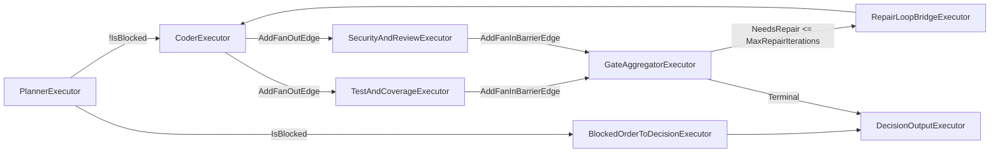

# Microsoft Agent Framework (`.NET 10`) inner specialist orchestration

Implementation reference for `M02.03` ([#14](https://github.com/Jamula/SoftwareFactory/issues/14)), `M02.04` ([#16](https://github.com/Jamula/SoftwareFactory/issues/16)), and `M01.02` ([#17](https://github.com/Jamula/SoftwareFactory/issues/17)).

## Scope and boundaries

`src/SoftwareFactory.Agents/` implements SoftwareFactory's `.NET 10` (`10.0.404`) inner specialist workflow engine on **Microsoft Agent Framework (`1.28.0` GA)**:

- `Microsoft.Agents.AI` (`1.28.0`) — `ChatClientAgent` / `AIAgent` specialist execution over `Microsoft.Extensions.AI.IChatClient`
- `Microsoft.Agents.AI.Workflows` (`1.28.0`) — deterministic Pregel superstep `WorkflowBuilder`, `Executor<TInput, TOutput>`, `StatefulExecutor<TState, TInput>`, conditional `AddEdge<T>`, parallel `AddFanOutEdge`, barrier `AddFanInBarrierEdge`, `InProcessExecution`, and `CheckpointManager.CreateJson`
- `Microsoft.Agents.AI.GitHub.Copilot` (`1.28.0`) — pinned Copilot SDK agent adapter contract (`GitHubCopilotAgent` behind a fail-closed shadow execution guard; `<CopilotSkipCliDownload>true</CopilotSkipCliDownload>` keeps CI builds hermetic)

No Semantic Kernel, archived AutoGen, or retired GitHub Models packages are referenced. All execution remains shadow-only (`shadow: true`, `liveDispatch: false`, `liveMerge: false`, `$0` unapproved incremental spend) with `DeterministicSyntheticChatClient` providing offline deterministic replay.

## Specialist superstep topology (`#14`)



1. **Contract and path-ownership enforcement (`WorkItemContract` & `PathOwnershipGuard`)**:
   - Validates `RepositoryId` against the trusted repository scope, `RepositorySlug`, 40-char lowercase `HeadSha`, `IssueNumber`, kebab-case `LaneId`, allowlisted `SpecialistRole` (`api`, `data`, `security`, `test`, `infra`, `ui`, `docs`, `coordinator`), `OwnedPaths`, W3C `TraceParent`, `MaxRepairIterations` (`0..5`), and coverage floors (`>=98%` lines / `>=95%` branches for SoftwareFactory; `>=95%` / `>=90%` or stricter consumer floors).
   - Rejects `..`, `.`, leading/trailing `/`, empty segments, backslashes, drive colons, protected control-plane paths BEFORE `OwnedPaths` unless `HumanOwnerSignOffVerified == true` (`PROTECTED_CONTROL_PLANE_PATH_REJECTED` across `.github/workflows/**`, `**/*.lock.yml`, `config/**`, `SECURITY.md`, `docs/POLICY.md`, `docs/ENGINEERING-STANDARDS.md`, and core gate evaluators), unowned paths (`OUT_OF_LANE_PATH_REJECTED`), and cross-repository mismatches (`CROSS_REPO_ISOLATION_VIOLATION`) fail-closed without repair retries.
  - Enforces an explicit offline-only `IOfflineSyntheticChatClient` boundary in shadow mode (`LIVE_PROVIDER_CLIENT_FORBIDDEN_IN_SHADOW` if a non-offline `IChatClient` is supplied).
2. **Parallel verification and bounded repair**:
   - `CoderExecutor` fans out to `TestAndCoverageExecutor` and `SecurityAndReviewExecutor` in the same Pregel superstep (`AddFanOutEdge`) and synchronizes at `GateAggregatorExecutor` (`AddFanInBarrierEdge`).
   - Only repairable test/coverage deficits within `Iteration < MaxRepairIterations` loop back to `CoderExecutor`; security/review findings, isolation violations, and exhausted repair budgets terminate fail-closed (`blocked`).

## Integrity-verified JSON checkpointing (`#16`)

`IntegrityVerifiedJsonCheckpointStore` implements `ICheckpointStore<JsonElement>` for `CheckpointManager.CreateJson`:

- Canonicalizes every `JsonElement` payload (lexicographically sorted object properties), verifies embedded `WorkItemContract` identities match `ExpectedBinding` on start, save, load, and resume (`CHECKPOINT_CONTRACT_BINDING_MISMATCH`), and binds `SchemaVersion`, monotonic `Sequence` (`maxExistingSequence + 1` so pruned earlier files never reuse IDs), `SessionId`, `CheckpointId`, optional parent checkpoint coordinates, `RepositoryId`, `IssueNumber`, and `HeadSha` under a SHA-256 digest verified with `CryptographicOperations.FixedTimeEquals`.
- Writes atomically via sibling `.tmp` files and non-overwriting `File.Move(..., overwrite: false)` (`CHECKPOINT_COLLISION_DETECTED` if a checkpoint ID already exists).
- Resumes mid-workflow via `InProcessExecution.ResumeStreamingAsync` without repeating already committed supersteps (`priorSuperstepsRepeated: 0`), and fails closed on tampered payloads (`CHECKPOINT_DIGEST_MISMATCH`), stale commits (`STALE_CHECKPOINT_HEAD_SHA`), or repository/issue mismatches.

## Aspire 17 and sanitized OpenTelemetry contract (`#16`, `#17`)

- `apphost.cs` preserves the existing `synthetic-shadow` Node resource untouched and registers `maf-specialist-shadow` via `AddDotnetProject("maf-specialist-shadow", "./src/SoftwareFactory.Agents/SoftwareFactory.Agents.csproj").WithArgs("--smoke").WithExplicitStart()`.
- `LocalOtlpBootstrap` initializes `TracerProvider`, `MeterProvider`, and correlated `ILoggerFactory` OTLP exporters when `OTEL_EXPORTER_OTLP_ENDPOINT` is set—requiring an explicit-port loopback `http`/`https` origin (`127.0.0.1`, `localhost`, `[::1]`) and authenticated `OTEL_EXPORTER_OTLP_HEADERS` while rejecting signal-specific overrides or proxy variables—and flushes + disposes all providers before process exit while preserving collector-free headless operation when unset.
- Spans are emitted on both `ActivitySource("Microsoft.Agents.AI.Workflows")` (via `.WithOpenTelemetry(...)`) and `ActivitySource("SoftwareFactory.Agents")` with W3C `traceparent` propagation and strictly allowlisted low-cardinality tags (`sf.stage`, `sf.lane`, `sf.superstep`, `sf.outcome`, `sf.reason`). Raw prompts, issue bodies, tokens, exception text, and PII are never recorded.
- `--benchmark` executes `12` / `50` / `100` logical lanes in bounded parallel batches (`Task.WhenAll` up to `ConfiguredWorkerCap`, recording `ObservedPeakConcurrency` and `ExecutedBatches`) and marks `2x`–`25x` cohort slots `UNMEASURED_BASELINE_REQUIRED` until real matched baseline/candidate cohort inputs (`>= 5` finite comparable accepted units with zero coverage, quality, or cost regressions) are supplied.

## Local commands and CI verification

```bash
# Restore, build, and enforce >=98% line and >=95% branch coverage
dotnet restore tests/SoftwareFactory.Agents.Tests/SoftwareFactory.Agents.Tests.csproj --source https://api.nuget.org/v3/index.json
dotnet test tests/SoftwareFactory.Agents.Tests/SoftwareFactory.Agents.Tests.csproj --configuration Release --no-restore -p:CollectCoverage=true

# Execute synthetic workflow + checkpoint resume smoke receipt
dotnet run --project src/SoftwareFactory.Agents/SoftwareFactory.Agents.csproj --configuration Release --no-build -- --smoke

# Execute 12/50/100 logical-lane and 2x-25x matched cohort benchmark
dotnet run --project src/SoftwareFactory.Agents/SoftwareFactory.Agents.csproj --configuration Release --no-build -- --benchmark

# Verify Aspire 17 single-file AppHost restore and Release build
dotnet restore apphost.cs --source https://api.nuget.org/v3/index.json
dotnet build apphost.cs --configuration Release --no-restore
```
