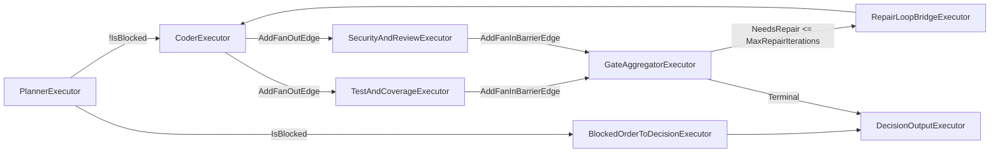

# Microsoft Agent Framework (`.NET 10`) inner specialist orchestration

Implementation reference for `M02.03` ([#14](https://github.com/Jamula/SoftwareFactory/issues/14)), `M02.04` ([#16](https://github.com/Jamula/SoftwareFactory/issues/16)), and `M01.02` ([#17](https://github.com/Jamula/SoftwareFactory/issues/17)).

## Scope and boundaries

`src/SoftwareFactory.Agents/` implements SoftwareFactory's `.NET 10` (`10.0.404`) inner specialist workflow engine on **Microsoft Agent Framework (`1.28.0` GA)**:

- `Microsoft.Agents.AI` (`1.28.0`) — `ChatClientAgent` / `AIAgent` specialist execution over `Microsoft.Extensions.AI.IChatClient`
- `Microsoft.Agents.AI.Workflows` (`1.28.0`) — deterministic Pregel superstep `WorkflowBuilder`, `Executor<TInput, TOutput>`, `StatefulExecutor<TState, TInput>`, conditional `AddEdge<T>`, parallel `AddFanOutEdge`, barrier `AddFanInBarrierEdge`, `InProcessExecution`, and `CheckpointManager.CreateJson`
- `Microsoft.Agents.AI.GitHub.Copilot` (`1.28.0`) — pinned Copilot SDK agent adapter contract (`GitHubCopilotAgent` behind a fail-closed shadow execution guard; `<CopilotSkipCliDownload>true</CopilotSkipCliDownload>` keeps CI builds hermetic)

No Semantic Kernel, archived AutoGen, or retired GitHub Models packages are referenced. All execution remains shadow-only (`shadow: true`, `liveDispatch: false`, `liveMerge: false`, `$0` unapproved incremental spend) with `DeterministicSyntheticChatClient` providing offline deterministic replay.

## Specialist superstep topology (`#14`)



1. **Contract and path-ownership enforcement (`WorkItemContract` & `PathOwnershipGuard`)**:
   - Validates `RepositoryId` against the trusted repository scope, `RepositorySlug`, 40-char lowercase `HeadSha`, `IssueNumber`, kebab-case `LaneId`, allowlisted `SpecialistRole` (`api`, `data`, `security`, `test`, `infra`, `ui`, `docs`, `coordinator`), `OwnedPaths`, W3C `TraceParent`, `MaxRepairIterations` (`0..5`), and coverage floors (`>=98%` lines / `>=95%` branches for SoftwareFactory; `>=95%` / `>=90%` or stricter consumer floors).
   - Rejects `..`, `.`, leading/trailing `/`, empty segments, backslashes, drive colons, protected control-plane paths BEFORE `OwnedPaths` unless `HumanOwnerSignOffVerified == true` (`PROTECTED_CONTROL_PLANE_PATH_REJECTED` across `.github/workflows/**`, `**/*.lock.yml`, `config/**`, `SECURITY.md`, `docs/POLICY.md`, `docs/ENGINEERING-STANDARDS.md`, and core gate evaluators), unowned paths (`OUT_OF_LANE_PATH_REJECTED`), and cross-repository mismatches (`CROSS_REPO_ISOLATION_VIOLATION`) fail-closed without repair retries.
  - Enforces an explicit offline-only `IOfflineSyntheticChatClient` boundary in shadow mode (`LIVE_PROVIDER_CLIENT_FORBIDDEN_IN_SHADOW` if a non-offline `IChatClient` is supplied).
2. **Parallel verification and bounded repair**:
   - `CoderExecutor` fans out to `TestAndCoverageExecutor` and `SecurityAndReviewExecutor` in the same Pregel superstep (`AddFanOutEdge`) and synchronizes at `GateAggregatorExecutor` (`AddFanInBarrierEdge`).
   - Only repairable test/coverage deficits within `Iteration < MaxRepairIterations` loop back to `CoderExecutor`; security/review findings, isolation violations, and exhausted repair budgets terminate fail-closed (`blocked`).

## Selective repository guidance and curated lessons (`#14`)

`tools/engineering-factory/curated-lessons.mjs` implements `#14`'s portable, deterministic context selector and matched cohort evaluator so MAF specialist executors (`PlannerExecutor`, `CoderExecutor`, `TestAndCoverageExecutor`, `SecurityAndReviewExecutor`) load only verified, scoped repository knowledge without an external knowledge store while keeping issue refinement and acceptance criteria in GitHub:

- **Selective context assembly (`selectScopedGuidanceAndLessons(input)` & `validateCuratedLesson(lesson, context)`)**:
  - Enforces strict `types.isProxy` rejection and own enumerable data-descriptor validation (`Object.prototype` / `Array.prototype` only) across guidance entries, curated lessons, policies, and checkpoint bindings.
  - Validates provenance-bound lessons captured from accepted GitHub PRs and issues (`lessonId`, `repositoryId`, explicit `accepted-pr` / `accepted-issue` `sourceKind`, positive `sourceNumber`, 40-hex `sourceCommitSha`, 40-hex `verifiedHeadSha`, `componentScope`, bounded `guidanceText` `<= 512` chars, `observedAtMs`, and `maxFreshnessMs`).
  - Fails closed (`state: 'blocked'`) before specialist prompt construction on stale timestamps (`STALE_CURATED_LESSON`), unverified `HEAD` SHAs (`UNVERIFIED_LESSON_HEAD_SHA`), mismatched `repositoryId` (`CROSS_REPO_ISOLATION_VIOLATION`), checkpoint issue mismatches (`CHECKPOINT_ISSUE_MISMATCH`), cross-repository private data references (`CROSS_REPO_PRIVATE_DATA_REJECTED`), untrusted sources (`UNTRUSTED_INSTRUCTION_SOURCE`), mandatory external knowledge-store flags (`EXTERNAL_KNOWLEDGE_STORE_FORBIDDEN`), secrets/credentials (`SECRET_OR_CREDENTIAL_DETECTED`), prompt-injection directives (`PROMPT_INJECTION_DETECTED`), or any attempt to weaken `98%/95%` SoftwareFactory or stricter consumer coverage/review/security/budget gates (`POLICY_WEAKENING_REJECTED`).
  - Filters validated items by `targetComponent`, allowlisted `specialistRole`, and owned `changedPaths` with locale-independent UTF-16 code-unit tie-breaking within bounded `maxSelectedGuidance`, `maxSelectedLessons`, and `maxContextBytes` budgets, and pairs with `IntegrityVerifiedJsonCheckpointStore` issue-bound checkpoints (`checkpointEvidence.verifiedPaths`) to skip reloading guidance/lessons for paths already verified in committed prior supersteps (`omittedCheckpointedCount`). Selection is strictly read-only (`readOnly: true`, `autoPolicyMutation: false`) and never grants write or bypass authority over `EXACT_PROTECTED_CONTROL_PLANE_PATHS` (which remain governed under human-owner sign-off in `anti-rogue-audit.mjs`).
- **Matched exploration, context, and rework cohort gate (`compareExplorationContextReduction(baselineCohort, candidateCohort, policy)`)**:
  - Compares matched `>= 5`-unit accepted cohorts across equal non-overlapping observation windows with verified provenance, independent review, explicit per-unit `duplicateWork` and `unsupportedRouting` boolean evidence, and explicit validated `quotaCreditsRemaining` (`explorationStepsP50`, `contextBytesLoadedP50`, `repeatedContextLoadsP50`, `reworkIterationsRateBps`, `aiCreditsPerUnit`, and `acceptedUnitsPerDay`).
  - Approves adoption (`status: 'ADOPTION_APPROVED'`, `adoptionApproved: true`) only when measured exploration steps, context bytes loaded, repeated context loads, or rework iteration rates decrease while remaining cost-neutral or lower-cost (`$0` unapproved spend, within `quotaCreditsRemaining`) with zero coverage, security, routing, duplicate-work, or throughput regressions.

## Integrity-verified JSON checkpointing (`#16`)

`IntegrityVerifiedJsonCheckpointStore` implements `ICheckpointStore<JsonElement>` for `CheckpointManager.CreateJson`:

- Canonicalizes every `JsonElement` payload (lexicographically sorted object properties), verifies embedded `WorkItemContract` identities match `ExpectedBinding` on start, save, load, and resume (`CHECKPOINT_CONTRACT_BINDING_MISMATCH`), and binds `SchemaVersion`, monotonic `Sequence` (`maxExistingSequence + 1` so pruned earlier files never reuse IDs), `SessionId`, `CheckpointId`, optional parent checkpoint coordinates, `RepositoryId`, `IssueNumber`, and `HeadSha` under a SHA-256 digest verified with `CryptographicOperations.FixedTimeEquals`.
- Writes atomically via sibling `.tmp` files and non-overwriting `File.Move(..., overwrite: false)` (`CHECKPOINT_COLLISION_DETECTED` if a checkpoint ID already exists).
- Resumes mid-workflow via `InProcessExecution.ResumeStreamingAsync` without repeating already committed supersteps (`priorSuperstepsRepeated: 0`), and fails closed on tampered payloads (`CHECKPOINT_DIGEST_MISMATCH`), stale commits (`STALE_CHECKPOINT_HEAD_SHA`), or repository/issue mismatches.

## Aspire 17 and sanitized OpenTelemetry contract (`#16`, `#17`)

- `apphost.cs` preserves the existing `synthetic-shadow` Node resource untouched and registers `maf-specialist-shadow` via `AddDotnetProject("maf-specialist-shadow", "./src/SoftwareFactory.Agents/SoftwareFactory.Agents.csproj").WithArgs("--smoke").WithExplicitStart()`.
- `LocalOtlpBootstrap` initializes `TracerProvider`, `MeterProvider`, and correlated `ILoggerFactory` OTLP exporters when `OTEL_EXPORTER_OTLP_ENDPOINT` is set—requiring an explicit-port loopback `http`/`https` origin (`127.0.0.1`, `localhost`, `[::1]`) and authenticated `OTEL_EXPORTER_OTLP_HEADERS` while rejecting signal-specific overrides or proxy variables—and flushes + disposes all providers before process exit while preserving collector-free headless operation when unset.
- Spans are emitted on both `ActivitySource("Microsoft.Agents.AI.Workflows")` (via `.WithOpenTelemetry(...)`) and `ActivitySource("SoftwareFactory.Agents")` with W3C `traceparent` propagation and strictly allowlisted low-cardinality tags (`sf.stage`, `sf.lane`, `sf.superstep`, `sf.outcome`, `sf.reason`). Raw prompts, issue bodies, tokens, exception text, and PII are never recorded.
- `--benchmark` executes `12` / `50` / `100` logical lanes in bounded parallel batches (`Task.WhenAll` up to `ConfiguredWorkerCap`, recording `ObservedPeakConcurrency` and `ExecutedBatches`) and marks `2x`–`25x` cohort slots `UNMEASURED_BASELINE_REQUIRED` until real matched baseline/candidate cohort inputs (`>= 5` finite comparable accepted units with zero coverage, quality, or cost regressions) are supplied.

## Superstep workflow, integration-train, and shared 5-outcome cohort receipt (`#16`)

`docs/evidence/m02-04-maf-throughput-cohort.json` records the deterministic `M02.04` ([#16](https://github.com/Jamula/SoftwareFactory/issues/16)) benchmark and integration-train evaluation on `main` @ `ec438f54088f30856c2df6ff626e894dde2a0100`, verified through `allocatePortfolioCapacityAndSimulateTrains`, `evaluateDotnetConsolidationBenchmark`, and `evaluateSharedFiveOutcomeM02Cohort` in `tools/engineering-factory/portfolio-train-benchmark.mjs`:

1. **`.NET 10.0.404` MAF `1.28.0` GA `--smoke`, `--benchmark`, and hosted cross-OS CI receipts**:
   - `--smoke` completes `9` Pregel supersteps (`repairIterationsUsed: 1`, `checkpointSaved: true`, `checkpointResumed: true`, `priorSuperstepsRepeated: 0`, `$0` spend) and `--benchmark` executes `12` / `50` / `100` logical lanes (`195.298ms` / `74.968ms` / `144.431ms`, `duplicatePathLeases: 0`, `crossRepoLeaks: 0`).
   - Hosted GitHub Actions runs on `ec438f54088f30856c2df6ff626e894dde2a0100` (`46112285635` Linux Node `26.13.1` `test-coverage` at `41787/41816` lines `99.93%` and `22069/22267` branches `99.11%`; `46112285657` Linux + Windows `.NET 10.0.404` `SoftwareFactory.Agents` at `1737/1739` lines `99.88%` and `786/798` branches `98.49%`; `46112285658` Windows Aspire runtime) evaluate deterministically to `retain-node-authoritative` (`dual-runtime-retain-node-authoritative`), keeping Node `26.13.1` authoritative for outer evaluators while `.NET 10` MAF `1.28.0` executes inner specialist workflows.
2. **Contiguous `Waves 2–4` Squash Merge Queue integration-train replay**:
   - Replays all `32` contiguous Squash Merge Queue commits advancing `main` from `c77612ec3f4e89d792b3b77741718824318ca676` to `ec438f54088f30856c2df6ff626e894dde2a0100`: Wave 2 (`7` PRs: `#140`, `#141`, `#142`, `#139`, `#144`, `#120`, `#143`), the `21`-PR Wave 3 parallel Squash Merge Queue integration train (`#145`–`#165`, including `11` parallel non-overlapping PRs merged within `284s` between `2026-11-28T02:30:52Z` and `02:35:36Z`), and Wave 4 (`4` PRs: `#169`, `#166`, `#167`, `#168`), with `p50MergeQueueMs = 186000`, `p95MergeQueueMs = 438000`, `0` path overlaps within each wave, and `0` post-merge `main` failures.
3. **Streamlined shared `5`-outcome `@copilot` cohort gate and provenance separation**:
   - Retires the artificial `2x`–`25x` multi-cohort ceremony ladder (`multiCohortLadderRetired: true`) in favor of the owner-approved shared `5`-issue real `copilot-swe-agent[bot]` cohort across [#14](https://github.com/Jamula/SoftwareFactory/issues/14), [#16](https://github.com/Jamula/SoftwareFactory/issues/16), [#18](https://github.com/Jamula/SoftwareFactory/issues/18), and [#137](https://github.com/Jamula/SoftwareFactory/issues/137) anchored by [#10](https://github.com/Jamula/SoftwareFactory/issues/10)'s `3` real issues (`>= 2` parallel non-overlapping issues + `>= 1` review-repair loop) plus `2` additional real issues.
   - Enforces strict provenance separation (`PROVENANCE_CONFLATION_REJECTED` if session-orchestrated wave PRs are supplied as unattended `@copilot` outcomes) and keeps `#16` open (`status: 'PENDING_UNATTENDED_COPILOT_COHORT'`, `keepIssue16Open: true`, `0/5` completed) until all `5` unattended `copilot-swe-agent[bot]` outcomes land on healthy protected `main` with `0` routine human interventions and `$0` billed spend.

## Local commands and CI verification

```bash
# Restore, build, and enforce >=98% line and >=95% branch coverage
dotnet restore tests/SoftwareFactory.Agents.Tests/SoftwareFactory.Agents.Tests.csproj --source https://api.nuget.org/v3/index.json
dotnet test tests/SoftwareFactory.Agents.Tests/SoftwareFactory.Agents.Tests.csproj --configuration Release --no-restore -p:CollectCoverage=true

# Execute synthetic workflow + checkpoint resume smoke receipt
dotnet run --project src/SoftwareFactory.Agents/SoftwareFactory.Agents.csproj --configuration Release --no-build -- --smoke

# Execute 12/50/100 logical-lane and 2x-25x matched cohort benchmark
dotnet run --project src/SoftwareFactory.Agents/SoftwareFactory.Agents.csproj --configuration Release --no-build -- --benchmark

# Verify Aspire 17 single-file AppHost restore and Release build
dotnet restore apphost.cs --source https://api.nuget.org/v3/index.json
dotnet build apphost.cs --configuration Release --no-restore

# Verify selective curated-lessons & exploration/rework cohort evaluator (#14)
node --test tests/engineering-factory/curated-lessons.test.mjs

# Verify portfolio integration-train, .NET 10 consolidation, and M02.04 cohort receipt (#16)
node --test tests/engineering-factory/portfolio-train-benchmark.test.mjs
```
