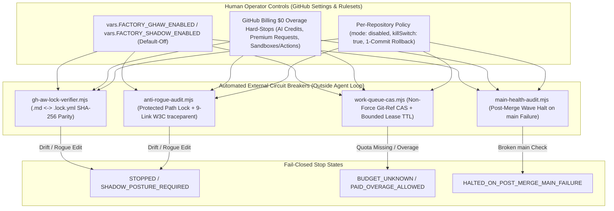
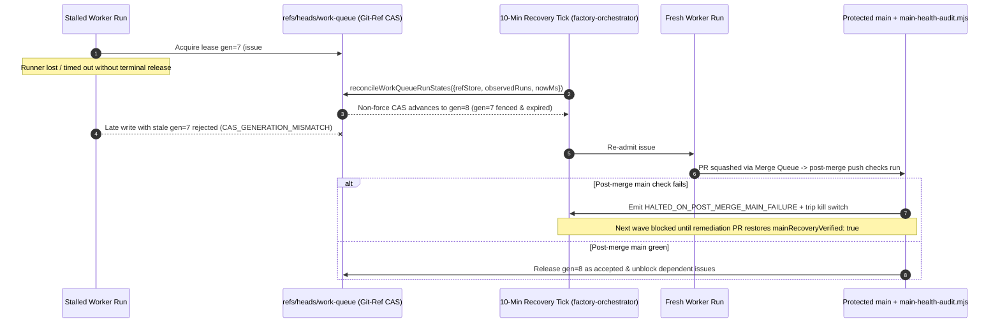
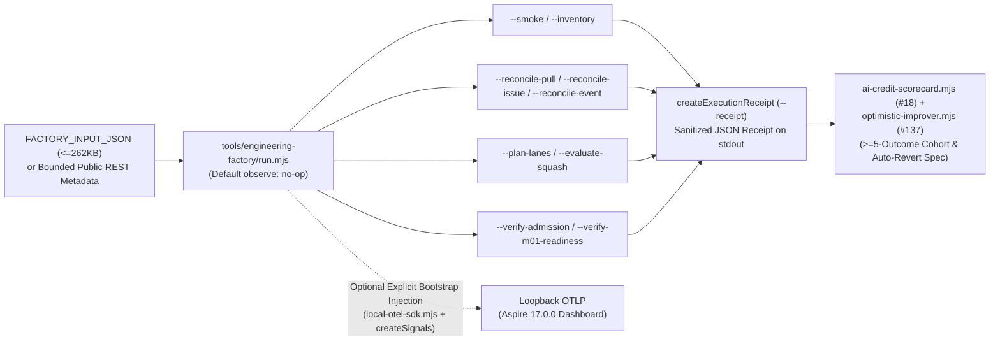

# Operations and troubleshooting

## Current operational posture (`M01` `9 / 10` closed; `#10` live pilot active)

SoftwareFactory operates with **GitHub as the orchestrator**—never a laptop daemon, local polling loop, or open chat session:

- **Outer orchestration (`#5`, `#6`)**: `.github/workflows/factory-orchestrator.md` + SHA-256 hash-locked `.lock.yml` (`github/gh-aw` `v1.2.2`, `safe-outputs` `staged: true`) remains default-off (`vars.FACTORY_GHAW_ENABLED == 'true'`), paired with manual fallback `.github/workflows/shadow-reconcile.yml` (`vars.FACTORY_SHADOW_ENABLED == 'true'`) and non-force git-ref Compare-and-Swap (`CAS`) leases on ruleset-protected `refs/heads/work-queue` (`work-queue-cas.mjs`).
- **Admission & `$0` billing hard-stops (`#7`, `#105`)**: Provider-level `$0` overage hard-stops (`1 AI credit = $0.01`) are verified across AI Credits, Copilot Premium Requests, and Cloud Sandboxes/Actions (`billing-hardstop-smoke.mjs`), paired with `cloud-agent-admission.mjs` rejecting missing or estimated accounting before worker dispatch (`copilot-swe-agent[bot]` on public/private/internal repos; Cloud Automations on private/internal repos).
- **Inner specialist engine & Merge Queue (`#8`, `#14`, `#16`)**: `.NET 10.0.404` + Microsoft Agent Framework `1.28.0` GA (`src/SoftwareFactory.Agents/`) executes shadow Pregel superstep workflows with SHA-256-verified JSON checkpoints (`priorSuperstepsRepeated: 0`), while `main` integration routes exclusively through **GitHub Native Squash Merge Queue** (`Default-Branch-Ruleset` `28054442`, `ALLGREEN`, `review_on_push: false`).
- **Consumer rollout (`M03` → `M04` → `M05`)**: Shared onboarding contract (`#13`) is closed; external consumer pilots remain disabled at rest (`mode: "disabled"`, `killSwitch: true`) in strict sequence: **`M03` `Jamula/Spellbook` (`#11` P0)** → **`M04` `Jamula/FamilyTree` (`#36` P1)** → **`M05` `FamilyHub` (`#12` P1)**.

## Unified diagnostic CLI commands

```sh
# Deterministic synthetic smoke check + sanitized stage receipt
node tools/engineering-factory/run.mjs --smoke --receipt

# Read-only public metadata inventory, PR/issue/event reconciliation, lane planning, squash & admission gates
node tools/engineering-factory/run.mjs \
  [--inventory | --reconcile-pull | --reconcile-issue | --reconcile-event | \
   --plan-lanes | --evaluate-squash | --verify-admission | --verify-m01-readiness] \
  [--receipt]

# .NET 10.0.404 MAF 1.28.0 GA superstep + checkpoint smoke and 12/50/100 lane benchmark
dotnet run --project src/SoftwareFactory.Agents/SoftwareFactory.Agents.csproj --configuration Release -- --smoke
dotnet run --project src/SoftwareFactory.Agents/SoftwareFactory.Agents.csproj --configuration Release -- --benchmark
```

## Operational architecture, recovery sequence, and CLI data flow diagrams

### 1. Operational control plane & circuit-breaker architecture diagram



### 2. Lease crash-recovery and post-merge wave-halt sequence diagram



### 3. Unified `run.mjs` CLI and Kaizen telemetry data flow diagram

`run.mjs --receipt` serializes a sanitized JSON execution receipt to `stdout` only—its default `observe` adapter is a no-op and `run.mjs` constructs no OTLP SDK or exporter. Loopback OTLP export occurs only when an explicit local/AppHost bootstrap (`local-otel-sdk.mjs` + `telemetry.mjs` `createSignals`) injects an `observe` callback around the runner.



## Incident response and troubleshooting

| Symptom / reason code | Operational response |
| --- | --- |
| `.lock.yml` hash or trigger drift (`gh-aw-lock-verifier.mjs`) | Do **not** hand-edit `.github/workflows/factory-orchestrator.md` or `.lock.yml` independently; recompile with pinned `gh aw compile` (`v1.2.2`) in a dedicated workflow lane with human owner review |
| `refs/heads/work-queue` CAS conflict or expired lease (`work-queue-cas.mjs`) | Run bounded CAS reconciliation via `reconcileWorkQueueRunStates({refStore, observedRuns, nowMs})` to fence stale generations; never force-push `refs/heads/work-queue` |
| Anti-rogue circuit breaker tripped (`anti-rogue-audit.mjs`) | Triggered outside the agent loop on protected control-plane edits (`.github/workflows/`, `*.lock.yml`, rulesets, policy, gate evaluators, kill switches), out-of-lane edits, retry-cap breaches, AI-credit burn spikes, `safe-outputs` threat flags, or post-merge `main` failures; keep `killSwitch: true` / `FACTORY_GHAW_ENABLED != 'true'` until human root-cause sign-off |
| Missing/estimated quota or overage risk (`BUDGET_UNKNOWN` / `PAID_OVERAGE_ALLOWED`) | Block dispatch immediately; re-verify GitHub Billing `$0` overage hard-stops across all 3 meters (`#105`) before resuming |
| Post-merge `main` check or CodeQL failure (`main-health-audit.mjs`) | Halt subsequent Merge Queue wave dispatch (`HALTED_ON_POST_MERGE_MAIN_FAILURE`), remediate via reviewed PR through Squash Merge Queue, and record `mainRecoveryVerified: true` before unblocking dependents |
| Suspected credential exposure or unintended privilege | Disable `FACTORY_GHAW_ENABLED` and `FACTORY_SHADOW_ENABLED` repository variables, set consumer `killSwitch: true`, revoke only the affected repository-scoped `credentialId`, and follow [private security reporting](../SECURITY.md) |

## Emergency stop and independent `1`-commit consumer rollback

1. **SoftwareFactory pause**: Unset or set `FACTORY_GHAW_ENABLED=false` and `FACTORY_SHADOW_ENABLED=false` in GitHub repository variables; in-flight read-only runs cannot merge to `main` because `gh-aw` has no merge tool and `Default-Branch-Ruleset` (`28054442`) gates Squash Merge Queue independently.
2. **Single-consumer rollback (`verifyIndependentRollback`)**: Set `mode: "disabled"` and `killSwitch: true`, revoke only that consumer's `credentialId`, revert its 2-file onboarding commit (`commitsToRevert === 1`) via reviewed PR, and verify `queuedLiveMutations === 0`. `Jamula/SoftwareFactory` and peer consumers remain unaffected. Preserve all audit receipts and git history.

## Telemetry, causal audit, and Kaizen measurement

Every autonomous cycle must preserve the unbroken **9-link W3C `traceparent` causal provenance chain** (`Issue/Event deliveryId -> gh-aw .lock.yml SHA-256 -> git-ref CAS lease generation -> Mission Control taskId/sessionId -> signed commit SHA -> exact-head CI/CodeQL/coverage receipts -> independent review ID -> Merge Queue squash SHA -> verified main receipt`, [#9](https://github.com/Jamula/SoftwareFactory/issues/9) / [#137](https://github.com/Jamula/SoftwareFactory/issues/137)). Track p50/p95 stage latencies, AI Credits (`1 AI credit = $0.01`, [#18](https://github.com/Jamula/SoftwareFactory/issues/18)), rework rates, and matched `>=5`-outcome Kaizen cohorts (`optimistic-improver.mjs`, auto-proposing revert specs on quality or cost regression) per [Engineering standards](ENGINEERING-STANDARDS.md). Never log raw issue prose, prompts, private genealogy/consumer records, or tokens.
