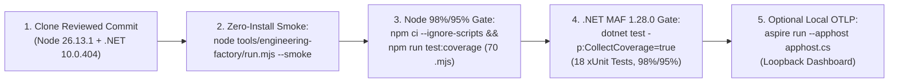

# Quickstart: run the SoftwareFactory shadow suites locally

**No GitHub credential, cloud service, agent subscription, or external collector is needed to run the offline validation and synthetic smoke suites.**



## 1. Prerequisites

1. Clone `https://github.com/Jamula/SoftwareFactory.git` and check out the reviewed commit you intend to inspect. Development PR branches are not releases.
2. Install the CI-pinned runtimes:
   - **Node.js `26.13.1`**
   - **`.NET SDK 10.0.404`** (`global.json` sets `rollForward: "disable"`)

## 2. Run the Node.js `26.13.1` smoke and `98%/95%` coverage gate

```sh
node --version
# Zero-install synthetic CLI smoke check
node tools/engineering-factory/run.mjs --smoke

# Install locked OpenTelemetry + Cobertura packages and enforce >=98% line / >=95% branch coverage
# across all 70 .mjs components in tools/engineering-factory/ and tools/engineering-coordinator/
npm ci --ignore-scripts && npm run test:coverage
```

Inspect `tools/engineering-factory/core.mjs`, `tools/engineering-factory/consumer-onboarding.mjs`, and the synthetic `tools/engineering-factory/example-policies.json`. Every evaluator returns a frozen shadow decision (`shadow: true`) and never dispatches agents, approves PRs, or merges commits.

## 3. Run the `.NET 10.0.404` Microsoft Agent Framework `1.28.0` GA suite

```sh
dotnet --version
# Run all 18 xUnit specialist workflow, checkpoint, ownership, and telemetry tests (with Coverlet 98%/95% gate)
dotnet test tests/SoftwareFactory.Agents.Tests/SoftwareFactory.Agents.Tests.csproj --configuration Release -p:CollectCoverage=true

# Run the offline Pregel superstep + SHA-256 JSON checkpoint resume smoke receipt
dotnet run --project src/SoftwareFactory.Agents/SoftwareFactory.Agents.csproj --configuration Release --no-build -- --smoke
```

## 4. Unified CLI flags (`tools/engineering-factory/run.mjs`)

```sh
node tools/engineering-factory/run.mjs \
  [--smoke | --inventory | --reconcile-pull | --reconcile-issue | --reconcile-event | \
   --plan-lanes | --evaluate-squash | --verify-admission | --verify-m01-readiness] \
  [--receipt]
```

Supply JSON inputs via `FACTORY_INPUT_JSON` (`<= 262,144` UTF-8 bytes) and add `--receipt` to wrap the decision in a sanitized stage receipt. Clean temporary local artifacts (`rm -rf .local coverage-evidence.json cobertura-coverage.xml`) when finished.

## 5. Aspire `17.0.0` AppHost and loopback OpenTelemetry

`apphost.cs` orchestrates both the Node `synthetic-shadow` resource and the `.NET 10` `maf-specialist-shadow` resource (`WithExplicitStart()`) behind an authenticated loopback Aspire Dashboard and loopback OTLP collector (`127.0.0.1` / `[::1]`). See [local development](LOCAL-DEVELOPMENT.md) and [Aspire synthetic smoke](ASPIRE-SYNTHETIC-SMOKE.md) for local launch steps, and next read [workflow guide](WORKFLOWS.md) and [consumer onboarding](CONSUMER-ONBOARDING.md).
