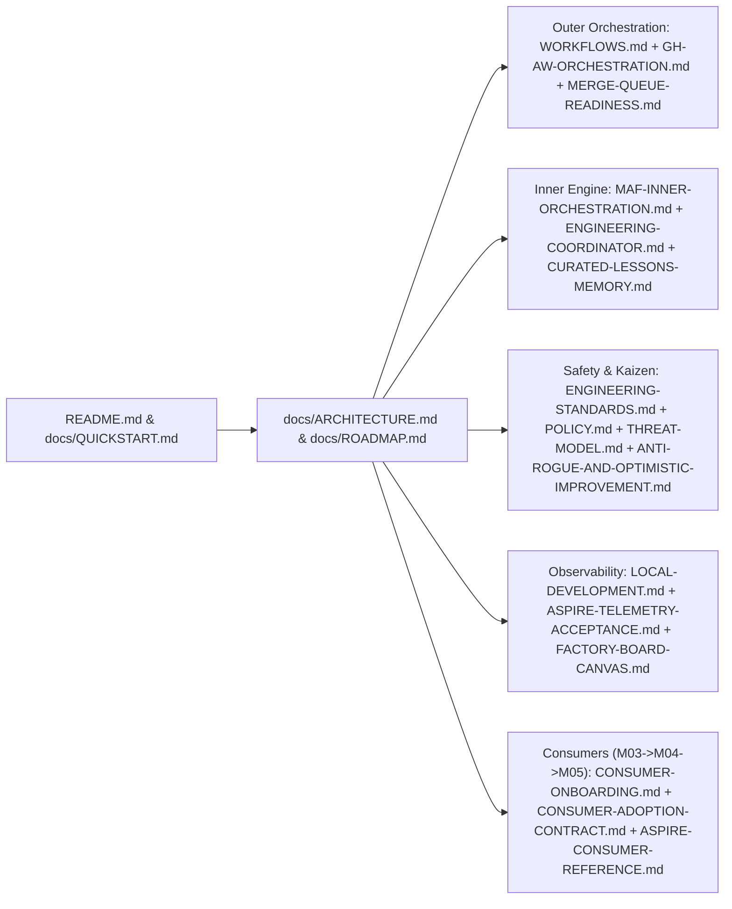

# SoftwareFactory Documentation Index

Complete index of all shipped guides under `docs/`, organized by domain. See also [Repository README](../README.md) · [Contributing](../CONTRIBUTING.md) · [Agent rules](../AGENTS.md) · [Security policy](../SECURITY.md).

## 1. Core architecture, roadmap, and standards

| Document | Audience | Purpose |
| --- | --- | --- |
| [Quickstart](QUICKSTART.md) | Developers | Run the Node `26.13.1`, `.NET 10.0.404` MAF `1.28.0` GA, and `run.mjs` smoke/coverage suites locally |
| [Architecture](ARCHITECTURE.md) | Engineers | Module boundaries across `tools/engineering-factory/`, `tools/engineering-coordinator/`, `src/SoftwareFactory.Agents/`, and workflows |
| [Roadmap v2](ROADMAP.md) | Owners / contributors | `M01` autonomy (`9/10` closed; `#10` active), `M02` `.NET 10` MAF speed, and `M03` Spellbook → `M04` FamilyTree → `M05` FamilyHub rollout |
| [Engineering standards](ENGINEERING-STANDARDS.md) | All contributors / operators | Mandatory `98%/95%` coverage, exact-head independent review, Squash Merge Queue gates, velocity SLOs, and Chronicle retrospective rules |
| [Delivery lifecycle](DELIVERY-LIFECYCLE.md) | Maintainers | End-to-end event-to-acceptance state machine from `gh-aw` ingress to verified `main` |
| [Policy guide](POLICY.md) | Security reviewers | Closed v1 policy schema, caller-supplied vs. verified provenance, and fail-closed decision rules |
| [Threat model](THREAT-MODEL.md) | Security reviewers | Trust boundaries, privilege separation, and negative-path security invariants |
| [Operations](OPERATIONS.md) | Operators | Unified CLI diagnostics, kill switches, anti-rogue circuit breakers, `$0` billing hard-stops, and rollback |

## 2. Outer orchestration, durable queue, and merge gates (`M01`)

| Document | Audience | Purpose |
| --- | --- | --- |
| [Workflow guide](WORKFLOWS.md) | CI maintainers | Inventory of all 9 GitHub Actions / `gh-aw` workflows, `Default-Branch-Ruleset` `28054442`, and poison-safe CI caching |
| [GitHub Agentic Workflows (`gh-aw`) orchestration](GH-AW-ORCHESTRATION.md) | Orchestration engineers | `github/gh-aw` (`v1.2.2+`) `.md` → `.lock.yml` SHA-256 verification, `safe-outputs`, and `refs/heads/work-queue` non-force git-ref CAS |
| [GitHub-hosted Copilot pilot](GITHUB-HOSTED-COPILOT-PILOT.md) | Operators / billing owners | `#105` provider-level `$0` overage hard-stops (`1 AI credit = $0.01`), native `copilot-swe-agent[bot]` / Cloud Automations smoke receipts |
| [Cloud Agent admission gate and unified CLI](CLOUD-AGENT-ADMISSION.md) | Orchestration engineers | `#7` fail-closed non-estimated AI-credit admission gate, worker ladder (`1→12`), and unified `run.mjs` CLI |
| [Native merge queue readiness and PR merge latency SLO](MERGE-QUEUE-READINESS.md) | Maintainers | `ALLGREEN` Squash Merge Queue readiness, `merge_group` check parity, and eligible-to-merge latency evaluation |
| [Protected squash simulation](SHADOW-PROTECTED-SQUASH.md) | Engineers | Serialized expected-head squash state machine, GraphQL `enqueuePullRequest` builder, and post-merge `main` health gate |
| [Queue inspection](QUEUE-INSPECTION.md) | Operators | Read-only protected Merge Queue diagnostics and candidate ordering |
| [Queue reconciliation](QUEUE-RECONCILIATION.md) | Engineers | Read-only reconciliation of candidate PRs, required checks, and review states |
| [Shadow dispatch ledger](SHADOW-DISPATCH-LEDGER.md) | Engineers | Cross-run `work-queue-cas` binding, duplicate-dispatch prevention, and `$0` hard-stop reservation contract |
| [Shadow reconcile operations](SHADOW-RECONCILE-OPERATIONS.md) | Operators | Default-off read-only metadata inventory and event-driven PR/issue reconciliation |
| [Shadow runtime](SHADOW-RUNTIME.md) | Developers | Bounded unauthenticated public-metadata inventory and smoke adapter (`shadow-runtime.mjs`) |
| [M03 operational adapters](M03-OPERATIONAL-ADAPTERS.md) | Engineers | Historical M03 increment covering event-envelope normalization, pull signals, and shadow adapter boundaries |

## 3. Coordinator, `.NET 10` MAF inner workflows, Canvas, and connectors (`M02`)

| Document | Audience | Purpose |
| --- | --- | --- |
| [Microsoft Agent Framework (`.NET 10`) inner orchestration](MAF-INNER-ORCHESTRATION.md) | `.NET` / AI engineers | `#14` / `#16` `.NET 10.0.404` + MAF `1.28.0` GA Pregel superstep workflows, `IntegrityVerifiedJsonCheckpointStore`, and wave-train cohort receipt |
| [Curated lessons & scoped repository memory](CURATED-LESSONS-MEMORY.md) | Engineers | `#14` provenance-bound selective context loader (`curated-lessons.mjs`) and exploration/rework reduction gate |
| [Portable Engineering Coordinator](ENGINEERING-COORDINATOR.md) | Engineers | Provider-neutral lane planner (`planner.mjs`), bounded TTL runner (`coordinator.mjs`), and closed project schema |
| [Coordinator event journal](COORDINATOR-EVENT-JOURNAL.md) | Engineers | Bounded 10,000-entry deduplicated local SQLite reconciliation journal (`event-journal.mjs`) |
| [Coordinator review provider](COORDINATOR-REVIEW-PROVIDER.md) | Engineers | Atomic `repo:pr:head` Copilot review-request intent store and capacity-gated shadow review provider |
| [Durable local shadow host](LOCAL-SHADOW-HOST.md) | Developers | Local SQLite-fenced shadow tick harness (`local-shadow-host.mjs`) for offline testing |
| [SoftwareFactory live board Canvas](FACTORY-BOARD-CANVAS.md) | Developers / operators | `#135` read-only `.github/extensions/factory-board` live milestones, issue activity, PR checks/reviews, and merge-queue status board |
| [MCP server and multi-agent isolation connector](MCP-MULTI-AGENT-CONNECTOR.md) | Engineers | `#136` (`M02.06 P2` deferred) read-only MCP tool boundary and external-gate isolation for Codex/Claude connectors |

## 4. Observability, Aspire `17.0.0`, CI acceleration, and Kaizen (`M01.02` / `M02`)

| Document | Audience | Purpose |
| --- | --- | --- |
| [Local development and observability](LOCAL-DEVELOPMENT.md) | Developers / operators | Aspire `17.0.0` AppHost (`apphost.cs`), loopback OTLP traces/metrics/logs, and zero-Python verification |
| [Local Aspire synthetic smoke](ASPIRE-SYNTHETIC-SMOKE.md) | Developers | Step-by-step local Aspire AppHost launch, `STOPPED` + `LOCAL_SDK_SHUTDOWN_COMPLETE` markers, and clean stop |
| [Local telemetry acceptance](ASPIRE-TELEMETRY-ACCEPTANCE.md) | Platform engineers | `#17` / `#118` Linux ZIP export, Windows HTTPS API readback, and `Run`-mode SQLite metric persistence verification |
| [Aspire consumer reference](ASPIRE-CONSUMER-REFERENCE.md) | Consumer owners | Reference pattern for isolated consumer AppHost/OTLP adoption without cross-repo secrets or remote collectors |
| [Optional workstation compatibility](WORKSTATION-COMPATIBILITY.md) | Developers | `#66` (`M02.05 P2` non-blocking) offline workstation preflight and OS-neutral verification |
| [Anti-rogue causal audit, AI-credit scorecard, and Kaizen loop](ANTI-ROGUE-AND-OPTIMISTIC-IMPROVEMENT.md) | Owners / security / operators | `#9` 9-link W3C `traceparent` audit, `#18` AI-credit scorecard, and `#137` bounded `>=5`-outcome Kaizen improvement/rollback loop |
| [Consolidated CI migration](CI-CONSOLIDATION.md) | CI maintainers | `#15` poison-safe exact-lockfile `~/.npm` + `NuGet` + `Aspire.Cli 17.0.0` caching and deduplicated check topology |
| [Change-aware validation](CHANGE-AWARE-VALIDATION.md) | Engineers | `#15` subsystem contract-graph fast-feedback planning without weakening full required merge gates |
| [Engineering velocity program](ENGINEERING-VELOCITY.md) | All contributors | Measured bottleneck register, review-batching protocol, and prioritized speed experiments |
| [Engineering metric contract](ENGINEERING-METRIC-CONTRACT.md) | Maintainers / analysts | Canonical definitions for dispatch, CI, review, Merge Queue, and accepted-outcome metrics |
| [Stage latency decomposition](STAGE-LATENCY.md) | Analysts / operators | `#9` / `#18` non-overlapping stage latency decomposition and hosted execution receipts |
| [Validation timing baseline](VALIDATION-TIMING-BASELINE.md) | CI maintainers | Cold/warm CI timing baselines and stage instrumentation |
| [Historical GitHub timing proxies](HISTORICAL-GITHUB-PROXIES.md) | Analysts | Pre-autonomy historical GitHub PR/check timing proxy dataset and caveats |
| [Verified outcome reporting](VERIFIED-OUTCOME-REPORTING.md) | Owners / maintainers | Cohort reporting rules (`>=5` comparable accepted units), censored-work disclosure, and zero-fabrication policy |

## 5. Consumer onboarding (`M03` → `M04` → `M05`)

| Document | Audience | Purpose |
| --- | --- | --- |
| [Consumer onboarding guide](CONSUMER-ONBOARDING.md) | Repository owners | `#13` 3-stage onboarding journey (`Discovery <=5 min` → `Stage 1 Shadow PR <=15 min` → `Stage 2 @copilot Merge`), public/private matrix, and `M03` Spellbook → `M04` FamilyTree → `M05` FamilyHub rollout |
| [Consumer adoption contract](CONSUMER-ADOPTION-CONTRACT.md) | Security / consumer leads | Version-1 onboarding package verification, dual 40-hex SHA pins (`consumer-shadow-tests.yml`), 6 shadow denials, and `1`-commit independent rollback |

Reusable caller example: [`consumer-shadow-tests.yml`](consumer-shadow-tests.yml).

## Architecture, sequence, and data flow diagrams

### Static SVG diagrams (`images/`)

- [GitHub-hosted orchestration architecture (`v2`)](images/github-orchestration-v2.svg)
- [Milestone dependencies (`M01`–`M05`)](images/milestone-dependencies-v2.svg)
- [Shared engine and isolated consumer boundaries](images/architecture.svg)
- [Issue-to-merge delivery lifecycle](images/lifecycle.svg)

### Interactive Mermaid diagrams across the documentation suite

| Diagram type | Where to view |
| --- | --- |
| **System & module architecture diagrams** | [Repository README](../README.md), [Architecture](ARCHITECTURE.md), [Workflow guide](WORKFLOWS.md), [Operations](OPERATIONS.md), [Consumer onboarding](CONSUMER-ONBOARDING.md), [Local development](LOCAL-DEVELOPMENT.md) |
| **End-to-end sequence diagrams** | [Repository README](../README.md), [Architecture](ARCHITECTURE.md), [Delivery lifecycle](DELIVERY-LIFECYCLE.md), [Workflow guide](WORKFLOWS.md), [Operations](OPERATIONS.md), [Consumer onboarding](CONSUMER-ONBOARDING.md), [Consumer adoption contract](CONSUMER-ADOPTION-CONTRACT.md), [Contributing](../CONTRIBUTING.md), [Local development](LOCAL-DEVELOPMENT.md), [Aspire consumer reference](ASPIRE-CONSUMER-REFERENCE.md) |
| **Data flow & trust-boundary diagrams** | [Repository README](../README.md), [Architecture](ARCHITECTURE.md), [Delivery lifecycle](DELIVERY-LIFECYCLE.md), [Workflow guide](WORKFLOWS.md), [Operations](OPERATIONS.md), [Consumer onboarding](CONSUMER-ONBOARDING.md), [Consumer adoption contract](CONSUMER-ADOPTION-CONTRACT.md), [Engineering standards](ENGINEERING-STANDARDS.md), [Local development](LOCAL-DEVELOPMENT.md), [Quickstart](QUICKSTART.md), [Security policy](../SECURITY.md), [Contributing](../CONTRIBUTING.md) |

### Documentation map overview

