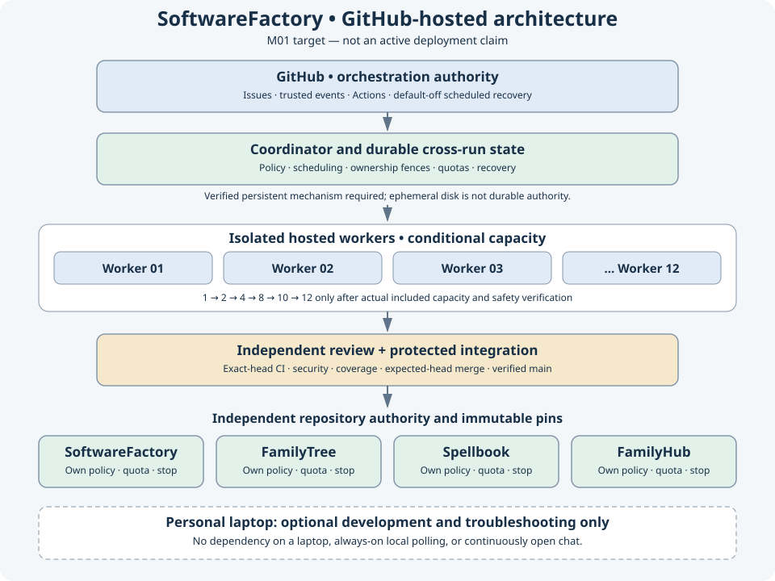
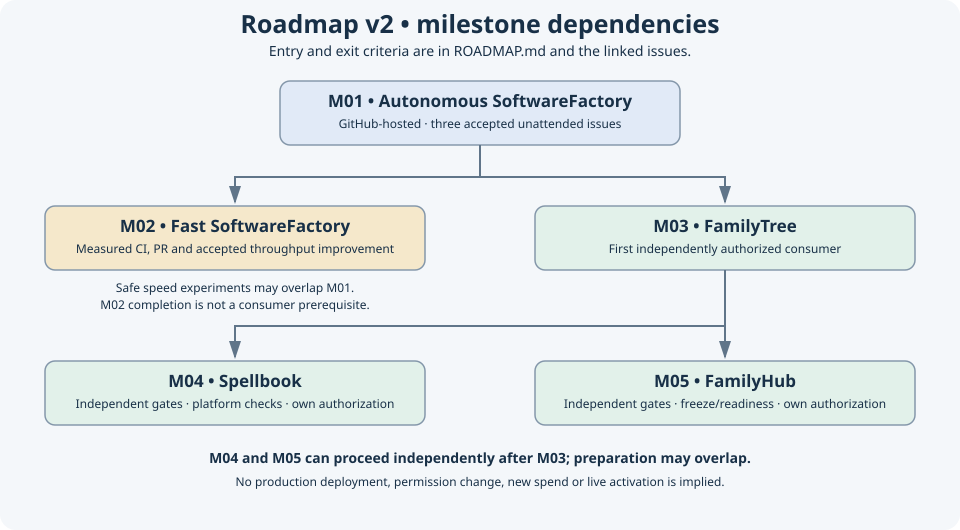

# SoftwareFactory delivery roadmap — v2

Owner direction, November 26, 2026 PT. **GitHub is the orchestrator.** The first milestone is an autonomous SoftwareFactory; the second is a fast SoftwareFactory; the next three apply the pattern independently to FamilyTree, Spellbook and FamilyHub. The old foundation is historical, not a new delivery gate.

## Non-negotiable operating model

- GitHub issues/PRs and trusted GitHub events are the work inventory and orchestration source. Use GitHub Actions and supported GitHub-native hosted execution/dispatch. GitHub-hosted Linux and Windows runners are the required validation environment. A personal laptop, self-hosted laptop runner, continuously open chat or local polling loop is never an operational dependency.
- Ephemeral runner disks are not durable cross-run state. Prove a supported, least-privilege, cost-verified GitHub-hosted persistence/reconciliation mechanism before live execution; demonstrate restart, deduplication, ownership fencing, cancellation and stop. Do not assume caches or artifacts implement atomic leases.
- Aspire AppHost and OpenTelemetry/OTLP remain the local development and hosted synthetic runtime standards, not an always-on laptop service. Local development is optional. No new paid service or overage, credentials/protection changes, external collector, consumer activation, deployment or release without separate verified authorization.
- SoftwareFactory >=98% production source lines and >=95% branches per executable component and overall; consumers >=95/90 or their stronger local gates. Require actual exact-head independent review including summary-only findings, full trusted checks and security, protected expected-head integration, verified healthy main, scope acceptance and rollback. Unknown quota, cost, permission, identity or evidence blocks action. No synthetic approval, gate bypass or self-review. $0 incremental authorized spend.
- Keep one owner per independent issue/path; run compatible lanes in parallel without duplicated work. Scale actual workers only with verified included capacity and authorization. Distinguish implemented, tested, reviewed, merged, deployed and independently accepted.

## Product capabilities and Customer One acceptance

- AI-first, cloud-native, bring-your-own AI and resources; no SoftwareFactory-hosted service, mandatory persistent daemon, separate task tracker, database or custom dashboard. GitHub remains authoritative. Operational claims/receipts may reference issues but never become a competing backlog.
- Prefer supported native execution, events, shared versioned workflows, isolated jobs and durable state primitives where they meet the existing trust, cost, concurrency and recovery contract. Compare reuse versus custom code; retain the existing deterministic policy/evidence gate and remove redundant machinery only after equivalent proof.
- Separate model, execution harness, billing entitlement and runner. Discover capability and supported authorization per provider; unknown capacity or price fails closed. Provider-neutral checkpoints and bounded handoff are desired, not claims of current availability.
- Default to read-only discovery and a reviewable onboarding plan/PR; no installation overwrites, implicit activation, privilege escalation or production deployment. One natural-language request should suffice to start new or existing project onboarding; use GitHub Issues and native relationships for requirements, decomposition and tracking.
- Customer One success means actual accepted work in SoftwareFactory, FamilyTree, Spellbook and FamilyHub; lightweight greenfield and existing-repository onboarding are product acceptance scenarios under #13, prepared in parallel with M01 without changing existing activation dependencies.
- Provisional usability targets: initial plan <=5 min; basic integration <=15 min after verified prerequisites; <=5 mandatory user-supplied settings (excluding explicit authorization/credential entry); zero mandatory additional services, subscriptions or local software. Measure elapsed time, prompts, files, manual interventions and cost; targets are not current results.
- Prefer short, portable, selectively loaded engineering guidance; validate and curate lessons from completed work. AI proposes improvements, deterministic policy controls writes and merge eligibility. Avoid adding a second specification lifecycle.

## Architecture and dependency diagrams

These diagrams describe planned capabilities and conditional dependencies, not verified active workers or granted permissions.

## Active milestones

| ID | Outcome | Entry | Exit | ETA/confidence |
| --- | --- | --- | --- | --- |
| M01 | Autonomous SoftwareFactory | Historical foundation #1, owner-approved bounded scope; verify entry for each issue | All mandatory M01 capabilities evidenced; three actual independently accepted unattended issues, including parallel candidates and review repair; zero routine human touches, duplicate dispatch, unauthorized writes, gate bypass and incremental spend. Prove GitHub-hosted restart/stop/recovery with laptop offline. Record actual worker capacity and shortfall against 10–12 goal. | TBD; low, provider and durable-state dependent |
| M02 | Fast SoftwareFactory | Instrumented baseline #9 and accepted autonomous pilot #10 for real performance claims. Safe independent experiments may start earlier. | Matched comparable accepted outcomes show measurable improvement with no quality/cost regression; full required CI p50 <75 s from candidate event to last required automated check; PR creation-to-merge p50 <=10 min, merge-to-verified-main <=2 min objective; report p95, cohort, missing/censored evidence, and SLO misses. Target 2× then 5× accepted throughput; 10×–25× stretch, not claimed or mandatory for initial speed acceptance. Optional experiments and workstation work do not delay acceptance. | TBD; low until actual baseline |
| M03 | FamilyTree autonomous adoption | M01 accepted, onboarding contract #13, own readiness and separate authorization | Independently pinned, policy-conformant, bounded unattended issue through verified main; stop/rollback, cost and independent acceptance proven, no production deployment. | TBD; low |
| M04 | Spellbook autonomous adoption | M01 and first FamilyTree pilot accepted, onboarding contract, own readiness and separate authorization | Same bounded unattended proof under Spellbook's stronger app/platform gates, two-agent cap until verified scaling, independent rollback. | TBD; low |
| M05 | FamilyHub autonomous adoption | M01 and first FamilyTree pilot accepted, onboarding contract, authoritative repo, verified migration/freeze status and separate authorization | Same bounded unattended proof under FamilyHub's formal approval, strict up-to-date and production isolation requirements; stop/rollback demonstrated, no production deployment. | TBD; low |

M02 is not a prerequisite for consumer activation: M03 follows M01, and M04/M05 may proceed independently after M03 subject to each consumer's own authorization/readiness. Consumer preparation can overlap M01. No freeze is lifted by this plan.

## M01 — autonomous SoftwareFactory (P0)

| Step | Tracking | Entry → exit |
| --- | --- | --- |
| M01.01 | [#4](https://github.com/Jamula/SoftwareFactory/issues/4) | Foundation/trust contract → exact-head quality, protection, security, negative cases and healthy main evidence. |
| M01.02 | [#17](https://github.com/Jamula/SoftwareFactory/issues/17) | Pinned runtime and #4 contract → actual authenticated trace/log/metric and shutdown evidence on GitHub-hosted Windows and Linux. Reopened because prior closure preceded final acceptance. |
| M01.03 | [#5](https://github.com/Jamula/SoftwareFactory/issues/5) | #4 trust and #6 state interfaces → trusted GitHub events, default-off ten-minute recovery heartbeat, durable missed-event recovery and fresh scoped reads. |
| M01.04 | [#6](https://github.com/Jamula/SoftwareFactory/issues/6) | #5 event contract → durable cross-run ownership, leases, work receipt, idempotency, restart/cancel/stop, hosted isolation and overlap prevention. |
| M01.05 | [#8](https://github.com/Jamula/SoftwareFactory/issues/8) | #4/#5/#6 → independent review and serialized protected expected-head integration, healthy main, stale/race/rollback proof. |
| M01.06 | [#9](https://github.com/Jamula/SoftwareFactory/issues/9) | #5/#17 instrumentation contracts → actual sanitized execution evidence and reporting interface, quota/cost/unknowns. |
| M01.07 | [#7](https://github.com/Jamula/SoftwareFactory/issues/7) | #6/#8/#105 → supported hosted dispatch and durable reservation; staged actual 1→2→4→8→10→12 workers only as capacity permits. |
| M01.07.01 | [#105](https://github.com/Jamula/SoftwareFactory/issues/105) | Verified #104/#106, protected main and authorized GitHub settings → included-only Copilot synthetic hosted run, recorded actual entitlement/hard stop/cost attribution; disable opt-in. Not a coding-worker acceptance result. |
| M01.08 | [#10](https://github.com/Jamula/SoftwareFactory/issues/10) | #4–#9/#17/#105 minimum capabilities and scoped live authorization → three actual accepted unattended cycles and restart/stop proof. |

A bounded M01 pilot is allowed only after verified minimum readiness and separate repository-scoped live authorization; its three actual accepted cycles are M01 exit evidence, not an entry gate. No general activation follows from pilot authorization. Minimum safe bounded failure diagnosis is part of M01. M02 performance targets, optional language migration and historical dashboard polish are not M01 entry gates. Missing provider entitlement or paid-usage hard stop prevents live dispatch; the owner must enter credentials directly in the approved GitHub environment, never in chat/source/logs.

## M02 — fast SoftwareFactory

| Step | Tracking | Entry → exit |
| --- | --- | --- |
| M02.01 | [#15](https://github.com/Jamula/SoftwareFactory/issues/15) | #4/#9 → measured safe full CI acceleration, exact-input reuse, change-aware additional feedback and bounded diagnosis; preserve all gates. |
| M02.02 | [#18](https://github.com/Jamula/SoftwareFactory/issues/18) | #9/#17 and real #10 baseline → reproducible read-only scorecard, p50/p95, actual cost, utilization, delay, rework, coverage/provenance and unknowns. |
| M02.03 | [#14](https://github.com/Jamula/SoftwareFactory/issues/14) | #6/#7/#13 interfaces → trusted knowledge/decomposition and scoped specialist routing with measured reduction in exploration/rework. |
| M02.04 | [#16](https://github.com/Jamula/SoftwareFactory/issues/16) | #8/#9/#10/#14/#15 → matched throughput and integration-train experiments; 2×, 5×, 10×, 15×, 20×, 25× checkpoints as evidence permits; keep stretch work open until evidenced or explicitly revised. |
| M02.05 | [#66](https://github.com/Jamula/SoftwareFactory/issues/66) | Optional owner request and existing workstation → compatibility evidence only. Non-blocking for all milestones. |

No wholesale rewrite. Profile before deciding. Optional Rust execution-engine prototype compares Node and Rust at 12, 50 and 100 simulated workers under the same GitHub-hosted workload, including CPU, memory, latency, contention, cancellation, CI overhead, coverage, security, and cost. Adopt only with material measured end-to-end improvement, reviewed decision and rollback. Keep Node evaluator and existing contracts until justified.

## M03–M05 — independent consumers

| Step | Tracking | Entry → exit |
| --- | --- | --- |
| M03.01 | [#13](https://github.com/Jamula/SoftwareFactory/issues/13) | #5–#8 contracts → immutable reviewed onboarding package, policy/schema/catalog, two synthetic profiles, independent rollback; shared by all consumers. |
| M03.02 | [#36](https://github.com/Jamula/SoftwareFactory/issues/36) | #10/#13, Jamula/FamilyTree #128/#120, separately authorized → one bounded unattended accepted issue under own stronger gates, synthetic shadow denial first, no private data/deploy. |
| M04.01 | [#11](https://github.com/Jamula/SoftwareFactory/issues/11) | #10/#13/#36, Jamula/Spellbook #103, scoped authorization → one accepted unattended issue; retain >=97/90 app coverage or stricter, WebKit/iOS and release checks, two-agent cap. |
| M05.01 | [#12](https://github.com/Jamula/SoftwareFactory/issues/12) | #10/#13/#36, authoritative FamilyHub repo, #81 readiness, owner freeze verification and scoped authorization → one accepted unattended issue; exact-head APPROVED, copilot-review/validate, strict base freshness, production isolation. |

Each consumer independently pins an immutable reviewed revision, owns its policy, credentials, quotas and kill switch, proves shadow denials (stale/dismissed review, wrong repo, missing quota, stop), and can roll back without affecting others. No forced adoption, shared admin token, production release or automatic update.

## Historical mapping and GitHub tracking

Logical v2 IDs in issue titles and this document are authoritative for new work. GitHub's native milestone numeric identifiers are stable and separate from logical labels. Existing buckets are retained until their native titles/descriptions can be renamed in authorized GitHub settings; do not create duplicates or relabel historical PRs.

| v1 milestone | v2 mapping | Existing native GitHub bucket |
| --- | --- | --- |
| M01 foundation | Historical foundation #1 (closed) | #1 |
| M02 core; older M03–M05 consolidated core | M01 autonomy (except #15) | #2 |
| M06 speed, old M02.09 #15, optional M10 #66 | M02 speed | #6 |
| M07 FamilyTree/onboarding | M03 | #7 |
| M08 Spellbook | M04 | #8 |
| M09 FamilyHub | M05 | #9 |

Historical PR titles, issue text and receipts retain previous IDs. Issue IDs do not change. Current issue delivery contracts supersede obsolete dates, phase names and host assumptions; historical technical evidence and safety requirements are preserved. #76 is unrelated consumer product work. No partial PR closes a milestone or parent acceptance issue.

## Scorecard and reporting

Use [engineering standards](ENGINEERING-STANDARDS.md), [metric definitions](ENGINEERING-METRIC-CONTRACT.md), [velocity program](ENGINEERING-VELOCITY.md), [timing baseline](VALIDATION-TIMING-BASELINE.md) and [consumer adoption contract](CONSUMER-ADOPTION-CONTRACT.md). Measure issue ready→first PR (10 min, 2 stretch), ready→verified acceptance (25 min, 7 stretch), PR draft→publish (3 min, 1 stretch), publish→merge (7 min, 3 stretch), creation→merge (10 min, 4 stretch), merge→verified main (2 min), and eligible→merge p95 <=120 s (30 s stretch) separately. Report full CI event→last required automated check p50 <75 s, first-job-start duration, queue/review, p95 and 30 s fast-feedback stretch. Never sum overlapping stages as wall time. Compare at least five comparable accepted units per cohort as an exploratory minimum; disclose window, sample size, censored work and uncertainty. Count accepted work once, not PRs. Report actual human interventions, cost attribution, safety and quality with every speed claim; unknown is not zero.

ETA dates remain TBD/low confidence until verified entry, capacity and actual critical-path measurements permit reforecasting. Use existing reporting cadence and GitHub evidence; no duplicate schedule. No claim of operational autonomy, performance or activated workers based on this roadmap.
