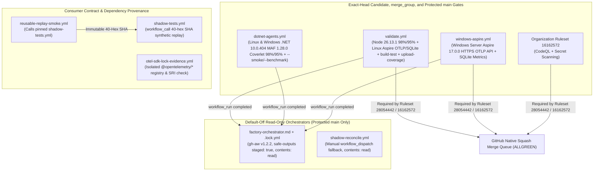
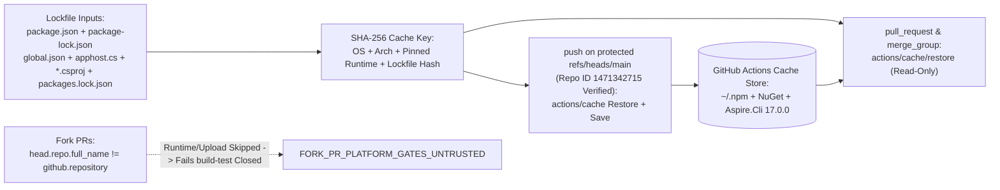

# GitHub workflow guide

## Repository workflow inventory

SoftwareFactory ships eight workflows (`9` files under `.github/workflows/`). Every workflow pins third-party Actions to immutable 40-character commit SHAs, disables Git credential persistence (`persist-credentials: false`) when checking out code, pins Node.js `26.13.1` and `.NET SDK 10.0.404` where used, enforces poison-safe exact-lockfile caching (restoring read-only on PRs/merge groups and saving only from protected `refs/heads/main` on `Jamula/SoftwareFactory` `1471342715`), and never checks out or executes untrusted pull-request code in a privileged context.

| Workflow file | Name | Triggers | Permissions | Purpose and trust boundary |
| --- | --- | --- | --- | --- |
| `.github/workflows/factory-orchestrator.md` + `.lock.yml` | Factory gh-aw outer orchestrator | `workflow_dispatch`, 10-minute `schedule` (`3,13,23,33,43,53 * * * *`), `issues`, `pull_request_target` (`main`), `workflow_run` (`Factory validation`, `Windows Aspire runtime`, `.NET MAF specialist agents`), `push` (`main`) | `contents: read` (`safe-outputs` `staged: true`) | Default-off (`vars.FACTORY_GHAW_ENABLED == 'true'`), SHA-256 frontmatter/body hash-locked `github/gh-aw` (`v1.2.2`) outer orchestrator (`gh-aw-lock-verifier.mjs`). Suppresses `*[bot]` self-loops, checks out no untrusted PR code, coordinates claims via non-force git-ref CAS on `refs/heads/work-queue` (`work-queue-cas.mjs`), and never invokes `gh pr merge` (Squash Merge Queue is sole merge path). |
| `.github/workflows/validate.yml` | Factory validation | `pull_request`, `merge_group` (`checks_requested`), `push` (`main`) | `contents: read` (`upload-coverage-javascript` adds `code-quality: write`) | Exact-head candidate validation on Linux: poison-safe exact-lockfile `~/.npm` + NuGet + `Aspire.Cli 17.0.0` caches (`#15`/`#174`), `run.mjs --smoke`, full `npm run test:coverage` (`FACTORY_EXPECTED_HEAD`, `>=98%` line and `>=95%` branch across all `70` `.mjs` components via `coverage-reporter.mjs`), isolated Aspire AppHost loopback HTTPS login/OTLP/SQLite runtime validation (`linux-aspire-runtime`, same-repo/merge-group/`main` only), required `build-test` aggregate check, and `upload-coverage-javascript`. |
| `.github/workflows/dotnet-agents.yml` | .NET MAF specialist agents | Path-filtered `pull_request` (`src/**`, `tests/SoftwareFactory.Agents.Tests/**`, `apphost.cs`, `global.json`, `.props`, workflow), `merge_group` (`checks_requested`), `push` (`main`) | `contents: read` | Exact-head Linux and Windows `.NET SDK 10.0.404` + Microsoft Agent Framework `1.28.0` GA validation: poison-safe exact-lockfile NuGet cache, Release build of `SoftwareFactory.Agents` and `apphost.cs`, `18` xUnit tests with Coverlet `98%/95%` threshold gate, and `--smoke` / `--benchmark` CLI verification (`#14`, `#16`). |
| `.github/workflows/windows-aspire.yml` | Windows Aspire runtime | `pull_request`, `merge_group` (`checks_requested`), `push` (`main`) | `contents: read` | Exact-head `windows-aspire-runtime` check on `windows-latest` (same-repo/merge-group/`main` only): pins Node.js `26.13.1`, `.NET SDK 10.0.404`, and `Aspire.Cli` `17.0.0` with poison-safe exact-lockfile caches, verifies scoped ephemeral PEM certificate trust without modifying the Windows root store, loopback HTTPS authentication, OTLP trace/correlated log API readback, SQLite metric persistence, and clean AppHost shutdown. |
| `.github/workflows/shadow-reconcile.yml` | Factory shadow reconciliation | Manual `workflow_dispatch` | `contents: read` | Default-off read-only manual reconciliation fallback on protected `refs/heads/main` (narrowed to `workflow_dispatch` so automated event/schedule triggers do not duplicate `factory-orchestrator.lock.yml`). Case-sensitive Bash guard requires `FACTORY_SHADOW_ENABLED=true`, `GITHUB_REPOSITORY=Jamula/SoftwareFactory`, `GITHUB_REPOSITORY_ID=1471342715`, and `GITHUB_REF_PROTECTED=true` before checking out `main`/`github.workflow_sha` and running `run.mjs`. |
| `.github/workflows/reusable-replay-smoke.yml` | Reusable replay smoke | Path-filtered `pull_request`, `merge_group` (`checks_requested`), `push` (`main`) | `contents: read` | Exercises the consumer reusable-workflow contract (`pinned-synthetic-replay`) by calling `.github/workflows/shadow-tests.yml` at an immutable commit SHA (`afc3d223f287b029db32672908097efc67a259c9`). Validates the pinned consumer contract rather than the current candidate head. |
| `.github/workflows/shadow-tests.yml` | Engineering factory shadow replay | `workflow_call` | `contents: read` | Reusable synthetic replay workflow for external callers. Checks out a pinned SoftwareFactory revision (`1208481843e73d1d2506085c654e84255303541d`) with `persist-credentials: false` and runs `tests/engineering-factory/core.test.mjs` on Node.js `26.13.1`. Does not inspect consumer PR data, execute consumer code, dispatch agents, or mutate GitHub. |
| `.github/workflows/otel-sdk-lock-evidence.yml` | OpenTelemetry SDK dependency evidence | Path-filtered `pull_request` (`.github/workflows/otel-sdk-lock-evidence.yml`) | `contents: read` | Same-repository PR workflow that validates pinned `@opentelemetry/*` dependency resolution, `https://registry.npmjs.org/` URL provenance, subresource integrity hashes, and ESM imports inside an isolated temporary directory (`--ignore-scripts`), publishing a 1-day evidence artifact. |

Hosted coding-agent execution standardizes on native GitHub Cloud Agents (`copilot-swe-agent[bot]` / Repository Cloud Automations; see [GitHub-hosted Copilot pilot](GITHUB-HOSTED-COPILOT-PILOT.md)) with zero personal PATs in Actions secrets rather than a DIY CLI-in-Actions workflow.

## Workflow architecture, sequence, and cache data flow diagrams

### 1. Workflow privilege-separation architecture diagram



### 2. Candidate PR, `merge_group`, and protected-`main` sequence diagram

```mermaid
sequenceDiagram
  autonumber
  participant PR as Pull Request (Same-Repo Head)
  participant Cache as Actions Cache (Exact-Lockfile Keys)
  participant CI as validate.yml + dotnet-agents.yml + windows-aspire.yml
  participant MQ as Squash Merge Queue (Ruleset 28054442)
  participant Main as Protected refs/heads/main

  PR->>Cache: actions/cache/restore ONLY (read-only; never writes cache on PR)
  Cache-->>CI: Restore ~/.npm, NuGet, and Aspire.Cli 17.0.0 if exact lockfile hash matches
  CI->>CI: Verify git rev-parse HEAD == EXPECTED_HEAD + Node 26.13.1 + .NET 10.0.404
  CI-->>PR: build-test + upload-coverage-javascript + windows-aspire-runtime green
  PR->>MQ: Enqueue after independent review & 0 unresolved threads
  MQ->>Cache: actions/cache/restore ONLY on merge_group (checks_requested)
  MQ->>CI: Re-execute required Linux & Windows runtime/coverage checks on queue SHA
  CI-->>MQ: ALLGREEN
  MQ->>Main: Atomic squash commit pushed to refs/heads/main
  Main->>Cache: actions/cache save (ONLY when ref == refs/heads/main & ref_protected == true)
```

### 3. Poison-safe CI cache data flow diagram (`#15` / `#174`)



## Effective `main` rulesets vs. exact-head merge gates

Protected integration on `Jamula/SoftwareFactory` (`main`) combines two active GitHub rulesets (with zero bypass actors) and explicit SoftwareFactory exact-head verification:

- **Repository `Default-Branch-Ruleset` (`28054442`)**: requires squash-only merges (`allowed_merge_methods: ["squash"]`), an `ALLGREEN` `SQUASH` merge queue (`max_entries_to_build: 5`, `max_entries_to_merge: 5`, `check_response_timeout_minutes: 15`), strict `required_status_checks` (`build-test`, `upload-coverage-javascript`, and `windows-aspire-runtime`, all bound to GitHub Actions `integration_id: 15368`), `code_coverage` (`minimum_coverage: 98`, `max_coverage_drop: 0`), `required_review_thread_resolution: true`, and `copilot_code_review` (`review_on_push: false`, `review_draft_pull_requests: false`), while setting **`required_approving_review_count: 0`**.
- **Organization ruleset (`16162572`)**: requires `deletion`, `non_fast_forward`, and `required_linear_history` protections, `require_secret_scanning_alert_resolution`, and `code_scanning` (`CodeQL` with `security_alerts_threshold: medium_or_higher` and `alerts_threshold: errors_and_warnings`), also with `required_approving_review_count: 0`. (Classic branch-protection REST reads return HTTP `403`, so only observed ruleset API facts are asserted.)
- **Shadow exact-head review & summary-finding requirements (`required_approving_review_count: 0` live gap)**: because GitHub's `pull_request` rulesets set `required_approving_review_count: 0`, GitHub's native ruleset does **not** mechanically enforce independent final-head approval, and `required_review_thread_resolution: true` checks inline threads only. SoftwareFactory's shadow evaluators require an authenticated independent review from `trustedReviewers` on the exact candidate `head` (`APPROVED`, or for `Jamula/SoftwareFactory` an allowlisted `copilot-pull-request-reviewer[bot]` `COMMENTED` review on `head`) with `summaryDisposition: "clear"`, zero unresolved inline or summary-only findings, and zero outstanding blocking reviews (`CHANGES_REQUESTED` or `DISMISSED`); authenticated live receipt acquisition and required live gate wiring remain pending before autonomous merge activation.
- **Separate `CodeQL`, `merge_group`, and fork-PR enforcement**:
  - `CodeQL` is enforced through the organization `code_scanning` ruleset rather than `required_status_checks`; candidate gate verification (`verifyCandidateGateReceipt` in `tools/engineering-factory/coverage-evidence.mjs`) checks both `required_status_checks` and `CodeQL` completion (`conclusion: "success"`) with zero open alerts on `head`.
  - Fork PRs (`head.repo.full_name != github.repository`) skip `linux-aspire-runtime`, `upload-coverage-javascript`, and `windows-aspire-runtime`. Because `build-test` requires `needs.test-coverage.result == 'success'` and `needs.linux-aspire-runtime.result == 'success'`, fork PRs fail `build-test` and are rejected fail-closed (`FORK_PR_PLATFORM_GATES_UNTRUSTED`) before queue admission.
  - Every `merge_group` (`checks_requested`) run must independently execute and pass `build-test`, `upload-coverage-javascript`, and `windows-aspire-runtime` on the exact `merge_group` SHA before squash integration.

## Reusable synthetic replay caller template

A consumer caller referencing `.github/workflows/shadow-tests.yml` (see [docs/consumer-shadow-tests.yml](consumer-shadow-tests.yml)) must pin a **reviewed, available full SHA**. The following template is intentionally non-runnable until the placeholder is replaced:

```yaml
name: SoftwareFactory synthetic replay
on:
  pull_request:
  workflow_dispatch:
permissions:
  contents: read
jobs:
  replay:
    uses: Jamula/SoftwareFactory/.github/workflows/shadow-tests.yml@REPLACE_WITH_REVIEWED_FULL_SHA
```

Review both the called workflow revision and the checkout revision it uses; they are separate pins. Verify the intended test files actually run. Do not treat a replay job as a required product security/approval check or automatically copy secrets into it.

### Consumer onboarding rubric, execution matrix, and independent rollback (`M03.01`, `#13`)

`tools/engineering-factory/consumer-onboarding.mjs` (`buildReadOnlyOnboardingPlan`, `verifyWorkflowPin`, `verifyConsumerOnboardingPackage`, `verifyIndependentRollback`, `evaluateConsumerOnboardingSuccess`) enforces the **3-Stage New-Repo Onboarding Rubric (Discovery → Shadow PR → First Unattended Merge)** across the consumer rollout sequence (**`M03` `Jamula/Spellbook` `#11` → `M04` `Jamula/FamilyTree` `#36` → `M05` `FamilyHub` `#12`**; see [consumer onboarding](CONSUMER-ONBOARDING.md) and [`docs/evidence/m03-01-onboarding-success-contract.json`](evidence/m03-01-onboarding-success-contract.json)):

1. **Customer journey & Day-0 usability SLAs**: `1` natural-language request → `<= 5` mandatory settings (excluding auth/billing confirmation) → `2` generated files (`.github/workflows/softwarefactory-shadow-replay.yml` and `.github/softwarefactory-policy.json`) in `<= 5 min` (`discoveryAndPlanDurationMs <= 300_000`) → reviewable disabled-at-rest PR in `<= 15 min` (`basicIntegrationDurationMs <= 900_000`) with `0` overwritten files, `0` competing backlogs (`authoritativeBacklog: "github-issues"`), `0` external services, and `$0` spend (`incrementalBilledUsdCents === 0`).
2. **Stage 1 (`STAGE_1_SHADOW_ONBOARDED`) vs. Stage 2 (`STAGE_2_AUTONOMOUS_ACCEPTED`)**:
   - **Stage 1**: Onboarding PR merged disabled-at-rest (`mode: "disabled"`, `killSwitch: true`), dual 40-hex workflow + `checkoutRef` SHA pins verified (`afc3d223f287b029db32672908097efc67a259c9` → `1208481843e73d1d2506085c654e84255303541d`), stricter local coverage/checks/concurrency preserved (`>= Math.max(95, existingLine)` / `>= Math.max(90, existingBranch)`), formal `APPROVED` review (`allowCommentedBotApproval === false`), repository-isolated credentials (`sharedAdminToken === false`), `$0` AI-credit overage hard-stops, all `6` single-mutation shadow denials proven, and `1`-commit independent rollback verified.
   - **Stage 2 ("Onboarded & Accepted")**: Requires Stage 1 **plus** a non-synthetic (`synthetic === false`) Day-1 autonomous receipt proving `>= 1` real bounded unattended `@copilot` (`copilot-swe-agent[bot]`) issue landed onto the healthy protected default branch with `humanInterventions === 0`, `unauthorizedWrites === 0`, `productionDeployments === 0`, and `incrementalBilledUsdCents === 0` (synthetic runs never satisfy Stage 2).
3. **Public vs. private hosted execution matrix**: `gh-aw` compiled `.lock.yml` workflows + `@copilot` (`copilot-swe-agent[bot]`) + pinned `@microsoft/copilot-sdk` (`2.0.3`) operate on `public`, `private`, and `internal` repositories; Repository Cloud Automations operate on `private` and `internal` repositories only; per-repository `$0` AI-credit/Actions overage hard-stops are mandatory across all visibilities.
4. **Independent `1`-commit rollback**: Reverting the single 2-file onboarding commit via reviewed PR, confirming `mode: "disabled"` and `killSwitch: true`, revoking only that consumer's `credentialId`, and verifying `queuedLiveMutations === 0` immediately stops the target repository (`STOPPED`) while leaving `Jamula/SoftwareFactory` and peer consumers unaffected.

## Event reconciliation status and remaining prerequisites

| Event category | Current workflow / adapter status | Live gate boundary |
| --- | --- | --- |
| Issue metadata change (`issues`, manual `workflow_dispatch`) | Default-off outer orchestrator (`factory-orchestrator.lock.yml`) + manual `shadow-reconcile.yml` fallback (`run.mjs --reconcile-issue` / `--plan-lanes` / `--verify-admission`), backed by `work-queue-cas.mjs` on `refs/heads/work-queue` (`#5`, `#6`, `#7`, `#105` closed) | Live `FACTORY_GHAW_ENABLED=true` opt-in and `#10` 3-issue unattended `copilot-swe-agent[bot]` pilot proof |
| PR lifecycle (`pull_request_target`) | Default-off `factory-orchestrator.lock.yml` (`run.mjs --reconcile-pull` / `--evaluate-squash`), rejecting forks and moved heads (`#5`, `#8` closed) | Exact-head independent review + `ALLGREEN` Squash Merge Queue admission |
| CI completion (`workflow_run`) / 10-min `schedule` | Default-off `factory-orchestrator.lock.yml` wake-up hint across `Factory validation`, `Windows Aspire runtime`, and `.NET MAF specialist agents` (`3,13,23,33,43,53 * * * *`) | Scoped live authorization for `#10` pilot cycles |
| Review or `code_scanning` completion | `pull-signals.mjs`, `review-history.mjs`, `coverage-evidence.mjs`, and `anti-rogue-audit.mjs` (9-link W3C `traceparent` verification, `#9` / `#137`) | Exact-head independent review (`summaryDisposition: "clear"`) and zero open `CodeQL`/secret alerts |
| Main push (`push` on `main`) | Exact-head `validate.yml`, `dotnet-agents.yml`, `windows-aspire.yml`, `reusable-replay-smoke.yml` (saving poison-safe lockfile caches only on protected `main`), and default-off `factory-orchestrator.lock.yml` (`main-health-audit.mjs`) | Post-merge `main` health verification and `#137` Kaizen cohort accounting |

Never run untrusted PR code in a privileged job, never trust policy or coverage counts from an unverified PR payload, and never synthesize approvals or check results.

References: [reusing workflows](https://docs.github.com/en/actions/sharing-automations/reusing-workflows), [secure use](https://docs.github.com/en/actions/reference/security/secure-use), [GITHUB_TOKEN](https://docs.github.com/en/actions/concepts/security/github_token), [managing a merge queue](https://docs.github.com/en/repositories/configuring-branches-and-merges-in-your-repository/configuring-pull-request-merges/managing-a-merge-queue).
